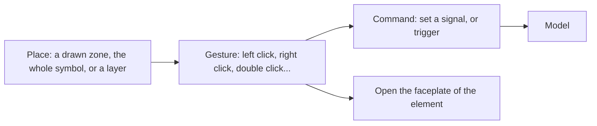
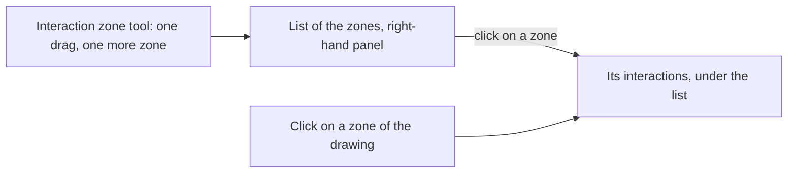

# Interaction mode

> [Home](../../README.md) › [Symbols](../README.md) › Interaction mode · Previous: [Alignment mode](../06-alignment-mode/README.md) · Next: [Animation mode](../08-animation-mode/README.md)

Status: draft. Not validated.

The mode of the [editor](../03-editor/README.md) in which the user says what happens when a gesture is done on the symbol. An interaction says: when the user does a gesture on a place of the symbol, a command is sent. The name "interaction" is provisional (see [Open questions](../10-open-questions.md)).

## Rules

- Tool bar: [Select](../03-editor/select.md), [Hand](../03-editor/hand.md) and Interaction zone (below).
- Right-hand panel: the interactions of the selected place.
- Only for a symbol with a type. A symbol without a type has no command to send (see [Libraries and symbols](../01-libraries-and-symbols.md)).
- The places offered for an interaction are: the zones the user drew, the bounding box of the whole symbol, and a layer. A layer is clickable as its real shape, not as the square around it, and stays clickable when its fill is transparent (see [Select](../03-editor/select.md)). Example: a button drawn on its own layer can be the place.
- Several gestures are possible on a place: left click, right click, double click, and others (the list is to settle).
- Each interaction links a place, a gesture and what happens. What happens is one of two things:
  - a command of the type (see [Commands](../../metadata/draft.md#commands)): a command that sets a signal, or a trigger;
  - **opening the faceplate** of the element: the user says "this opens the faceplate of the element" (see [Type and faceplate](../02-type-and-faceplate.md)).
- What the opened faceplate allows (display only, or display with commands) is **not** decided in the symbol editor. It is set later, once the symbol is placed, in the synoptic part (not written yet).
- A symbol uses only the commands it links.

## Interaction zone tool

- Only in this mode. Draws a zone on the symbol, by hand, that reacts to a gesture.
- **As many zones as wanted**, added on the fly: each drag of the tool makes a new zone (Product Owner, 2026-11-25: "faut pouvoir mettre des zones à la volée, le nombre qu'on veut").
- All the zones of the symbol are shown on the drawing in this mode, so the user sees those available.

## Right-hand panel

Proposed from the Product Owner's words (2026-11-25, "la liste des zones peut potentiellement être dans le menu à droite"); the place of the list is to confirm.

1. **The list of the zones**: a line per zone, a bin on hover to remove it (as in the [point editing mode](../05-point-editing-mode/README.md#list-of-the-points)).
2. **A click on a zone**, in the list or on the drawing, selects it, and the panel shows **its interactions** under the list (Product Owner, 2026-11-25: "tu cliques sur la zone et le menu à droite se fait en fonction").
3. The whole symbol and a layer stay places too: a click on a layer, or on the drawing outside every zone, shows their interactions in the same way (assistant's reading).

## Example

| Place | Gesture | Command |
| --- | --- | --- |
| Zone "start button" | Left click | `start` (sets `running` to `true`) |
| Layer "body" | Right click | `maintenance_requested` (trigger) |
| The whole symbol | Double click | Open the faceplate |

## Where it is used

| Thing | Created and changed in | Used in | In a symbol | In a synoptic |
| --- | --- | --- | --- | --- |
| Interaction zone | Symbol editor | Symbol | Draw | No |
| Interaction (place, gesture, command) | Symbol editor | Symbol | Create, edit | No |

## What the research found

Source: the second research report (`research/t4-…/rapport.md`, sections 3.8 to 3.10). "Opinion" is the report's, not a decision.

### Gestures

Tools offer from six to twelve gestures (Ignition Perspective, Figma prototype, WinCC OA): click, double click, right click, press and release, pointer enter and leave, key, wheel, drag, delay. They all exist on Windows, macOS, Linux and in a browser. Traps: the context menu of the browser must be cancelled, and Firefox still shows it when Shift is held; in Ignition a disabled component still receives the click.

| Gesture proposed | Keep? | Reason (opinion of the report) |
| --- | --- | --- |
| Click (left) | Yes | The usual case. |
| Double click | Yes | To specify: on the same place, does the click wait for the double-click delay? |
| Right click | Yes | The menu of the browser is cancelled; keyboard equivalent: the menu key. |
| While pressed (press, then release) | Yes | A held command: one value at the press, another at the release. To specify: release outside the place. |
| Key (when the place has the focus) | Yes | Needed by keyboard access. |
| Pointer enter, pointer leave | No, as a command trigger | Risk of an accidental send; hover is for visual feedback. |
| Wheel, middle click | No | They move and zoom the drawing. |
| Drag | Not first | The text that becomes an input and the faceplate cover setting a value. |
| Long press, touch gestures | No | Tablets and phones are out of scope. |

### Names

| Tool | The whole | The gesture | What happens | The place |
| --- | --- | --- | --- | --- |
| Figma | Interaction | Trigger | Action | Hotspot |
| Ignition | — | Event | Action | Component |
| WinCC OA | — | Event | Function, action | Graphics object |

"Trigger" is taken by Metadata; "Event" and "Action" were set aside by decision 0002. Opinion of the report: **Interaction** (the whole), **Gesture** (the gesture), **Effect** (what happens: send a command, or open the faceplate), **Interaction zone** (the drawn zone). Confidence: medium.

### Feedback, disabled state, confirmation, keyboard

| Subject | Sources | Opinion of the report |
| --- | --- | --- |
| Hover, cursor, pressed state | Content shown on hover must be dismissable, hoverable and persistent; components and their states need a contrast of 3:1 (WCAG). | Per place: "hand" cursor, light outline on hover, pressed state; optional tooltip in plain text. |
| Disabled state | Disable the commands not valid in the context. | A condition "disabled when", linked to an output boolean signal: the place looks inactive and sends nothing. |
| Confirmation | HMIs confirm actions with heavy consequences, in two steps (one secondary source). | An option "confirm before sending" per interaction, off by default; the box names the command and the value. Confidence: low. |
| Keyboard | Everything usable with the keyboard (WCAG level A); a visible focus (level AA). | Each interactive place reached with Tab, in an order that can be set; Enter or Space acts as a click; the menu key as a right click; an accessible name taken from the command. |

## To decide by the Product Owner

1. The gesture list above (short list, advised)?
2. The names Interaction, Gesture, Effect, Interaction zone?
3. Write here the feedback, the "disabled when" condition, the optional confirmation and the keyboard access (advised), or leave them to part 3?

## Open questions

- Click and double click on the same place: does the click wait? Release of "while pressed" outside the place?
- The list of the zones: in the right-hand panel (proposed), or in the left-hand panel with the layers?
- See [Open questions](../10-open-questions.md).
