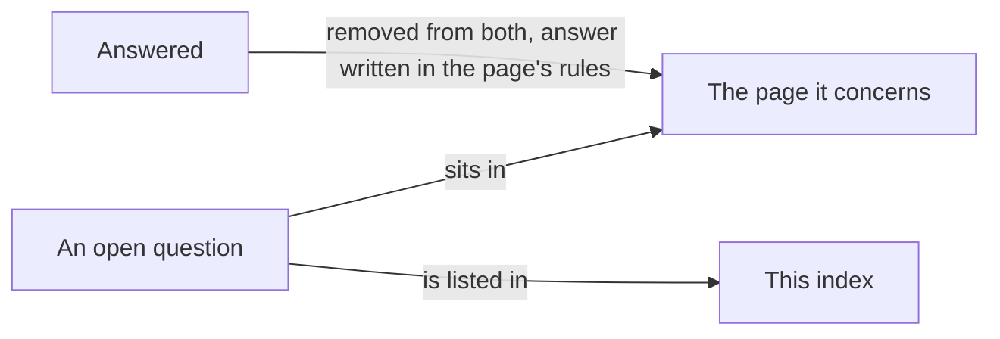

# Symbols: open questions

> [Home](../README.md) › [Symbols](README.md) › Open questions · Previous: [Testing](06-testing.md)

Status: draft. Everything in this part is still a draft: these are the questions raised while writing it.

This file is the index of the open questions. A question sits in the file it concerns and is listed here; once answered, it is removed from both and the answer goes in the rules.

| Question | Page | Written as |
| --- | --- | --- |
| Can the link from a Symbol Lib to its Type Lib be changed later, and what then? Can one Type Lib serve several Symbol Libs? Is the link required for a library of static symbols? Metadata's Libraries page still says that the user chooses a library in a symbol: it must be aligned once this is validated. | [Libraries and symbols](01-libraries-and-symbols.md) | Open. |
| Which changes of Metadata exactly break a link (a rename never does), how are broken items shown, and how does the user fix one (rebind to another signal or command, or remove it)? The fix is made on the symbol side. | [Libraries and symbols](01-libraries-and-symbols.md) | To describe. |
| Signals and commands need an internal identifier (as types have) so that a rename in Metadata is followed by the symbols. Metadata says it only for types, enums and quantities: to align in the Signals and Commands pages once validated. | [Libraries and symbols](01-libraries-and-symbols.md) | To align with Metadata. |
| Names to review: layer, interaction, gesture (left click, right click...), zone, symbol mode, static and dynamic. "Symbol Lib" and "Type Lib" are settled. Metadata already uses "trigger" for a kind of command: a gesture must not be confused with it. | All | A research on the vocabulary can be done, as for Metadata. |
| Full list of tools and their options (fill, stroke, align, group, boolean operations, zoom, snapping...), point editing detail. | [Drawing](02-drawing.md) | To describe. |
| The pen modifier key, and how it works exactly (next segment only, or a switch). | [Drawing](02-drawing.md) | To confirm. |
| Properties an animation can drive, shape of the mapping (linear or not), animation of an enum. | [Animation](04-animation.md) | To describe. |
| Can a text that shows a value become an input on click, from the symbol editor? | [Animation](04-animation.md) | To confirm. |
| Gesture list, and can an interaction open the faceplate? | [Interactions](05-interactions.md) | To settle. |
| Do interactions work in the test mode? | [Testing](06-testing.md) | Open. |
| How are an unwired dynamic symbol and the placement in a synoptic handled? | Part 3 | Belongs to the synoptic part, not written yet. |

