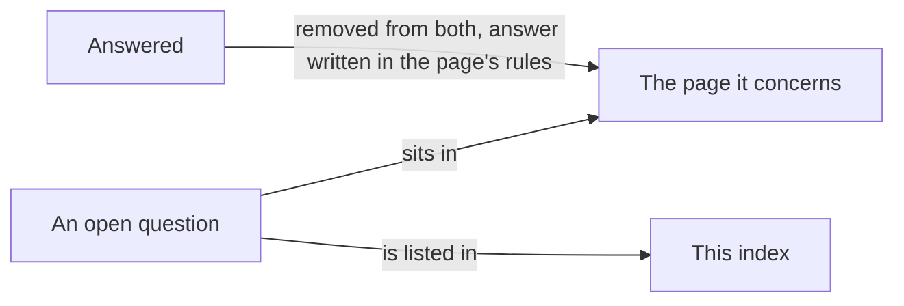

# Symbols: open questions

> [Home](../README.md) › [Symbols](README.md) › Open questions · Previous: [Testing](06-testing.md)

Status: draft. Everything in this part is still a draft: these are the questions raised while writing it.

This file is the index of the open questions. A question sits in the file it concerns and is listed here; once answered, it is removed from both and the answer goes in the rules.

| Question | Page | Written as |
| --- | --- | --- |
| Names to review: layer, interaction, gesture (left click, right click...), zone, symbol mode, static and dynamic. "Symbol Lib" and "Type Lib" are settled. Metadata already uses "trigger" for a kind of command: a gesture must not be confused with it. | All | A research on the vocabulary can be done, as for Metadata. |
| Polygon: is a third mode "like Figma" kept? Figma's triangle does not fill its box and the Product Owner does not know why. | [Polygon tool](drawing/tool-polygon.md) | A documentary research, at the end, like the one for Metadata. |
| Options of each expert entry, of the alignment panel and of the group layout. | [Expert menu](drawing/expert-menu.md), [Alignment](drawing/mode-alignment.md), [Groups](drawing/groups.md) | To describe, page by page. |
| Is "Group" also an entry of the tool bar? | [Groups](drawing/groups.md) | To settle. |
| Modifier keys: square (Shift or Ctrl), selection rectangle (Shift or Alt), pen (which key, and how it works). | [Select](drawing/tool-select.md), [Rectangle](drawing/tool-rectangle.md), [Pen](drawing/tool-pen.md) | To define later. |
| Properties an animation can drive, shape of the mapping (linear or not), animation of an enum. | [Animation](04-animation.md) | To describe. |
| Can a text that shows a value become an input on click, from the symbol editor? | [Animation](04-animation.md) | To confirm. |
| Gesture list, and can an interaction open the faceplate? | [Interactions](05-interactions.md) | To settle. |
| Do interactions work in the Run mode? | [Testing](06-testing.md) | Open. |
| How are an unwired dynamic symbol and the placement in a synoptic handled? | Part 3 | Belongs to the synoptic part, not written yet. |

