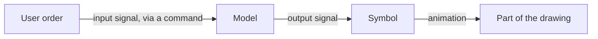
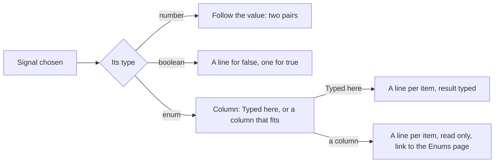
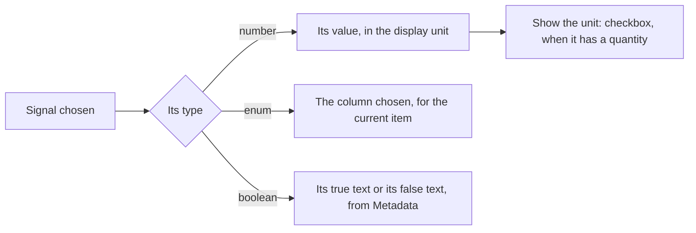
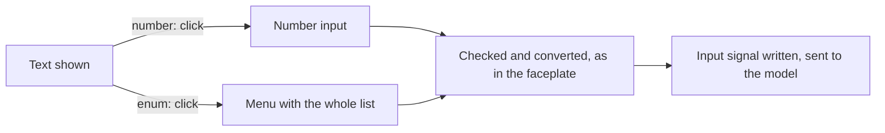
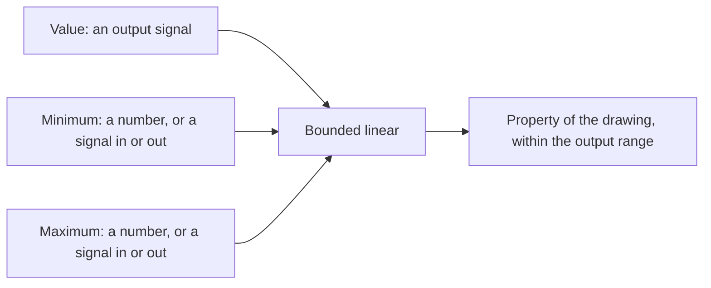

# Animation mode

> [Home](../../README.md) › [Symbols](../README.md) › Animation mode · Previous: [Interaction mode](../07-interaction-mode/README.md) · Next: [Run mode](../09-run-mode/README.md)

Status: draft. Not validated.

The mode of the [editor](../03-editor/README.md) in which the signals are linked to the drawing. Animating a symbol means that the value of a signal changes a part of the drawing. The change of scale or of range (0 to 1 turned into 0 to 90 degrees) is done here, not in Metadata: Metadata only states the contract with the model (see [Signals](../../metadata/draft.md#signals)).

## Rules

- Tool bar: [Select](../03-editor/select.md), then [Guides](../03-editor/layout-guides.md); no Hand (2026-11-26). Right-hand panel: the animations of the selected part.
- The user selects a part (a shape, a layer, a text); the + of its animations **adds an empty line**; in the panel, the user **chooses the output signal**, then **the kind of animation**, then its options show (Product Owner, 2026-11-26: "quand on fait +, ça rajoute juste une ligne vide. Après, on choisit le signal qu'on veut, l'animation, et après, ça met son menu"). Only the kinds of the V1 that fit the type of the signal are offered.
- The kinds of animation: see the [catalogue of the animations](animation-catalogue.md). The V1 offers Rotate, Move, Fill, Show or hide, Colour per state, and a text that shows a signal (Value); the others are kept for later (Product Owner, 2026-11-26).
- **How the value acts comes with the animation**: no separate choice of a "mapping". Each animation follows the value or works per state, as its line of the catalogue says (assistant's proposal, 2026-11-26). No animation of the V1 works by steps, and no choice between ways exists (Product Owner, 2026-11-26: "on n'est pas là pour faire des options à la con", "les steps, ça sert à rien").
- **The panel of an animation**, the same order for all (assistant's proposal, 2026-11-26, drawn in the section "Symbol mode · Animations" of the page Spec):
  1. the signal (select), then the animation (select, one flat list without families, too few animations for them (Product Owner, 2026-11-26), each with a few words under its name: "Rotate · Turns to an angle");
  2. its own options, each a choice of two to four short options in one click (Along, From);
  3. **what the value does, written as a sentence**: a header "When opening is → The blade is at", then one line per pair, `[0] → [0°]`, `[1] → [90°]`. Follow the value has two pairs; Per state has one line per state, the state on the left, read only. A value on the left can be a number or a signal: the signal icon inside the field picks one, and turns blue once a signal is chosen. A short grey hint says what happens in between and outside;
  4. the pivot, when the animation has one (below).
- **Several animations on one part**: allowed, as long as each drives a different property (Product Owner, 2026-11-26): a Rotate and a Show or hide on the same needle, a Colour per state on the fill and another on the border. Two animations never drive the same property: in the panel, a choice that would drive a property already animated on this part is disabled, with the reason as a hint ("Already animated by Rotate"). Move and Rotate on one part compose in a fixed order, move then rotate (assistant's proposal, 2026-11-26, from the research).
- **No transition** (Product Owner, 2026-11-26: "je veux que ce soit saccadé [...] que ça arrive en mode sec, point barre"): at each new value, the part jumps to its new place, angle or colour; nothing is smoothed between two values in this version.
- **No Try** in the panel (Product Owner, 2026-11-26): the animation is seen in the Run mode.
- **Pivot** (Rotate; Spin and Flip by sign when they come back): two lines (Product Owner, 2026-11-26: "ça pivote par rapport à telle ancre sur un autre élément"):
  - **Pivot**: a select, "This part" by default, or any other element of the symbol;
  - **Anchor**: the 9-point grid of that element, the centre by default, the same grid as the anchors of the drawing mode.
- On the drawing, in this mode, the pivot of the selected animation shows as a small blue cross (assistant's proposal, 2026-11-26).
- A layer that has an animation shows the icon of this mode on the right of its line in the layers, in every mode; a click on the icon opens this mode with the layer selected, a second click goes back to the mode before (Product Owner, 2026-11-26: "que ce soit marqué [...] par une icône").
- Only the output signals of the type are offered for an animation. An output is what the model sends, and the model computes what the symbol shows. An input is what the model receives and is never animated; it can only serve as the minimum or the maximum of a bounded linear animation (see [below](#the-input-range-of-a-bounded-linear-animation)).
- A value ordered and a value obtained are two signals for the model. Example: `opening_order` (input, what the user asks) and `opening` (output, what the model computes). The symbol animates `opening`. The faceplate can show both (see [MD-14](../../screens/metadata.md#md-14--faceplate)).
- Only a symbol with a type has animations. A symbol without a type has no signal to animate (see [Libraries and symbols](../01-libraries-and-symbols.md)).

## What an animation can do

| Signal type | Example | What it does |
| --- | --- | --- |
| Real or integer | `opening` from 0 to 1 | A range of values becomes a range of a property of the drawing: 0 to 1 becomes a rotation of 0 to 90 degrees (Rotate). |
| Boolean | `fault` | A value gives a state: when `true`, a fault icon is shown (Show or hide). |
| Enum | `mode` | A property of the drawing takes the value of a column added to the enum in the Symbol Lib, for the current item: `mode` = 2 gives the angle of the column `angle` for item 2 (Rotate), the colour of the column `color` (Colour per state), or a text shows its column `display name short` (see [Enums of a Symbol Lib](../11-enums-of-a-symbol-lib.md#used-by-an-animation)). |

Every animation possible, with an example, is listed in the [catalogue of the animations](animation-catalogue.md) (2026-11-25), to choose from.

### By type of signal

Every animation of the V1 with every type of signal is drawn in Figma, page Spec, section "Symbol mode · Animations by type of signal (2026-11-26)": one row per animation, one column per type (Number, Boolean, Enum), and in each case the right-hand panel set and filled, numbered 1 to 30, each tagged In the spec or New · to choose (Product Owner, 2026-11-26: "pour un signal, le rotate [...] pour un truc qui soit un nombre, un truc qui soit un enum [...] je veux ça sur Figma"). Only the cases that may stay are drawn: a case refused is removed, never kept with a tag ("les trucs que je veux pas, ça dégage"). The Product Owner chooses there, by number, what to keep. How the panel follows the type of the signal:

- **Number**: Rotate, Move and Fill follow the value, two pairs, nothing else: no Steps (Product Owner, 2026-11-26: "il y a que la partie follow et puis point barre", "les steps, ça sert à rien"). Show or hide and Colour per state are not offered for a number.
- **Boolean**: one line for false, one for true, typed in the panel; Show or hide has **Shown when: True / False** (assistant's proposal, still to review).
- **Enum**: a line **Column**, right under Animation. Its list: **Typed here** first, then the columns of the enum whose kind fits the animation (Number for an angle, a position, a level; Colour for Colour per state; Yes / no for Show or hide; the display name, Text and Number for a text). Typed here: one line per item, the item read only, the result typed. A column: the same lines, all read only, and a link to the Enums page (Product Owner, 2026-11-26: "les enums, ça fait sens").
- **Colour per state** has no Typed here: its colours come from a colour column only (2026-11-26).

## Texts that show a signal

A text of the symbol is either written by the user, or linked to a signal. The signal is chosen first; what the text shows follows from its type (Product Owner, 2026-11-26: "il faut d'abord sélectionner le signal et, en fonction de son type, ça va montrer [...] une valeur").

- **A number**: the text shows its value, converted to the display unit and rounded to the decimal places set in the signal settings of the type (see [MD-07](../../screens/metadata.md#md-07--signal-settings)).
  - When the signal has a quantity, a checkbox **Show the unit** says whether the unit follows the value ("il faut pouvoir cocher [...] montrer une unité ou pas"). Nothing else to choose.
- **An enum**: the user chooses which **column** of the enum the text shows, for the current item: the display name, or a column added on the [Enums page](../11-enums-of-a-symbol-lib.md) of the Symbol Lib ("il faut pouvoir choisir, dans les différentes colonnes de l'enum, ce qu'on va afficher"). A text column shows its text; a number column shows its value, without unit (Product Owner, 2026-11-26).
- **A boolean**: the text shows the true text or the false text of the signal, as written in Metadata (see [Boolean texts](../../metadata/entities/18-boolean-texts.md)); nothing else to choose (Product Owner, 2026-11-26).
- **A text with the unit only**: not in the V1, kept for later ("les unités, ça ne sert à rien [...] pour l'instant, on ne fera pas ça").

### A text that becomes an input

A text can be set at the size the user needs, and it can turn into an input when the user clicks it, if an input signal is linked to it. It makes quick entries: no separate panel is opened.

- Since commands always send a fixed value (2026-11-16, see [Commands](../../metadata/draft.md#the-value-is-always-fixed)), this text **writes an input signal of the type directly**, with the same checks as a write entry of the faceplate: conversion from the display unit, enum item, and the bounds of the number field, typed by hand or taken from a signal (see [MD-14.6](../../screens/metadata.md#md-14--faceplate), decision 0041). No command is used.
- Only an input signal can be linked: an output is computed by the model.

| What the text shows | What a click does |
| --- | --- |
| A number | The text turns into a **number input**, right there. This is the main case. |
| An enum | A **selection menu** opens, with the whole list of the enum, and the user picks one item. |

- The user chooses, in the editor, which of these a text does: number input or selection menu.
- **No text input**: a signal is never a text (see [Signals](../../metadata/draft.md#no-text-signal)).
- An enum is shown by the display name of its item, never by its key (see [Enums](../../metadata/draft.md#enums)). A click on it opens the menu of the display names; the input signal receives the key of the item picked.
- What the user picks or types is checked, converted to the model unit, then written to the input signal.

## Where it is used

| Thing | Created and changed in | Used in | In a symbol | In a synoptic |
| --- | --- | --- | --- | --- |
| Animation (signal, target, mapping) | Symbol editor | Symbol | Create, edit | No |
| Text linked to a signal | Symbol editor | Symbol | Create, edit | No |

## What the research found

Source: the second research report (`research/t4-…/rapport.md`, sections 3.11 to 3.16, 3.21). Nothing measured; "Opinion" is the report's.

### Properties a signal can drive

Transform and opacity, animated by CSS or by the animation interface of the browser, go through the graphics card; animating a position or a radius by attribute, deforming a path or moving dashes triggers a repaint, whose cost follows the area.

| Property | SVG mechanism | Expected cost | Opinion of the report |
| --- | --- | --- | --- |
| Rotation | Transform | Low | Offer |
| Position | Transform | Low | Offer |
| Opacity | Opacity | Low | Offer |
| Visibility (show, hide) | Display | Low | Offer |
| Fill or border colour | Repaint | Medium, but rare (a change of state) | Offer |
| Fill level (tank, gauge) | Cut by a rectangle that moves | Low if the cut is simple | Offer, as a dedicated animation |
| Blinking | Opacity animation | Low | Offer, bounded (below) |
| Dash travel | `stroke-dashoffset` | Repaint at each frame | Pipes and lines only, subject to POC P10 |
| Gradient stop or colour | Repaint | To measure | Subject to a POC |
| Size by scale | Transform | Low, but makes the borders grow | Not first: against "never a scale" |
| Point deformation, filter parameters, `viewBox` | Repaint or filter | High | Refuse |

### Shapes of mapping

| Shape | For | Opinion of the report |
| --- | --- | --- |
| Bounded linear: an input range becomes an output range; outside it, the output stays at its bound | Integer, real | Offer; the input range is chosen by the user (below) |
| By ranges (thresholds): a table of non-overlapping ranges, each with a value (as in WinCC Unified, which flags overlaps) | Integer, real | Offer |
| Two values | Boolean | Offer |
| State table | Enum | Offer (below) |
| Table of points (piecewise linear) | Integer, real | Later |
| Curve, expression, script | — | Refuse: against "for everyone" |

Confidence: low (one tool read).

### The input range of a bounded linear animation

Decision 0027, since a signal has no bounds of its own (a bound is a plain signal, see [Signals](../../metadata/draft.md#rules-3)).

- The user chooses the **minimum** and the **maximum** of the input range.
- Each of the two can be **a signal of the type**, an input or an output. Example: the maximum taken from `speed_setpoint_max`, an input.
- Each can also be a **number typed** by the user. Assistant's reading, to confirm.
- The minimum and the maximum are chosen separately: one can be a number and the other a signal.
- **The value that drives the animation is always an output** of the model, as for every animation.
- The output range (for example 0 to 360 degrees) is typed, as before.

### Enum: a state table

For each value of the enum, the values of a few properties (colour, visible layers, text), plus a default row for an unknown value. No state machine: the enum already carries the state, and transitions are the model's business. Code a state by brightness and a word, never by colour alone. Keep the word "Animation" ("dynamization" at Siemens). Confidence: low.

Decision 0036: the table is not written in each animation but **once per Symbol Lib**, as columns added to the enum on the [Enums page of the Symbol Lib](../11-enums-of-a-symbol-lib.md). An animation picks the column it uses. The default row for an unknown value is still open there.

### Transition, pivot, conflicts, blinking

| Subject | Opinion of the report | Confidence |
| --- | --- | --- |
| Jump or smooth | An option per animation: no transition, or a short linear duration; none by default for a change of state. Settled: no transition at all (Product Owner, 2026-11-26, [Rules](#rules)). | low |
| Pivot | One of the nine anchors of the box (centre by default) or a point set by the user. In CSS, an SVG element turns around the origin of the `viewBox` unless `transform-box: fill-box` is set. Settled: an anchor of the part or of another element ([Rules](#rules)). | medium |
| Two animations on one property | Forbid it and flag it in the editor; transforms of different kinds compose in a fixed order: move, then rotate. Settled: several animations on one part, never two on the same property ([Rules](#rules)). | very low |
| Blinking | A "Blink" animation at a fixed rate, under three flashes per second (WCAG level A), by opacity; a reminder in the editor ("keep it for the abnormal"); a global stop; follow the system's "reduce motion". A blink lasting more than five seconds must be possible to stop. | medium |
| Many animated symbols | POC **P11**: 50, 200, 1 000 symbols animated by signals at 10 updates per second. | — |

### Quality of a value

Ignition classes quality as Good, Uncertain, Bad, Error, and shows an overlay on the component (pending, unknown, error). Opinion of the report: show it **by default** on every symbol animated by a signal whose quality is not good, with a mark that is not only a colour; not an animation to configure. The signals of Metadata have no quality: it is a question for the contract with the model.

### Texts that show a value

- The browser formats a number by language (decimal comma), with or without thousand separators, leading zeros, decimals or significant digits, standard, scientific or engineering notation, sign always or never.
- Opinion of the report: no free format string. In the signal settings: the decimals (already). Per text: thousand separator (off by default), sign, leading zeros, notation. The language of the application sets the decimal comma.
- Missing value: a long dash and the quality mark. Out of range: the value as it is (a signal has no bounds of its own since 2026-11-17). Too long for a fixed box: "####", never truncated digits. Confidence: very low.

### A text that becomes an input: a gap with a validated page

- `foreignObject` is supported everywhere since 2015, but **WebKit misplaces HTML content inside it** as soon as it gets a layer (opacity, transform, relative or absolute position): bug opened in 2009, still open (changed 2026-09-11). An `<input>` in it is badly scaled and the buttons of a number field are shifted.
- Opinion of the report: do not put the input in the SVG. On click, lay an HTML field over the text, outside the SVG. Decision 0014 (accepted) makes the text write an input signal of the type directly, without a command; decision 0006 (proposed) carries the HTML field instead of an SVG `foreignObject`, in two forms only, a number or an enum item (no text, decision 0043), and waits for POC P12. POC **P12**: an input in a `foreignObject` against an HTML field laid over it, in Chromium, Firefox and WebKit, with zoom and rotation of the symbol. Confidence: high.
- Pitfalls of the input: Enter validates, Escape cancels, losing the focus cancels; the value shown is frozen while typing; decimal comma by language; checks and conversion follow the faceplate rules of Metadata.

## To decide by the Product Owner

1. The list of animatable properties and the shapes of mapping above?
2. The state table for an enum: settled on 2026-11-17, as columns of the Symbol Lib (see above).
3. Blinking bounded under three flashes per second, with a global stop?
4. Quality of a value shown by default: needs a quality in the contract with the model.
5. Text that becomes an input: an HTML field laid over the text instead of a `foreignObject`? Proposed in decision 0006, settled after the POC P12.

## Open questions

- See [Open questions](../10-open-questions.md).
