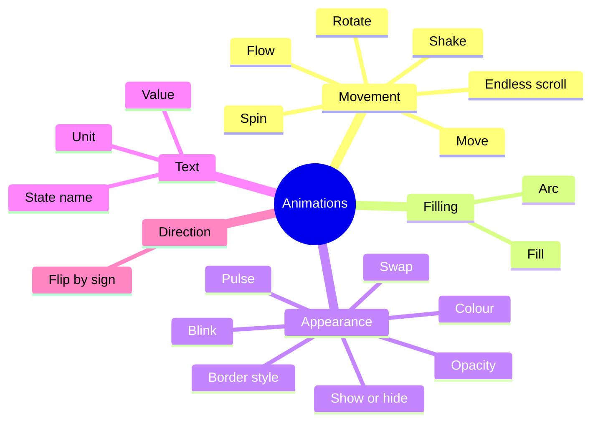

# Catalogue of the animations

> [Home](../../README.md) › [Symbols](../README.md) › [Animation mode](README.md) › Catalogue of the animations

Status: draft, proposed by the assistant (2026-11-25, renamed and regrouped on 2026-11-26 at the Product Owner's request: "trouve de meilleurs noms [...] je veux vraiment comprendre chaque animation parfaitement"). Nothing here is chosen yet: the Product Owner picks the animations of this version.

Every animation that a signal can drive on a part of a symbol, one line each, with a short name that says what the part does. Each one is drawn and explained in Figma, page Spec, section "Symbol mode · Animations (2026-11-26)": the part at three values, and its options in the right-hand panel.

## How to read it

- **Signal**: the type of the output signal that drives it: a number (real or integer), a boolean, an enum.
- **How the value acts**: one of four ways, always the same words in the panel.
  - **Follow the value**: between a minimum and a maximum of the value, the part goes from one end to the other (an angle, a position, a fill). Under the minimum or over the maximum, it stays at its end. The minimum and the maximum are each a number or a signal ([below](README.md#the-input-range-of-a-bounded-linear-animation)).
  - **Speed**: the value is a speed. The bigger the value, the faster; the sign gives the way; zero stops.
  - **Steps**: a table of ranges of the value, each with its result (a colour, shown or hidden).
  - **Per state**: a boolean gives two results (true, false); an enum gives one result per item, taken from a column of the enum ([Enums of a Symbol Lib](../11-enums-of-a-symbol-lib.md)).
- **Cost**: what the second research expects in the browser, nothing measured (see [Properties a signal can drive](README.md#properties-a-signal-can-drive)). Low: done by the graphics card (transform, opacity). Medium: a repaint at each change of value. High: a repaint at each frame, or a filter.

## Movement

| # | Animation | What the part does | Signal | How the value acts | Example | Cost |
| --- | --- | --- | --- | --- | --- | --- |
| 1 | **Rotate** | Turns to an angle given by the value, around its pivot, and stays there. | Number, boolean, enum | Follow the value (angle at the minimum, angle at the maximum); per state (an angle per item) | A damper opens from 0° to 90° with `opening` 0 to 1; a dial needle from −135° to 135°; a selector on Off, Manual, Auto at 0°, 45°, 90° | Low |
| 2 | **Spin** | Turns without stopping, around its pivot. | Number | Speed: the user says how many turns per second the part makes at a given value; half the value, half the speed; a negative value turns it the other way; zero stops it | The impeller of a pump, a fan, a mixer: `speed` 1 500 rpm gives 1 turn a second, −1 500 the other way | Low |
| 3 | **Move** | Moves to a position given by the value, and stays there. **Along**: X (sideways), Y (up and down), or a Path drawn in the symbol. | Number, boolean, enum | Follow the value (position at the minimum, at the maximum; for a path, 0 % to 100 % of its length); per state (a position per item) | The stem of a valve goes up as it opens (Vertical); a slider (Horizontal); a cart on a curved rail (Path) | Low (Path: medium, to measure) |
| 4 | **Endless scroll** | What is inside the part slides without end and comes back on the other side, like a conveyor belt. The part shows only what is inside its box. **Direction**: Horizontal or Vertical. | Number | Speed | The parcels on a conveyor belt, a chain, a moving walkway | Low |
| 5 | **Flow** | Dashes travel along a line or along the border of the part. | Number | Speed | The flow in a pipe drawn inside the symbol; the way of a flow in a heat exchanger | High: repaint at each frame (POC P10) |
| 6 | **Shake** | Shakes a little, a few pixels, while the value is true. | Boolean | Per state | A motor with a vibration alarm | Low; keep the movement for the abnormal |

## Filling

| # | Animation | What the part does | Signal | How the value acts | Example | Cost |
| --- | --- | --- | --- | --- | --- | --- |
| 7 | **Fill** | Is shown only up to the value, the rest cut off. **From**: Bottom, Top, Left or Right, shown in the panel as the arrows ↑ ↓ → ← of the way it grows. | Number | Follow the value: 0 % shown at the minimum, 100 % at the maximum | The level of a tank from the bottom; a bar of power from the left; the charge of a battery | Low (a simple cut) |
| 8 | **Arc** | Is shown along an arc up to the value, like a ring gauge. **Start** and **end** angle of the full arc. | Number | Follow the value | A round gauge from 0 to 100 %; the opening of a valve shown as a ring | Medium, to measure |

A gauge with **thresholds** (green, then orange, then red as the value grows) is an Arc or a Fill **plus** a Colour by steps on the same part: two animations, on two different properties.

## Appearance

| # | Animation | What the part does | Signal | How the value acts | Example | Cost |
| --- | --- | --- | --- | --- | --- | --- |
| 9 | **Colour** | Its fill, its border or, for a text, its letters take a colour given by the value. **Colours**: Fill or Border. For a number: **Steps** (a colour per range) or **Blend** (slides between two colours). | Number, boolean, enum | Steps or Blend; per state (two colours, or a colour column of the enum) | A temperature normal, high from 80, very high from 95 (Steps); a pipe wall from blue to red (Blend); a motor stopped grey, running green, fault red (per state) | Medium, rare (Blend: at each change) |
| 10 | **Opacity** | Fades from transparent to opaque. | Number | Follow the value (opacity at the minimum, at the maximum) | The density of a smoke; the glow of a lamp | Low |
| 11 | **Show or hide** | Is shown or hidden. | Boolean, number, enum | Per state (shown when true, or when false); Steps (shown inside a range) | A fault icon shown when `fault` is true; a flame shown when the burner is on | Low |
| 12 | **Swap** | On a group: one of its children is shown at a time, the others hidden: the one of the current state. | Boolean, enum | Per state (a child per item) | A valve drawn open, closed, in transit | Low |
| 13 | **Blink** | Goes on and off at a fixed rate, under three flashes per second, while the value is true. | Boolean | Per state | An alarm not acknowledged | Low; for the abnormal only, a global stop |
| 14 | **Pulse** | Its opacity rises and falls softly while the value is true: quieter than Blink. | Boolean | Per state | An element that asks for attention | Low |
| 15 | **Border style** | Its border becomes dashed, or thicker, by state. | Boolean, enum | Per state | A dashed border when the equipment is in manual mode | Medium, rare |

## Text

A text shows a value through the field "What it shows" of the text (Text, Value, Unit: [SY-08.7](../../screens/symbols.md#sy-08--animation-mode)), not through the list of animations. They are listed here so that the whole is in one place.

| # | Animation | What the text does | Signal | Example | Cost |
| --- | --- | --- | --- | --- | --- |
| 16 | **Value** | Shows the value, in the display unit, with or without the unit (see [Texts: value and unit](README.md#texts-value-and-unit)). | Number | `12.5 m³/h` beside a flowmeter | Medium (text repainted) |
| 17 | **Unit** | Shows the display unit of a signal only. | Number | The unit alone under a big value | Medium |
| 18 | **State name** | Shows the display name of the current item. | Enum | "Running", "Stopped", "Fault" under a motor | Medium, rare |

## Direction

| # | Animation | What the part does | Signal | How the value acts | Example | Cost |
| --- | --- | --- | --- | --- | --- | --- |
| 19 | **Flip by sign** | Is mirrored while the value is negative. **Mirror**: Horizontal or Vertical. **At zero**: Keep or Hide. | Number | The sign: positive as drawn, negative mirrored, zero kept or hidden | The arrow of a flow points right when the flow is positive, left when it is negative, and is hidden at zero | Low; a mirror is a transform, to weigh against "never a scale" |

## Renamed or merged on 2026-11-26

| Before | Now | Why |
| --- | --- | --- |
| Rotation by a value, Rotation by steps | Rotate | One animation; a number follows, an enum gives an angle per item. |
| Continuous rotation at a speed | Spin | A short word for a part that never stops turning. |
| Move along a line, Move along a path | Move, along Horizontal, Vertical or Path | The Product Owner wants X or Y, and the path too ("il faut pouvoir bouger par rapport à un X ou un Y aussi"). |
| Continuous scrolling at a speed | Endless scroll | The name said "scrolling" without saying that it loops. |
| Flow dashes | Flow | — |
| Vibration | Shake | — |
| Fill level, Bar | Fill, from Bottom, Top, Left or Right | A bar is a fill from the left: one animation. |
| Arc gauge | Arc | The thresholds of a gauge are a Colour by steps on the same part. |
| Colour by ranges, Colour by state, Colour by a boolean, Colour between two colours, Text colour | Colour | One animation; how the value acts depends on the signal. |
| Visibility | Show or hide | Says what it does. |
| Layer by state | Swap | One child of a group shown at a time. |
| Border by state | Border style | — |
| Text by state | State name | — |
| Arrow turned by the sign, Mirror by the sign | Flip by sign | An arrow turned by the sign is a part mirrored by the sign. |

## Set aside

| Animation | Why |
| --- | --- |
| Size (grows or shrinks) | Makes the borders grow; against "never a scale" (research). |
| Gradient that moves | Cost to measure first, POC. |
| Deforming the points of a path | Repaint at each frame, high cost (refused by the research). |
| A parameter of a filter (blur, glow) | Filter recomputed, high cost (refused by the research). |
| A change of the `viewBox` | High cost (refused by the research). |
| A curve, an expression, a script as mapping | Against "for everyone" (refused by the research). |

## Where it is used

| Screen | Element |
| --- | --- |
| [SY-08](../../screens/symbols.md#sy-08--animation-mode) | SY-08.3, the animation chosen; SY-08.4, how the value acts |
| [SY-03](../../screens/symbols.md#sy-03--symbol-editor-what-every-mode-shares) | SY-03.15, the icon of the Animation mode on the line of a layer that has an animation |

## Open questions

- Which of these the animation mode offers in this version: the Product Owner picks.
- Spin, Endless scroll and Flow: the unit of the speed (turns per second, pixels per second) and its maximum. Proposal drawn: the user types the value of the signal that gives one turn (or one length of the pattern) per second.
- Several animations on the same part (a Rotate and a Colour): allowed, as long as they drive different properties (proposal of the research).
- Swap: the child shown for each item, chosen in the animation (drawn) or in a column of the enum, as the colours?
