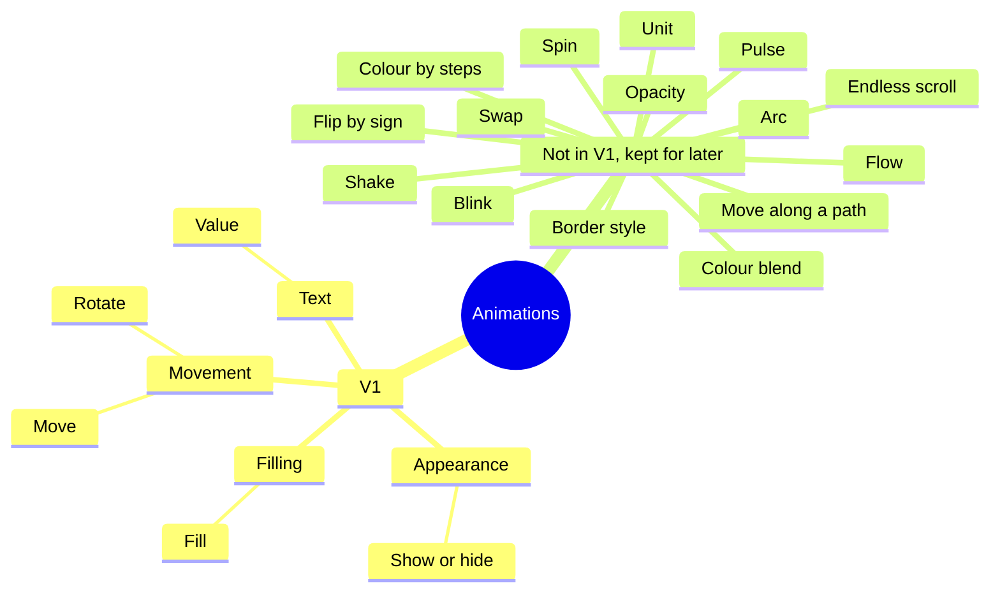

# Catalogue of the animations

> [Home](../../README.md) › [Symbols](../README.md) › [Animation mode](README.md) › Catalogue of the animations

Status: draft, proposed by the assistant (2026-11-25, renamed and regrouped on 2026-11-26 at the Product Owner's request: "trouve de meilleurs noms [...] je veux vraiment comprendre chaque animation parfaitement"). The Product Owner picked the animations of the V1, row by row (2026-11-26): see [Choice for the V1](#choice-for-the-v1).

Every animation that a signal can drive on a part of a symbol, one line each, with a short name that says what the part does. Each one is drawn and explained in Figma, page Spec, section "Symbol mode · Animations (2026-11-26)": what it does, how to set it step by step in the order of the panel, the part at three values of its signal, and its right-hand panel (see [The panel of an animation](README.md#rules)). The main list holds the animations of the V1; the others are set apart, with their rows and their numbers, in a list of their own: [Not in V1, kept for later](#not-in-v1-kept-for-later), in Figma the column on the right of the section.

## How to read it

- **Signal**: the type of the output signal that drives it: a number (real or integer), a boolean, an enum.
- **How the value acts**: one of four ways, always the same words in the panel.
  - **Follow the value**: between a minimum and a maximum of the value, the part goes from one end to the other (an angle, a position, a fill). Under the minimum or over the maximum, it stays at its end. The minimum and the maximum are each a number or a signal ([below](README.md#the-input-range-of-a-bounded-linear-animation)).
  - **Speed**: the value is a speed. The bigger the value, the faster; the sign gives the way; zero stops.
  - **Steps**: a table of ranges of the value, each with its result (shown or hidden).
  - **Per state**: a boolean gives two results (true, false); an enum gives one result per item, taken from a column of the enum ([Enums of a Symbol Lib](../11-enums-of-a-symbol-lib.md)).
- **Cost**: what the second research expects in the browser, nothing measured (see [Properties a signal can drive](README.md#properties-a-signal-can-drive)). Low: done by the graphics card (transform, opacity). Medium: a repaint at each change of value. High: a repaint at each frame, or a filter.

## Choice for the V1

Settled by the Product Owner on 2026-11-26, row by row: few animations, done well, before more complex ones ("je préfère faire parfaitement les choses au début et pouvoir implémenter des choses plus complexes après"). An animation left for later is not refused: it is kept for a later version ("je te dis pas que c'est pas de bonnes idées [...] garde ça en mémoire").

| Animation | V1 |
| --- | --- |
| Rotate, Move (along X or Y), Fill, Show or hide, Value | Yes |
| Move along a path, Spin, Endless scroll, Flow, Shake, Arc, Colour by steps, Colour blend, Opacity, Swap, Blink, Pulse, Border style, Unit, Flip by sign | No, kept for later, in [their own list](#not-in-v1-kept-for-later) |
| Colour per state (9c) | No, and not kept: the colour of each item is written in a column of the enum ("on peut le mettre dans la définition de l'enum directement"), see [Set aside](#set-aside) |
| State name (18) | Merged into Value: a text linked to an enum signal shows the column of the enum chosen, see [Text](#text) |

Arc: the Product Owner likes it, but it is a shape more than an animation ("c'est une forme [...] faut rajouter une forme arc, et point barre"). It comes back in a later version as an [Arc shape](../04-drawing-mode/arc.md), after the Ellipse (2026-11-26).

## Movement

| # | Animation | What the part does | Signal | How the value acts | Example | Cost |
| --- | --- | --- | --- | --- | --- | --- |
| 1 | **Rotate** | Turns to an angle given by the value, around its pivot, and stays there. | Number, boolean, enum | Follow the value (angle at the minimum, angle at the maximum); per state (an angle per item) | A damper opens from 0° to 90° with `opening` 0 to 1; a dial needle from −135° to 135°; a selector on Off, Manual, Auto at 0°, 45°, 90° | Low |
| 3 | **Move** | Moves to a position given by the value, and stays there. **Along**: X (sideways) or Y (up and down); to move both ways, two animations, one along X, one along Y (Product Owner, 2026-11-26). | Number, boolean, enum | Follow the value (position at the minimum, at the maximum); per state (a position per item) | The stem of a valve goes up as it opens (Y); a slider (X) | Low |

## Filling

| # | Animation | What the part does | Signal | How the value acts | Example | Cost |
| --- | --- | --- | --- | --- | --- | --- |
| 7 | **Fill** | Is shown only up to the value, the rest cut off. **From**: Bottom, Top, Left or Right, shown in the panel as the arrows ↑ ↓ → ← of the way it grows. | Number | Follow the value: 0 % shown at the minimum, 100 % at the maximum | The level of a tank from the bottom; a bar of power from the left; the charge of a battery | Low (a simple cut) |

## Appearance

| # | Animation | What the part does | Signal | How the value acts | Example | Cost |
| --- | --- | --- | --- | --- | --- | --- |
| 11 | **Show or hide** | Is shown or hidden. | Boolean, number, enum | Per state (shown when true, or when false); Steps (shown inside a range) | A fault icon shown when `fault` is true; a flame shown when the burner is on | Low |

## Text

A text shows a signal through its own fields in the panel ([SY-08.7](../../screens/symbols.md#sy-08--animation-mode)), not through the list of animations. It is listed here so that the whole is in one place. The rules: [Texts that show a signal](README.md#texts-that-show-a-signal).

| # | Animation | What the text does | Signal | Example | Cost |
| --- | --- | --- | --- | --- | --- |
| 16 | **Value** | The signal is chosen first; what the text shows follows from its type. A number: its value, in the display unit, and **Show the unit**, a checkbox, when the signal has a quantity. An enum: the **column** of the enum chosen, for the current item (Product Owner, 2026-11-26). | Number, enum | `12.5 m³/h` beside a flowmeter; "Running" under a motor | Medium (text repainted) |

## Not in V1, kept for later

Set apart by the Product Owner on 2026-11-26, not refused ("garde ça en mémoire, c'est pas délirant"); each keeps its number, to be taken again in a later version. In Figma: the column "Not in V1 · kept for later", on the right of the section, with its own list and its rows.

| # | Animation | What the part does | Signal | How the value acts | Example | Cost |
| --- | --- | --- | --- | --- | --- | --- |
| 2 | **Spin** | Turns without stopping, around its pivot. | Number | Speed: the user says how many turns per second the part makes at a given value; half the value, half the speed; a negative value turns it the other way; zero stops it | The impeller of a pump, a fan, a mixer: `speed` 1 500 rpm gives 1 turn a second, −1 500 the other way | Low |
| 3b | **Move along a path** | Moves along a path of the symbol, to a point given by the value, and stays there. **Path**: a shape of the symbol, chosen in a select. | Number | Follow the value: at the start of the path at the minimum, at its end at the maximum | A marker along a curved track; a level along a bent tube | Low for the move; the point on the path, to measure |
| 4 | **Endless scroll** | What is inside the part slides without end and comes back on the other side, like a conveyor belt. The part shows only what is inside its box. **Direction**: X or Y. The part is a group: its box is the window, its content slides inside it. | Number | Speed | The parcels on a conveyor belt, a chain, a moving walkway | Low |
| 5 | **Flow** | Dashes travel along a line or along the border of the part. | Number | Speed | The flow in a pipe drawn inside the symbol; the way of a flow in a heat exchanger | High: repaint at each frame (POC P10) |
| 6 | **Shake** | Shakes a little, a few pixels, while the value is true. | Boolean | Per state | A motor with a vibration alarm | Low; keep the movement for the abnormal |
| 8 | **Arc** | Is shown along an arc up to the value, like a ring gauge. **Start** and **end** angle of the full arc. Comes back as a shape: [Arc](../04-drawing-mode/arc.md). | Number | Follow the value | A round gauge from 0 to 100 %; the opening of a valve shown as a ring | Medium, to measure |
| 9 | **Colour by steps** | Its fill, its border or, for a text, its letters take a colour per range of the value. **Colours**: Fill or Border. | Number | Steps (a colour per range) | A temperature normal, high from 80, very high from 95; with a Fill on the same part, a gauge with thresholds | Medium, rare |
| 9b | **Colour blend** | Its fill or its border slides between two colours. | Number | Follow the value (a colour at the minimum, another at the maximum) | A pipe wall from blue to red | Medium, at each change |
| 10 | **Opacity** | Fades from transparent to opaque. | Number | Follow the value (opacity at the minimum, at the maximum) | The density of a smoke; the glow of a lamp | Low |
| 12 | **Swap** | On a group: one of its children is shown at a time, the others hidden: the one of the current state. | Boolean, enum | Per state (a child per item) | A valve drawn open, closed, in transit | Low |
| 13 | **Blink** | Goes on and off at a fixed rate, under three flashes per second, while the value is true. | Boolean | Per state | An alarm not acknowledged | Low; for the abnormal only, a global stop |
| 14 | **Pulse** | Its opacity rises and falls softly while the value is true: quieter than Blink. | Boolean | Per state | An element that asks for attention | Low |
| 15 | **Border style** | Its border becomes thicker, or changes colour, by state; never dashed, a border has no dashes since 2026-11-26. | Boolean, enum | Per state | A thicker border when the equipment is in manual mode | Medium, rare |
| 17 | **Unit** | A text shows the display unit of a signal only. | Number | The unit alone under a big value | Medium |  |
| 19 | **Flip by sign** | Is mirrored while the value is negative. **Mirror**: ↔ (left and right swap) or ↕ (top and bottom swap). **At zero**: Keep or Hide. | Number | The sign: positive as drawn, negative mirrored, zero kept or hidden | The arrow of a flow points right when the flow is positive, left when it is negative, and is hidden at zero | Low; a mirror is a transform, to weigh against "never a scale" |

## Renamed or merged on 2026-11-26

| Before | Now | Why |
| --- | --- | --- |
| Rotation by a value, Rotation by steps | Rotate | One animation; a number follows, an enum gives an angle per item. |
| Continuous rotation at a speed | Spin | A short word for a part that never stops turning. |
| Move along a line, Move along a path | Move, along X or Y | The Product Owner wants X or Y ("il faut pouvoir bouger par rapport à un X ou un Y aussi"); the path is kept for a later version, row 3b of [Not in V1](#not-in-v1-kept-for-later) (2026-11-26). |
| Continuous scrolling at a speed | Endless scroll | The name said "scrolling" without saying that it loops. |
| Flow dashes | Flow | — |
| Vibration | Shake | — |
| Fill level, Bar | Fill, from Bottom, Top, Left or Right | A bar is a fill from the left: one animation. |
| Arc gauge | Arc | The thresholds of a gauge are a Colour by steps on the same part. |
| Colour by ranges, Colour between two colours, Text colour | Colour by steps, Colour blend | Two rows, 9 and 9b, both kept for later. |
| Visibility | Show or hide | Says what it does. |
| Layer by state | Swap | One child of a group shown at a time. |
| Border by state | Border style | — |
| Text by state, then State name | Value | A text linked to an enum signal shows the column chosen; the display name is one of them (Product Owner, 2026-11-26). |
| Arrow turned by the sign, Mirror by the sign | Flip by sign | An arrow turned by the sign is a part mirrored by the sign. |

## Set aside

| Animation | Why |
| --- | --- |
| Colour per state, Colour by a boolean (9c) | The colour of each item is written in a column of the enum on the [Enums page](../11-enums-of-a-symbol-lib.md) ("ça ne sert à rien, parce que, littéralement, on peut le mettre dans la définition de l'enum directement", Product Owner, 2026-11-26). |
| Size (grows or shrinks) | Makes the borders grow; against "never a scale" (research). |
| Gradient that moves | Cost to measure first, POC. |
| Deforming the points of a path | Repaint at each frame, high cost (refused by the research). |
| A parameter of a filter (blur, glow) | Filter recomputed, high cost (refused by the research). |
| A change of the `viewBox` | High cost (refused by the research). |
| A curve, an expression, a script as mapping | Against "for everyone" (refused by the research). |

## Where it is used

| Screen | Element |
| --- | --- |
| [SY-08](../../screens/symbols.md#sy-08--animation-mode) | SY-08.3, the animation chosen; SY-08.4, how the value acts; SY-08.7 and SY-08.8, a text that shows a signal |
| [SY-03](../../screens/symbols.md#sy-03--symbol-editor-what-every-mode-shares) | SY-03.15, the icon of the Animation mode on the line of a layer that has an animation |

## Open questions

- Fill: still in the V1? Taken on 2026-11-26, then not named in the last list of the same day ("le fil, l'arc, ça dégage": Fill or Flow?).
- Colour per state set aside: how does a part take the colour of the column of an enum, with no Colour animation in the V1?
- Value, a boolean signal: does the text show the texts of the boolean (true, false), or is a boolean not offered?
- Value, a number column of an enum: does it have a unit to show?
- Arc, when it comes back as a shape: does a signal move the end angle of the [Arc shape](../04-drawing-mode/arc.md) through an animation, and is the animation Arc then kept or replaced?
- Move along a path, when it comes back: is the part turned along the path or not?
- Endless scroll and Flow (not in V1, to settle when they come back): the unit of the speed (lengths of the pattern per second) and its maximum. Proposal drawn: as for Spin, the user gives the value of the signal that makes one length of the pattern per second (settled for Spin, Product Owner, 2026-11-26: "when speed is [...] RPM, turn 1 par seconde [...] c'est parfait"); that value can be a signal, a maximum speed for example.
- Several animations on the same part (a Rotate and a Show or hide): allowed, as long as they drive different properties (proposal of the research).
- Swap, when it comes back: the child shown for each item, chosen in the animation (drawn) or in a column of the enum?
