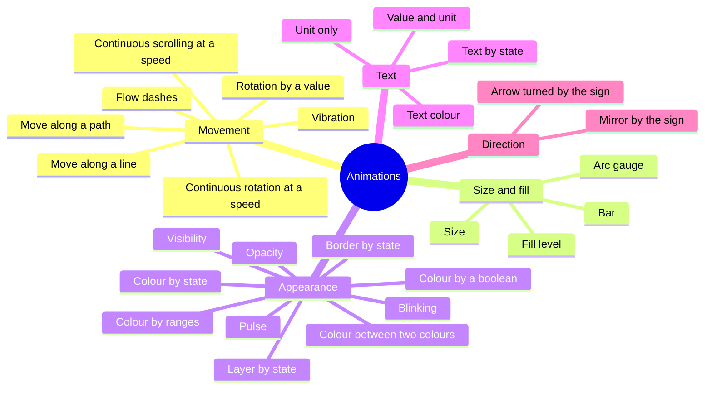

# Catalogue of the animations

> [Home](../../README.md) › [Symbols](../README.md) › [Animation mode](README.md) › Catalogue of the animations

Status: draft, written by the assistant at the Product Owner's request (2026-11-25: "fais-moi une liste de toutes les animations possibles [...] ça me permettra de réfléchir"). Nothing here is chosen yet: it is a list to think from.

Every animation that a signal could drive on a part of a symbol, with an example from industrial synoptics. The Product Owner picks from it which ones the [animation mode](README.md) offers.

## How to read it

- **Signal**: the type of the output signal that drives it: a number (real or integer), a boolean, an enum.
- **Mapping**: how the value becomes the animation (see [Shapes of mapping](README.md#shapes-of-mapping)): bounded linear, by ranges, two values, column of the enum, or a **speed** (the value sets how fast something moves; its sign sets which way).
- **Cost**: what the second research expects in the browser, nothing measured (see [Properties a signal can drive](README.md#properties-a-signal-can-drive)). Low: done by the graphics card (transform, opacity). Medium: a repaint at each change of value. High: a repaint at each frame, or a filter.
- **Research**: the opinion of the report T4 when it gave one; "new" when the assistant adds it here.

The direction of a movement comes from the **sign of the signal**: the model sends a positive or a negative value, and the animation runs one way or the other (Product Owner, 2026-11-25). Zero stops it.

## Movement

| # | Animation | Signal | Mapping | Example | Cost | Research |
| --- | --- | --- | --- | --- | --- | --- |
| 1 | **Rotation by a value**: the part turns to an angle | Number | Bounded linear | A damper opens from 0° to 90° with `opening` 0 to 1; the needle of a dial goes from −135° to 135° | Low | Offer |
| 2 | **Rotation by steps**: the part takes one angle per state | Enum | Column of the enum | A selector switch on Off, Manual, Auto: 0°, 45°, 90° | Low | New |
| 3 | **Continuous rotation at a speed**: the part turns without stopping, faster when the value grows | Number | Speed: turns per second from the value, the sign gives the direction | The impeller of a pump, a fan, a mixer, a motor shaft; `speed` = −10 turns it the other way | Low | New |
| 4 | **Move along a line**: the part slides between two positions | Number | Bounded linear | The stem of a valve goes up as it opens; a piston; the float of a level; a crane hook | Low | Offer |
| 5 | **Move along a path**: the part follows a line drawn in the symbol | Number | Bounded linear, 0 to 1 along the path | A cart on a rail; a carriage on a curved track; a part on a bent conveyor | Medium, to measure | New |
| 6 | **Continuous scrolling at a speed**: a pattern or a row of parts moves without stopping | Number | Speed, the sign gives the direction | The belt of a conveyor; parcels moving on it; a chain | Low if a transform | New |
| 7 | **Flow dashes**: dashes travel along a line | Number | Speed, the sign gives the direction | The flow in a pipe drawn inside the symbol; the direction of a flow inside a heat exchanger | High: repaint at each frame | Pipes and lines only, subject to POC P10 |
| 8 | **Vibration**: the part shakes a little | Boolean | Two values: still, shaking | A motor with a vibration alarm | Low | New; to weigh against "keep the movement for the abnormal" |

## Size and fill

| # | Animation | Signal | Mapping | Example | Cost | Research |
| --- | --- | --- | --- | --- | --- | --- |
| 9 | **Fill level**: a part is filled up to a height, cut by a rectangle that moves | Number | Bounded linear | The level of a tank or a silo; the charge of a battery; up, down, left or right | Low if the cut is simple | Offer, as a dedicated animation |
| 10 | **Bar**: a bar grows in length | Number | Bounded linear | A bar of power beside a motor; a bar of temperature | Low (the same cut as the fill level) | New, a variant of 9 |
| 11 | **Arc gauge**: a ring fills by its angle | Number | Bounded linear | A round gauge from 0 to 100 %; the opening of a valve shown as a ring | Medium: repaint at each change | New, to measure |
| 12 | **Size**: the part grows or shrinks | Number | Bounded linear | A flame bigger as the burner gives more power | Low, but makes the borders grow | Not first: against "never a scale" |

## Appearance

| # | Animation | Signal | Mapping | Example | Cost | Research |
| --- | --- | --- | --- | --- | --- | --- |
| 13 | **Colour by ranges**: the fill or the border takes one colour per range of values | Number | By ranges | A temperature: normal, high from 80, very high from 95 | Medium, but rare (a change of range) | Offer |
| 14 | **Colour by state**: one colour per item of an enum | Enum | Column of the enum ([Enums of a Symbol Lib](../11-enums-of-a-symbol-lib.md)) | A motor: stopped grey, running green, fault red | Medium, rare | Offer (decided as a column, 2026-11-17) |
| 15 | **Colour by a boolean**: two colours | Boolean | Two values | A valve open or closed | Medium, rare | Offer |
| 16 | **Colour between two colours**: the colour slides from one to the other with the value | Number | Bounded linear, between two colours | A pipe wall from blue (cold) to red (hot) | Medium: repaint at each change of value | New, to measure |
| 17 | **Opacity**: the part fades in or out with the value | Number | Bounded linear | The density of a smoke; the intensity of a lamp | Low | Offer |
| 18 | **Visibility**: the part is shown or hidden | Boolean, or a number by ranges | Two values | A fault icon shown when `fault` is true; a flame shown when the burner is on | Low | Offer |
| 19 | **Layer by state**: one layer among several is shown, the others hidden | Enum | Column of the enum (a layer per item) | A valve drawn open, closed, in transit; a motor drawn three ways | Low | Offer (visible layers in the state table) |
| 20 | **Blinking**: the part goes on and off at a fixed rate | Boolean | Two values: still, blinking | An alarm not yet acknowledged | Low (opacity) | Offer, under three flashes per second, with a global stop |
| 21 | **Pulse**: the opacity rises and falls softly | Boolean | Two values | An element that asks for attention, less loud than a blink | Low | New |
| 22 | **Border by state**: the border changes width or becomes dashed | Enum or boolean | Column of the enum, two values | A dashed border when the equipment is in manual mode | Medium, rare | New |
| 23 | **Gradient that moves**: a stop of a gradient follows the value | Number | Bounded linear | A level with a soft surface | To measure | Subject to a POC |

## Text

| # | Animation | Signal | Mapping | Example | Cost | Research |
| --- | --- | --- | --- | --- | --- | --- |
| 24 | **Value and unit**: the text shows the value, in the display unit | Number | — | `12.5 m³/h` beside a flowmeter | Medium (text repainted) | Decided (see [Texts: value and unit](README.md#texts-value-and-unit)) |
| 25 | **Unit only**: the text shows the display unit of a signal | Number | — | The unit on its own under a big value | Medium | Decided |
| 26 | **Text by state**: the text shows the display name of the current item | Enum | — | "Running", "Stopped", "Fault" under a motor | Medium, rare | New (the display name of the item) |
| 27 | **Text colour**: the colour of a text by ranges or by state | Number, enum, boolean | By ranges, column of the enum, two values | A value written in red above its alarm threshold | Medium, rare | New |

## Direction

| # | Animation | Signal | Mapping | Example | Cost | Research |
| --- | --- | --- | --- | --- | --- | --- |
| 28 | **Arrow turned by the sign**: an arrow points one way or the other | Number | Sign: positive, zero, negative | The arrow of a flow points right when the flow is positive, left when it is negative, is hidden at zero | Low | New |
| 29 | **Mirror by the sign**: the part is mirrored when the value is negative | Number | Sign | A fan drawn turning the other way | Low | New; a mirror is a transform, to weigh against "never a scale" |

## Refused by the research

| Animation | Why |
| --- | --- |
| Deforming the points of a path | Repaint at each frame, high cost |
| A parameter of a filter (blur, glow) | Filter recomputed, high cost |
| A change of the `viewBox` | High cost |
| A curve, an expression, a script as mapping | Against "for everyone" |

## Where it is used

| Screen | Element |
| --- | --- |
| [SY-08](../../screens/symbols.md#sy-08--animation-mode) | SY-08.3, the kind of animation |

## Open questions

- Which of these the animation mode offers in this version: the Product Owner picks.
- The speed animations (3, 6, 7): the unit of the speed (turns per second, pixels per second), and its maximum.
- Several animations on the same part (a rotation by a value and a colour by state): allowed, as long as they drive different properties (proposal of the research).
