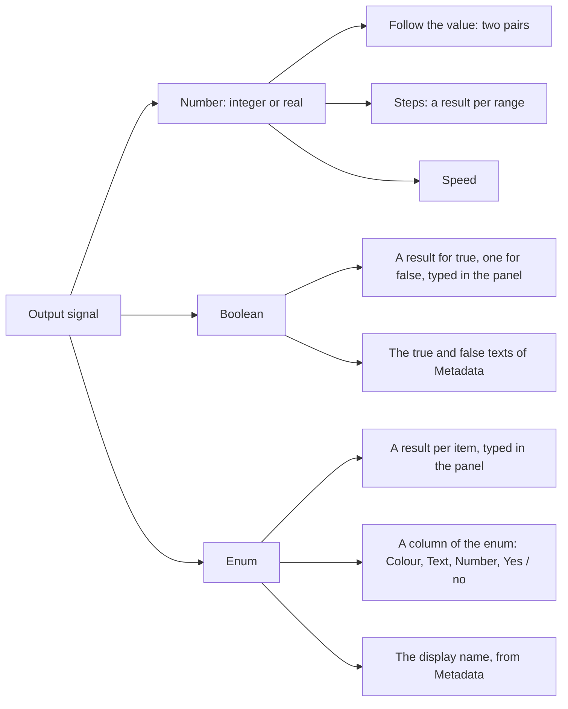

# Animations by type of signal

> [Home](../../README.md) › [Symbols](../README.md) › [Animation mode](README.md) › Animations by type of signal

Status: draft, to choose from (Product Owner, 2026-11-26: "une ligne par animation, en fonction de tous les types de signaux [...] je pourrais dire : ça, je veux, ça, je veux pas"). Each line is one animation with one type of signal and one place its result comes from. The column **Today** says where the line stands: **In the spec** (written in the [catalogue](animation-catalogue.md) or in [What an animation can do](README.md#what-an-animation-can-do)), **New** (proposed here, never written), or **Refused** (already settled against).

## The types of signal

A signal has one of four value types ([Value type](../../metadata/entities/15-value-type.md)). An integer and a real act the same way in every animation: one line, **Number**. An enum gives its result in two ways: typed per item in the panel of the animation, or taken from a column of the enum on the [Enums page](../11-enums-of-a-symbol-lib.md) of the Symbol Lib, whose kind is Colour, Text, Number or Yes / no; the display name comes from Metadata. The columns of the built-in enum `pipe_style` (widths, fills) act as Number and Colour columns.

## Animations of the V1

| Line | Animation | Signal | The result comes from | What the part does | Example | Today |
| --- | --- | --- | --- | --- | --- | --- |
| 1 | Rotate | Number | Follow the value: an angle at the minimum, one at the maximum | Turns between the two angles | `opening` 0 to 1 gives 0° to 90° | In the spec |
| 2 | Rotate | Number | Steps: an angle per range | Jumps to the angle of the range | Under 10 % at 0°, from 10 % at 45°, from 90 % at 90° | New |
| 3 | Rotate | Boolean | An angle for true, one for false, typed in the panel | Turns to one of two angles | A flap at 0° when `open` is false, 90° when true | In the spec |
| 4 | Rotate | Enum | An angle per item, typed in the panel | Turns to the angle of the item | A selector on Off, Manual, Auto at 0°, 45°, 90° | In the spec |
| 5 | Rotate | Enum | A Number column of the enum (degrees) | Turns to the angle of the column for the item | Column `angle` of `mode` | In the spec |
| 6 | Move | Number | Follow the value: a position at the minimum, one at the maximum, along X or Y | Slides between the two positions | The stem of a valve goes up as it opens | In the spec |
| 7 | Move | Number | Steps: a position per range | Jumps to the position of the range | A cursor on three marks | New |
| 8 | Move | Boolean | A position for true, one for false, typed in the panel | Moves to one of two positions | A latch in or out | In the spec |
| 9 | Move | Enum | A position per item, typed in the panel | Moves to the position of the item | A slider on Off, Manual, Auto | In the spec |
| 10 | Move | Enum | A Number column of the enum (px) | Moves by the value of the column for the item | Column `offset` of `mode` | In the spec |
| 11 | Fill | Number | Follow the value: 0 % at the minimum, 100 % at the maximum, from Bottom, Top, Left or Right | Is shown up to the value | The level of a tank | In the spec |
| 12 | Fill | Number | Steps: a level per range | Jumps to the level of the range | A battery in four bars | New |
| 13 | Fill | Boolean | A level for true, one for false, typed in the panel | Empty or full, or two levels | A chamber full when `filled` is true | New |
| 14 | Fill | Enum | A level per item, typed in the panel | Shown up to the level of the item | Low, Medium, High at 25 %, 50 %, 100 % | New |
| 15 | Fill | Enum | A Number column of the enum (%) | Shown up to the level of the column for the item | Column `level` of `tank_state` | New |
| 16 | Show or hide | Number | Steps: shown or hidden per range | Shown inside a range only | A warning shown above 80 | In the spec |
| 17 | Show or hide | Boolean | Shown when true, or when false | Shown or hidden | A fault icon shown when `fault` is true | In the spec |
| 18 | Show or hide | Enum | Shown or hidden per item, ticked in the panel | Shown for the items ticked | A hand shown in Manual only | In the spec |
| 19 | Show or hide | Enum | A Yes / no column of the enum | Shown for the items whose column is ticked | Column `visible` of `mode` | In the spec |
| 20 | Colour per state | Boolean | A colour for true, one for false, typed in the panel | Its fill or its border takes one of two colours | A lamp red when `fault` is true | In the spec |
| 21 | Colour per state | Enum | A Colour column of the enum, read only in the panel | Its fill or its border takes the colour of the item | Column `color` of `mode`: grey, orange, green | In the spec |
| 22 | Colour per state | Enum | A colour per item, typed in the panel | Its fill or its border takes the colour typed | Grey, orange, green typed in the animation | Refused (2026-11-26: from the column only) |
| 23 | Colour per state | Number | Steps: a colour per range | Its fill or its border takes the colour of the range | Normal, high from 80, very high from 95 | Kept for later, as Colour by steps (line 38) |
| 24 | Value | Number | Its value, in the display unit; Show the unit, a checkbox | The text shows the value | `12.5 m³/h` | In the spec |
| 25 | Value | Boolean | The true and false texts of Metadata | The text shows one of the two | "Fault" or "OK" | In the spec |
| 26 | Value | Boolean | A text for true, one for false, typed in the panel | The text shows one of the two | "Open" or "Closed" for this symbol only | New |
| 27 | Value | Enum | The display name, from Metadata | The text shows the name of the item | "Manual" | In the spec |
| 28 | Value | Enum | A Text column of the enum | The text shows the column for the item | Column `short`: "MAN" | In the spec |
| 29 | Value | Enum | A Number column of the enum | The text shows the number, without unit | Column `rank`: "2" | In the spec |
| 30 | Value | Enum | A text per item, typed in the panel | The text shows the text typed | "M" for Manual, for this symbol only | New |

## Kept for later

The animations set apart on 2026-11-26 ([Not in V1](animation-catalogue.md#not-in-v1-kept-for-later)), with every type of signal, to choose from when they come back.

| Line | Animation | Signal | The result comes from | What the part does | Example | Today |
| --- | --- | --- | --- | --- | --- | --- |
| 31 | Spin | Number | Speed: turns per second at a given value; the sign gives the way | Turns without stopping | `speed` 1 500 rpm gives 1 turn a second | In the spec |
| 32 | Spin | Boolean | A fixed speed while true | Turns while true, stops while false | An impeller while `running` is true | New |
| 33 | Spin | Enum | A speed per item, typed in the panel, or a Number column | Turns at the speed of the item | Stopped, slow, fast | New |
| 34 | Move along a path | Number | Follow the value: the start of the path at the minimum, its end at the maximum | Moves along the path | A marker along a curved track | In the spec |
| 35 | Move along a path | Enum | A point of the path per item, typed in the panel, or a Number column (%) | Moves to the point of the item | A shuttle at three stations | New |
| 36 | Endless scroll, Flow | Number | Speed; the sign gives the way | Slides or flows without end | Parcels on a belt; the flow in a pipe | In the spec |
| 37 | Endless scroll, Flow | Boolean | A fixed speed while true | Slides or flows while true | The belt runs while `running` is true | New |
| 38 | Colour by steps | Number | Steps: a colour per range | Its fill or its border takes the colour of the range | A temperature normal, high, very high | In the spec |
| 39 | Colour blend | Number | Follow the value: a colour at the minimum, one at the maximum | Its fill or its border slides between two colours | A pipe wall from blue to red | In the spec |
| 40 | Opacity | Number | Follow the value: an opacity at the minimum, one at the maximum | Fades | The density of a smoke | In the spec |
| 41 | Opacity | Boolean | An opacity for true, one for false | Dim or full | A part greyed while `disabled` is true | New |
| 42 | Opacity | Enum | An opacity per item, typed in the panel, or a Number column (%) | Takes the opacity of the item | Faded in Off | New |
| 43 | Shake, Blink, Pulse | Boolean | While true | Shakes, blinks or pulses | A motor with a vibration alarm; an alarm not acknowledged | In the spec |
| 44 | Shake, Blink, Pulse | Enum | Ticked per item in the panel, or a Yes / no column | Shakes, blinks or pulses for the items ticked | Blinks in Fault only | New |
| 45 | Shake, Blink, Pulse | Number | Steps: on or off per range | Shakes, blinks or pulses inside a range | Blinks above 95 | New |
| 46 | Swap | Boolean | A child for true, one for false | One child of a group shown | A valve drawn open or closed | In the spec |
| 47 | Swap | Enum | A child per item, chosen in the panel | The child of the item shown | Open, closed, in transit | In the spec |
| 48 | Border style | Boolean, enum | A width or a colour per state | Its border thicker, or of another colour | Thicker in manual mode | In the spec |
| 49 | Border style | Enum | A Number column (width) or a Colour column | Its border takes the value of the column | Column `width` of `pipe_style` | New |
| 50 | Unit | Number | The display unit of the signal | A text shows the unit alone | "m³/h" under a big value | In the spec |
| 51 | Flip by sign | Number | The sign: positive as drawn, negative mirrored, zero kept or hidden | Is mirrored while negative | The arrow of a flow | In the spec |
| 52 | Arc | Number | Follow the value | Is shown along an arc up to the value | A ring gauge | In the spec; comes back as a shape |

## Left out, no sense

- A Colour column or a Yes / no column for an angle, a position, a level or a text: the kind of a column says what it drives ([Kinds of value](../11-enums-of-a-symbol-lib.md#kinds-of-value)).
- Follow the value with a boolean or an enum: they have no range, only states.
- A speed typed for a boolean on Rotate, Move or Fill: these animations stay where the value puts them, they never run on.

## Where it is used

| Screen | Element |
| --- | --- |
| [SY-08](../../screens/symbols.md#sy-08--animation-mode) | SY-08.3, the animations offered for the type of the signal; SY-08.4, how the value acts; SY-08.4c, the column of the enum |
