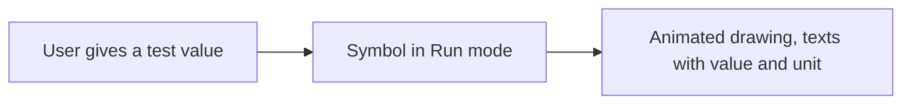

# Run mode

> [Home](../../README.md) › [Symbols](../README.md) › Run mode · Previous: [Animation mode](../08-animation-mode/README.md) · Next: [Open questions](../10-open-questions.md)

Status: draft, from the Product Owner's description of 2026-11-11. Not validated.

The mode of the [editor](../03-editor/README.md) in which the user tries the symbol without a model: they give values to the signals that animate it, and see it move. Only dynamic symbols have it.

## Rules

- Tool bar: [Hand](../03-editor/hand.md) only. Right-hand panel: the test values, and the simulated screen.
- There is no model. The Run mode is simply a mode with a menu on the right (or elsewhere) that lists all the output signals of the model that animate the symbol. What the model does does not matter: the mode only shows what can happen.
- The user gives each signal a value, within its bounds when it has some (see [Signals](../../metadata/04-signals.md)). The control depends on the type (decided by the Product Owner, 2026-11-11):

| Signal | Control |
| --- | --- |
| A number, for example from 0 to 1 | A number input or a slider. |
| An enum | A select, to choose a value of the enum and see the animation that goes with it. |
| A boolean | A switch (assumed by the assistant, the Product Owner named only the two above). |

- The symbol is redrawn at each change, with the display units and decimal places of its preset.
- Nothing is sent to a model, and nothing is saved in the symbol.

### Interactions in the Run mode

- There is no real interaction, since there is no model: nothing is sent.
- When the user acts on a place of the symbol that has an interaction, the editor only **simulates** what would happen:
  - an interaction that opens the faceplate simulates the opening of the pop-up;
  - a command assigned to the place gives a line in a log of the simulation: "you clicked here, so this action would be done".
- The exact form of the log and of the simulated pop-up is not decided: the Product Owner has no precise idea yet, only the principle (see the open question).

## Simulating another screen

The Run mode can show the symbol as it would look on another screen, which is not the edit mode's job.

- The user picks a simulated screen by its size and resolution. Example: a 24 inch 1080p screen, while working on a 27 inch 4K one.
- The editor then shows the size that screen would have, and displays the symbol at that resolution. It may zoom to do so.
- If the simulated screen is bigger than the real one (a 24 inch screen on a 16 inch laptop), the simulated screen goes beyond the window: scroll bars appear and the user moves in it.

## Where it is used

| Thing | Created and changed in | Used in | In a symbol | In a synoptic |
| --- | --- | --- | --- | --- |
| Run mode | Symbol editor | Checking a symbol | Use | No |

## Open questions

- The form of the simulation log and of the simulated faceplate (where the log is shown, what a line says, whether the faceplate shows the test values). See [Open questions](../10-open-questions.md).
