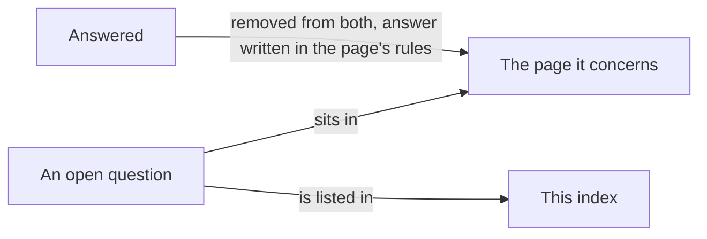

# Symbols: open questions

> [Home](../README.md) › [Symbols](README.md) › Open questions · Previous: [Run mode](09-run-mode/README.md)

Status: draft. Everything in this part is still a draft: these are the questions raised while writing it. Both researches are back (2026-11-11): their answers and opinions are in the pages; what is left is for the Product Owner to decide.

This file is the index of the open questions. A question sits in the file it concerns and is listed here; once answered, it is removed from both and the answer goes in the rules.

## To decide by the Product Owner, after the researches

| Question | Page | Opinion of the research |
| --- | --- | --- |
| Names: Advanced tools, Path, Interaction zone, Preview, Test mode; Layer, static and dynamic kept. | [Editor](03-editor/README.md) | Those names. |
| Rotation as the only transform of a shape; frame of a symbol; minimum snapping and guides; editor data in one `<metadata>` block; missing features to add now. | [Editor](03-editor/README.md) | See the page. |
| Desktop window; does "all in JavaScript" allow a shell in Rust? Browsers to hold at 8.3 ms; which effects go in the specs (two lots?); effect suspended during a gesture; colour filter or recomputed colours. | [Effects and masks](04-drawing-mode/effects-and-masks.md) | Electron, and the installed web app first; two lots of effects. |
| Open paths (middle only, caps, joins); native stroke under the hood for a "middle" border, which also settles the dashes; named colours and a "high-performance" palette. | [Fill and border](04-drawing-mode/fill-and-border.md) | Yes to the three. |
| OFL fonts embedded whole; text border kept. | [Text tool](04-drawing-mode/text.md) | Yes. |
| Third polygon mode "like Figma"; anchors on corners reserved to 3 and 4 sides or another meaning. | [Polygon](04-drawing-mode/polygon.md) | Drop the third mode. |
| Modifier keys (square, from the centre, angle lock). "Entirely enclosed" is settled: Alt. | [Select](03-editor/select.md), [Rectangle](04-drawing-mode/rectangle.md), [Pen](04-drawing-mode/pen.md) | Conventions written; key conflicts not researched. |
| Free form: options of the former shape; points list. | [Point editing mode](05-point-editing-mode/README.md) | Drop the options of the former shape; list the selected shapes. |
| Anchors on a real shape; distribution with equal spacing; one anchor for all the shapes to place or one each. | [Alignment mode](06-alignment-mode/README.md), [Anchors](03-editor/anchors.md) | Centre plus eight points on the outline; add the distribution. |
| Boolean operations and duplication rules. | [Boolean operations](03-editor/expert-menu/boolean-operations.md), [Placement and duplication](03-editor/expert-menu/placement-and-duplication.md) | Four operations; polar, along a path, grid. |
| Gesture list; names Interaction, Gesture, Effect; feedback, "disabled when", confirmation, keyboard. | [Interaction mode](07-interaction-mode/README.md) | Short list; those names; write them here. |
| Animatable properties, shapes of mapping, enum state table, blinking bounded, quality of a value, number format. | [Animation mode](08-animation-mode/README.md) | See the page. |
| **Text that becomes an input: HTML field laid over the text instead of a `foreignObject`.** It reopens a validated page ([Commands](../metadata/07-commands.md), decision 0003). | [Animation mode](08-animation-mode/README.md) | HTML field over the text, after POC P12; needs a dated decision. |
| Do the signals carry a quality in the contract with the model? | [Animation mode](08-animation-mode/README.md) | Yes, shown by default. |
| Name "Test mode"; form of the simulation log and of the simulated faceplate. | [Run mode](09-run-mode/README.md) | Test mode; a log line: time, place, gesture, effect, value. |
| Junctions, crossings and ends inside the pipe style or in separate lists; a branch as one pipe or two; inline symbols; a type of Metadata for a pipe; path kind per pipe. | [Pipes](pipes/README.md) | Inside the style; one pipe; yes; yes, three signals. |
| Two strokes or computed outlines for a pipe; flow dashes as a native stroke. | [Pipe styles](pipes/pipe-styles.md) | After POC P9; native stroke, animated only with a flow. |
| Size of bridges and gaps; default "last drawn on top"; borders on a bridge. | [Crossings](pipes/crossings.md) | Size in the style; last drawn on top. |
| Four or nine anchors on an end shape. | [Pipe ends](pipes/ends.md) | Not settled by the report. |

## Still open, not researched

| Question | Page | Written as |
| --- | --- | --- |
| Key conflicts (Alt and the Linux window managers, Ctrl+G in browsers). | [Editor](03-editor/README.md) | Not found by the research. |
| What can be taken from the symbol standards (ISA-5.1, ISO 14617, EN 60617, ISO 10628) without a copyright problem. | [Pipes](pipes/README.md) | Paid standards, not opened. |
| Options of each entry of the advanced tools, of the alignment panel and of the group (anchors, placement of the children). | [Expert menu](03-editor/expert-menu/README.md), [Alignment mode](06-alignment-mode/README.md), [Group](04-drawing-mode/group.md) | To describe, page by page. |
| Connection points: which mode places them, their names, the snapping zone. | [Connection points](pipes/connection-points.md) | To describe. |
| What the faceplate opened by an interaction allows once the symbol is placed (display only, or display with commands). | Part 3 | Belongs to the synoptic part, not written yet. |
| How are an unwired dynamic symbol, a placed symbol (linked instance) and its scale handled in a synoptic? | Part 3 | Belongs to the synoptic part, not written yet. |

