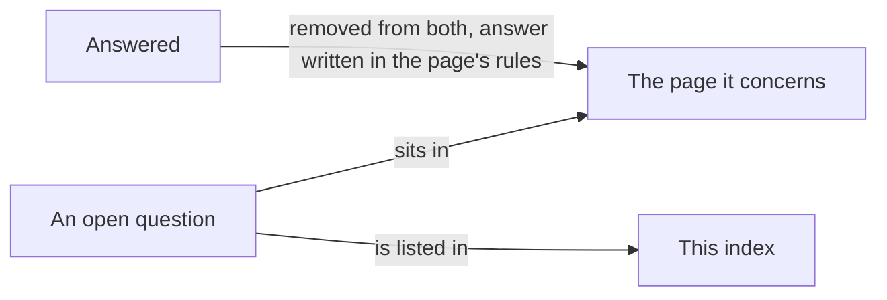

# Symbols: open questions

> [Home](../README.md) › [Symbols](README.md) › Open questions · Previous: [Run mode](09-run-mode/README.md) · Next: [Enums of a Symbol Lib](11-enums-of-a-symbol-lib.md)

Status: draft. Everything in this part is still a draft: these are the questions raised while writing it. Both researches are back (2026-11-11): their answers and opinions are in the pages; what is left is for the Product Owner to decide.

This file is the index of the open questions. A question sits in the file it concerns and is listed here; once answered, it is removed from both and the answer goes in the rules.

## To decide by the Product Owner, after the researches

| Question | Page | Opinion of the research |
| --- | --- | --- |
| Names: Advanced tools, Path, Interaction zone, Preview, Test mode; Layer kept. (Static and dynamic: dropped, one kind of symbol, 2026-11-15.) | [Editor](03-editor/README.md) | Those names. |
| Frame of a symbol; minimum snapping; editor data in one `<metadata>` block; missing features to add now. (Rotation in the panel and layout guides: decided 2026-11-25.) | [Editor](03-editor/README.md) | See the page. |
| Mirror of a shape; rotation of a group and its children. | [Geometry](04-drawing-mode/geometry.md) | Mirror recomputed in the points. |
| Grid of cells W × H or squares only (doubt of 2026-11-25); grid with columns and gutters; guides in percent. (Placement from the line of a guide, the eye: settled on 2026-11-25.) | [Layout guides](03-editor/layout-guides.md) | — |
| Desktop window; does "all in JavaScript" allow a shell in Rust? Browsers to hold at 8.3 ms; effect suspended during a gesture; colour filter or recomputed colours; after the POC, which effects are kept and how each is set. (Every effect of SVG and CSS tried in the POC, none refused beforehand: 2026-11-25.) | [Effects](04-drawing-mode/effects-and-masks.md) | Electron, and the installed web app first. |
| Native stroke for a plain "middle" border or every border computed; dashes of shape borders computed like pipes; named colours and a "high-performance" palette; after the POC, pattern, image and conic gradient kept as kinds of fill. (Dash sequences of coloured segments: decided 2026-11-11. Open paths with the three positions, no caps, no joins; several fills; pattern, image, conic to the POC: decided 2026-11-25.) | [Fill and border](04-drawing-mode/fill-and-border.md), [Paints](04-drawing-mode/paints.md) | Yes to colours. |
| OFL fonts embedded whole. (Text border kept, as a true stroke: decided 2026-11-25.) | [Text tool](04-drawing-mode/text.md) | Yes. |
| Third polygon mode "like Figma"; anchors on corners reserved to 3 and 4 sides or another meaning. | [Polygon](04-drawing-mode/polygon.md) | Drop the third mode. |
| Modifier keys (square, from the centre, angle lock). "Entirely enclosed" is settled: Alt. | [Select](03-editor/select.md), [Rectangle](04-drawing-mode/rectangle.md), [Pen](04-drawing-mode/pen.md) | Conventions written; key conflicts not researched. |
| Free form: options of the former shape; points list. | [Point editing mode](05-point-editing-mode/README.md) | Drop the options of the former shape; list the selected shapes. |
| Anchors on a real shape; distribution with equal spacing; one anchor for all the shapes to place or one each. | [Alignment mode](06-alignment-mode/README.md), [Anchors](03-editor/anchors.md) | Centre plus eight points on the outline; add the distribution. |
| Boolean operations and duplication rules. | [Boolean operations](03-editor/expert-menu/boolean-operations.md), [Placement and duplication](03-editor/expert-menu/placement-and-duplication.md) | Four operations; polar, along a path, grid. |
| Gesture list; names Interaction, Gesture, Effect; feedback, "disabled when", confirmation, keyboard. | [Interaction mode](07-interaction-mode/README.md) | Short list; those names; write them here. |
| Animatable properties, shapes of mapping, blinking bounded, quality of a value, number format. (Enum: the columns of the Symbol Lib replace the state table, 2026-11-17.) | [Animation mode](08-animation-mode/README.md) | See the page. |
| Kinds of value of a column; an item without value; what a deleted column breaks; a value or a named colour; the memory of earlier kinds as a part of the undo history. (Where the page opens from and how a column is added, named and typed: settled at the end of 2026-11-17; what the next blocks repeat, the values of a column whose kind changes (nothing converted, no notice) and a column deleted at once: settled on 2026-11-23.) | [Enums of a Symbol Lib](11-enums-of-a-symbol-lib.md) | Not researched (2026-11-17). |
| **Text that becomes an input: HTML field laid over the text instead of a `foreignObject`.** The text writes an input signal directly, without a command (decision 0014). | [Animation mode](08-animation-mode/README.md) | HTML field over the text: proposed in decision 0006, settled after POC P12. |
| Do the signals carry a quality in the contract with the model? | [Animation mode](08-animation-mode/README.md) | Yes, shown by default. |
| Name "Test mode"; form of the simulation log and of the simulated faceplate; the signals used as bounds of an animation listed with the test values. | [Run mode](09-run-mode/README.md) | Test mode; a log line: time, place, gesture, effect, value; bound signals listed, inputs included. |
| A bound of a bounded linear animation typed as a number, besides a signal in or out. | [Animation mode](08-animation-mode/README.md#the-input-range-of-a-bounded-linear-animation) | Yes: assistant's reading, to confirm. |
| A pipe that ends on another pipe of another style: a branch of it, or two pipes that meet. (Junctions, crossings and ends inside the pipe style; symbol connected to a pipe: decided 2026-11-11. One pipe as a tree, no path kind per pipe, the name Preview: settled on 2026-11-23.) | [Junctions](pipes/junctions.md) | Two pipes that meet. |
| Symbol connected to a pipe: which symbols, pipe cut under it or not, how its position is kept, what happens when the pipe changes. | [Pipes in the synoptic](pipes/in-the-synoptic.md) | Two connection points, pipe continuous under it (archived Figma page). |
| The enum `pipe_style`: an item a Symbol Lib has not styled yet; the properties of a pipe style an animation can take; a signal choosing the style of a pipe; what the dashes do with an item added to `pipe_direction`. (A global built-in enum named `pipe_style`, items added by the user to every built-in enum and base items never removed, key, display name and description in the enum, read-only on the Pipes page, no + there but a link to the enum in Metadata, each Symbol Lib drawing each item as it wants, no base item but a default copy in the user's configuration with Water alone, deletable, written at the very first start only and never put back: settled on 2026-11-24, decision 0099.) | [The enum pipe_style](pipes/pipe-styles.md#the-enum-pipe_style), [Built-in enums](../metadata/draft.md#built-in-enums) | Not researched. |
| Properties a signal can drive on a pipe style; branches sharing the values of their pipe, or a branch with its own; unit of the speed of the moving dashes; global stop and "reduce motion"; to discuss again (doubt of 2026-11-24): the direction as a number (−1, 0, 1, 0.5…) multiplying the speed instead of the enum `pipe_direction`. (Direction chosen in a list or given by a signal picked in its field; section Movement always shown, even without a type; Corners in the second column; no crossing size shown; the same preview for the base and every style: settled on 2026-11-24. A type and a movement on the base too, overridden by a pipe style with a reset, like the body and border widths, a style that overrides the type overriding its movement; no border on or off, width 0 for none; the speed field picks its signal with an icon inside; read-only base values in a style; the base first in the list: settled on 2026-11-24, decision 0097. Movement from one direction signal of three values, "stopped" included, no on or off; same sections for base and styles; junction size for a circle or a square only: settled on 2026-11-24. Base style without colour, fills in the pipe styles, the name "Pipe style" kept: settled on 2026-11-23. Dash sequences, computed dashes, propagation at junctions, optional type on a pipe style: decided 2026-11-11.) | [Pipe styles](pipes/pipe-styles.md) | Global stop and "reduce motion": yes. |
| Formula of the size of bridges and gaps from the body widths (no size setting: settled on 2026-11-24); default "last drawn on top"; borders on a bridge. | [Crossings](pipes/crossings.md) | Last drawn on top. |
| Arrows of a line drawn in a symbol: markers of the line, or nothing (markers proposed for the POC, 2026-11-25, see [Lines and text](04-drawing-mode/effects-lines-and-text.md#arrow-heads)). (No end shapes on pipes: an arrow or a flange at the end of a pipe is a symbol, settled on 2026-11-24, decision 0098.) | [Fill and border](04-drawing-mode/fill-and-border.md) | One concept for lines and pipes; pipes now use symbols. |

## Raised by the review of 2026-11-15

| Question | Page | Proposal of the assistant |
| --- | --- | --- |
| Thumbnail of a symbol in the list: the symbol itself, or its outlines only; what else an item shows. | [Libraries and symbols](01-libraries-and-symbols.md) | Outlines only, as Figma's outline view, with the name. |
| Look of the Interaction, Animation and Run modes before a type is chosen. | [Libraries and symbols](01-libraries-and-symbols.md) | Greyed in the mode menu, with a tooltip "choose a type first". |
| Place of the floating tool bar: bottom or top of the drawing area. | [Editor](03-editor/README.md) | Bottom, centred. |
| Key and ratio of the precise move; does it also apply to whole shapes. | [Precise move](03-editor/precise-move.md) | See the page. |
| What a line of the layer tree shows besides its name (lock, hide, icon of its kind). | [Layers](03-editor/layers.md) | Icon of the kind, name, hide, lock. |

## Raised by the review of 2026-11-16

| Question | Page | Proposal of the assistant |
| --- | --- | --- |
| A Symbol Lib in the navigation bar shows two letters of its name (decided, 2026-11-23): are three letters too many; how the letters are taken from the name. | [Libraries and symbols](01-libraries-and-symbols.md#navigation-bar-of-the-symbol-mode) | Two letters: the first letter of the first two words, or the first two letters of a one-word name; the name on hover. |
| The General page of a Symbol Lib: what it shows besides the name and the deletion (the deletion takes the symbols and the pipe styles: decided, 2026-11-23). | [Libraries and symbols](01-libraries-and-symbols.md#general-page-of-a-symbol-lib) | The name only. |
| What the symbol mode shows when there is no Symbol Lib yet. | [Libraries and symbols](01-libraries-and-symbols.md#navigation-bar-of-the-symbol-mode) | The bar with the + only, and an empty page that says to create one. |
| Type choice among all the types: how it stays quick when the tree grows. | [Libraries and symbols](01-libraries-and-symbols.md) | A tree with a search field, as in Metadata. |

## Raised on 2026-11-18

| Question | Page | Proposal of the assistant |
| --- | --- | --- |
| Sub-symbols: what becomes of them when their parent is deleted; where the + sits in the editor. (Decided 2026-11-18: a tree, the parent in the same Symbol Lib, a small + in the tree and in the editor, any type under a parent without a type, every sub-symbol in fault when the parent changes or loses its type, connection points taken, a parent can be deleted.) | [Sub-symbols](12-sub-symbols.md) | Into fault, as for a change of type. |
| The list of faults of the application: what puts a symbol in fault, how it shows, how it is repaired. | [Sub-symbols](12-sub-symbols.md) | Start from the small red mark of a broken link. |

## Raised on 2026-11-24 (fields like Figma)

| Question | Page | Proposal of the assistant |
| --- | --- | --- |
| A gradient in one segment; RGB as a fourth format of the picker; the order of the lines. (Pattern and image: to the POC, 2026-11-25.) (No line, no border; a − and a + instead of a kind "None"; selects instead of radios in every panel; no signal in a size field: settled on 2026-11-24. Eyedropper, hue and opacity sliders, Hex, HSL, HSB: settled on 2026-11-25.) | [Colour field](../controls/colour-field.md), [Segment list](../controls/segment-list.md) | Plain colours only in a segment; no pattern, no image, no RGB; a handle. |

(X and Y: under W and H, settled on 2026-11-25, see [Geometry](04-drawing-mode/geometry.md).)

## Still open, not researched

| Question | Page | Written as |
| --- | --- | --- |
| Key conflicts (Alt and the Linux window managers, Ctrl+G in browsers). | [Editor](03-editor/README.md) | Not found by the research. |
| What can be taken from the symbol standards (ISA-5.1, ISO 14617, EN 60617, ISO 10628) without a copyright problem. | [Pipes](pipes/README.md) | Paid standards, not opened. |
| Options of each entry of the advanced tools, of the alignment panel and of the group (anchors, placement of the children). | [Advanced tools](03-editor/expert-menu/README.md), [Alignment mode](06-alignment-mode/README.md), [Group](04-drawing-mode/group.md) | To describe, page by page. |
| Connection points: which mode places them, their names, the snapping zone. | [Connection points](pipes/connection-points.md) | To describe. |
| What the faceplate opened by an interaction allows once the symbol is placed (display only, or display with commands). | Part 3 | Belongs to the synoptic part, not written yet. |
| How are an unwired symbol with a type, a placed symbol (linked instance) and its scale handled in a synoptic? | Part 3 | Belongs to the synoptic part, not written yet. |

