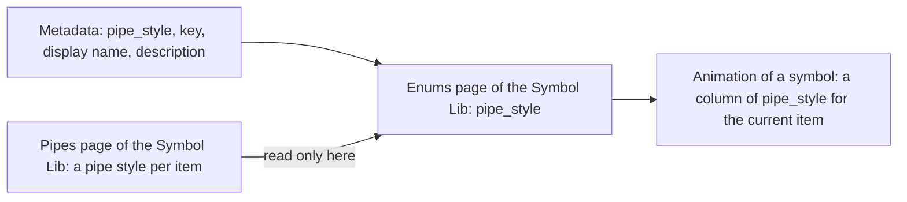
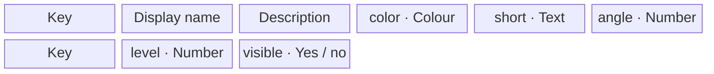
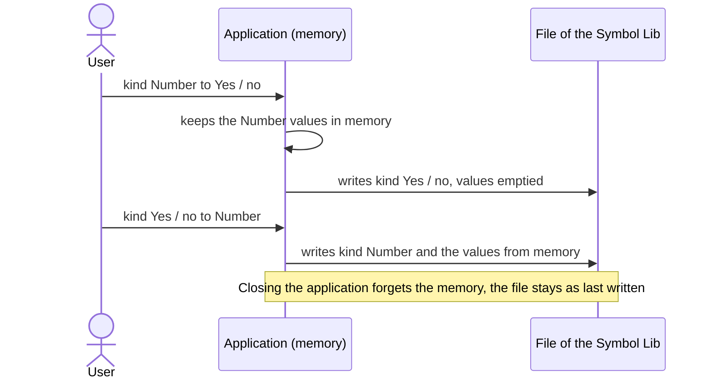
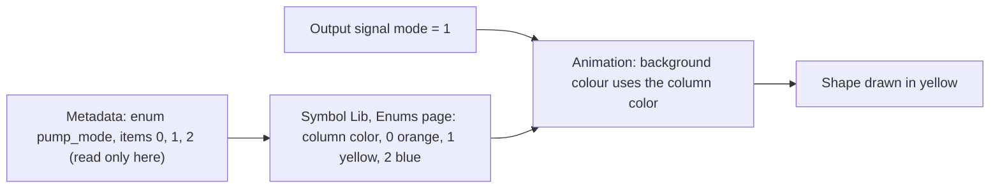

# Enums of a Symbol Lib

> [Home](../README.md) › [Symbols](README.md) › Enums of a Symbol Lib · Previous: [Open questions](10-open-questions.md) · Next: [Sub-symbols](12-sub-symbols.md)

Status: draft. The page and its added columns are carried by decisions 0036, 0090, 0091, 0092 and 0093; its test screens accepted on 2026-11-26, with the four kinds only (decision 0109); the two lists and the read-only columns of `pipe_style` the same day; the assistant's readings below stay to confirm. Not validated. Open points are listed in [Open questions](#open-questions).

Each Symbol Lib has a small **Enums** page. It shows every enum of Metadata, read only, and lets the user add **columns** to them: a colour, a short text, a number... The animations of the symbols of this library then use these columns: when an enum signal changes value, a property of the drawing takes the value of the chosen column for that item.

## Rules

- **One Enums page in each Symbol Lib**. It opens from the navigation bar, as one of the four pages of the selected library (see [Libraries and symbols](01-libraries-and-symbols.md#navigation-bar-of-the-symbol-mode)).
- **It lists every enum of Metadata**, the global enums and the templates (see [Enums](../metadata/draft.md#global-enums-and-templates)), in **two lists**: the **built-in enums** first, under their own title, then the user's **enums** (Product Owner, 2026-11-26: "qu'on sépare bien les deux"), as on the Enums page of Metadata. The list and the selected enum say whether it is **Global** or **Template**, read only (Product Owner, 2026-11-23).
- **What comes from Metadata is read only**: the key, the display name and the description of each item, so that the items can be understood. They are changed in Metadata only. Same columns, same order as on the Enums page of Metadata: Key, Display name, Description (decision 0032).
- **The user adds columns, as many as needed**, with no limit. Each column has:
  - a **name**, chosen freely by the user: `color`, `display name short`...;
  - a **kind of value**, chosen in a list (see [Kinds of value](#kinds-of-value)).
- **For a global enum, the user fills one value per item** in each added column: for `pump_mode`, 0 → orange, 1 → yellow, 2 → blue in the column `color`.
- **For a template, the user adds the columns the same way**, without items, since a template has none in advance. The items of a template are completed on each placed symbol, in the synoptic, with a small warning until they are (see [Enums](../metadata/draft.md#global-enums-and-templates)). The values of these columns are filled there too, with the items (assistant's reading: the question asked both together). Here, a template shows its name and its description, read only, instead of items.
- **The columns belong to the Symbol Lib**, not to Metadata: two Symbol Libs can give the same enum different colours, as they give the same objects a different look (see [Libraries and symbols](01-libraries-and-symbols.md#symbol-lib)). Assistant's reading, to confirm.
- Added columns never go to the model: they only serve the drawing.
- **The built-in enums take added columns too**, like any global enum. `pipe_style` also shows, before them, the values of its pipe styles (see [The built-in enum pipe_style](#the-built-in-enum-pipe_style)).

## The built-in enum pipe_style

On the Enums page of a Symbol Lib, `pipe_style` shows the look this library gives each of its items, so that the look can be used elsewhere, by an animation (Product Owner, 2026-11-26: "comme ça, on peut le réutiliser à d'autres endroits après").

- **After the key, the display name and the description, one column per value of the pipe style** of this library for the item (see [Pipe styles](pipes/pipe-styles.md)), in the order of the sections of a pipe style:

| Column | Value shown | From |
| --- | --- | --- |
| Body width | The fixed width of the style, in px | Its own or the base's |
| Border width | The fixed width of the border, in px | Its own or the base's |
| Corner radius | The base's | The base |
| Junction size | The base's | The base |
| Direction | The direction chosen in the list, or the signal that gives it | Its own or the base's |
| Speed | The fixed speed in px/s, or the signal that gives it | Its own or the base's |
| Body fill | Its colour, or its dash sequence | Its own |
| Border fill | Its colours, stacked | Its own |

- **These columns are not added by the user** and cannot be deleted: they come with the pipe styles. More may come with them ("tout ce qui pourrait être utilisé après").
- **Their values are read only here** and changed on the Pipes page only, where a small link leads (Product Owner, 2026-11-26).
- **They follow the rules of the blocks** like the added columns: those that do not fit go to a block below, which repeats the Key (see [When the columns do not fit](#when-the-columns-do-not-fit)).
- **Added columns come after them**, under their own title "Columns", as for any enum.

## Added columns

- **The + of the title "Columns" adds a column at once**, at the end of the last block, without a form; the same for a global enum as for a template (decision 0091).
- **A column just added is a Text column** (Product Owner, 2026-11-23, later the same day, replacing "Choose a kind"):
  - its name field takes the focus, empty;
  - its kind select shows Text, changed like any kind;
  - its values are empty text fields, ready to fill.
- **The header of an added column always holds, from top to bottom** (decision 0091):
  - a **delete icon** (a bin), on the right, which removes the column;
  - the **name**, a text field;
  - the **kind of value**, a select of the [kinds](#kinds-of-value).
- **The name and the kind are changed at any time, right in the header**, without opening a menu or a form.
- Changing the kind of a column that has values: see [Changing the kind](#changing-the-kind).
- **Deleting a column** is done at once, with no confirmation: the undo history takes it back (decision 0093; see [Files and conflicts](../storage/files-and-conflicts.md#undo-history)).
- **The order of the columns does not change**: no handle.
- **A template shows its columns and one example line**: it has no items here; under the headers, **one line, read only, gives an example value for the kind of each column**, so that the kind chosen is seen at once (Product Owner, 2026-11-26: "en fonction du type qu'on met, il y a un exemple qui est mis"). Its Key, Display name and Description say "Example"; its name, its kind and its description are shown read only above the table.

| Kind of the column | Example value shown |
| --- | --- |
| Colour | A swatch `D32F2F │ 100 %` |
| Text | `OFF` |
| Number | `90` |
| Yes / no | A tick |

## When the columns do not fit

The table never lacks room: the columns go to the next line, like words in a paragraph (decision 0091).

- **No column is narrowed** below the width its header needs (the bin, the name field and the kind select), and **the table never scrolls sideways**.
- **The added column that does not fit** in the width of the page **starts a new block below**. The columns read left to right, then block by block, top to bottom.
- **Display name and Description are shown in the first block only.**
- **Each block after the first repeats the Key alone**, read only, so that each line is known (Product Owner, 2026-11-23).
- **Every block has the same lines, in the same order**: the line of an item is at the same rank in each block.
- **The blocks follow the width of the window**: wider, a column goes back up to the block above; narrower, it goes down.

The enum `pump_mode` with five added columns, in a page too narrow for them all: the first three fit beside Description, the last two go to a second block that repeats the Key.

## Kinds of value

The kind of a column is **a kind of animation, not a type of the model** (Product Owner, 2026-11-23): it says which properties of the drawing the column can drive (see [Properties a signal can drive](08-animation-mode/README.md#properties-a-signal-can-drive)).

| Kind | A value | Drives | Status |
| --- | --- | --- | --- |
| Colour | Red, green, blue and opacity (RGBA), written `#RRGGBB` with an opacity in % | Fill, border, text colour | Decided |
| Text | A short text | The content of a text of the symbol | Decided |
| Number | A decimal number, without unit | Rotation (degrees), position, opacity, fill level | Decided |
| Yes / no | A tick | Visibility, blinking | Decided |

**Only these four kinds** (Product Owner, 2026-11-23, decision 0090). The three kinds the assistant proposed on 2026-11-26 (Symbol, Pipe style, Flow direction) are refused: the list stays at four (Product Owner, 2026-11-26, decision 0109).

## Changing the kind

The kind of a filled column can change at any time without losing work: the new kind starts again from empty values, and the values of an earlier kind come back when the user chooses it again while the application is open (Product Owner, 2026-11-23, decision 0092).

- **Nothing is converted**: the new kind starts with empty values, or with the values the column last had under that kind.
- **The application remembers the values of every kind the column had**, while it runs: choosing an earlier kind again gives back the values the column last had under it. The user can switch, test and go back as often as needed.
- **This memory is never written to the file**: the file holds the current kind and its values only, written at each change, like every change (see [Files and conflicts](../storage/files-and-conflicts.md#saving)).
- **Closing the application forgets the memory**; reopening shows what the file holds.
- **The change shows nothing**: no warning, no notice (decision 0093).

The column `level` of `pump_mode` goes from Number to Yes / no, then back to Number in the same session.

## Used by an animation

- In the [Animation mode](08-animation-mode/README.md), the user picks an output signal of the type enum, then a property of the drawing (background colour, text...), then **the column of the enum** that gives its value.
- When the signal changes value, the property takes the value of that column for the new item.
- Only a column whose kind fits the property is offered: a colour column for a colour, a text column for a text, a number column for a size or an angle (assistant's reading).

## Example

The enum `pump_mode` on the Enums page of the Symbol Lib "Plant A". The first three columns come from Metadata, read only; the last two were added in this library. The values are made up for the example.

| Key | Display name | Description | color (colour) | display name short (text) |
| --- | --- | --- | --- | --- |
| 0 | Off | The pump is stopped. | orange | OFF |
| 1 | Manual | An operator drives the pump. | yellow | MAN |
| 2 | Automatic | The control loop drives the pump. | blue | AUTO |

In the symbol of a pump, an animation gives the body of the pump the colour of the column `color` of the signal `mode`, and a text shows its column `display name short`.

## Where it is used

| Thing | Created and changed in | Used in | In a symbol | In a synoptic |
| --- | --- | --- | --- | --- |
| Key, display name, description of an item | Metadata, Enums page | Shown read only here | No | No |
| Column of `pipe_style` from its pipe styles | Pipes page of the Symbol Lib | Shown read only here; animations of the symbols of this library | Chosen by an animation | No |
| Added column (name, kind of value) | Enums page of a Symbol Lib, in the header of the column | Animations of the symbols of this library | Chosen by an animation | No |
| Value of an added column, global enum | Enums page of a Symbol Lib | Animations | Shown through the animation | No |
| Values of a column under its earlier kinds | Kept by the application while it runs, never in the file | Given back when an earlier kind is chosen again | No | No |
| Name and description of a template | Metadata, Enums page | Shown read only here | No | No |
| Value of an added column, template | On each placed symbol, with the items of the template | Animations | Shown through the animation | Filled for each placed symbol; a small warning until the template is completed |

## Open questions

Noted, not to be asked now: they come up at the review of the part.

- Is a number always without unit (an angle in degrees, a position in px)?
- Is the memory of the earlier kinds a part of the undo history (decision 0093)?
- More about the name of a column may come (said with a doubt).
- An item added later in Metadata: its added columns are empty; what does the animation show then (a default value per column)?
- Deleting a column used by an animation breaks it, with the small red mark (see [What breaks a link](01-libraries-and-symbols.md#what-breaks-a-link)): to confirm.
- Does a column hold a value, or a link to a named colour of the Symbol Lib (proposed by the research, see [Fill and border](04-drawing-mode/fill-and-border.md))?
- Does `pipe_direction`, the other built-in enum, show values of its own here?
