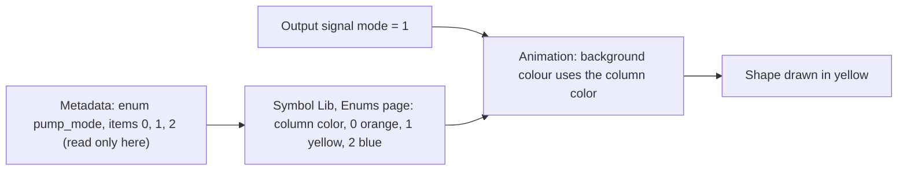

# Enums of a Symbol Lib

> [Home](../README.md) › [Symbols](README.md) › Enums of a Symbol Lib · Previous: [Open questions](10-open-questions.md) · Next: [Sub-symbols](12-sub-symbols.md)

Status: draft, from the Product Owner's description of 2026-11-17, completed at the end of the day (templates completed on each placed symbol; the page in the navigation bar; how a column is added, named, typed and deleted). The page and its added columns are carried by decision 0036 (accepted on 2026-11-17); the assistant's readings below stay to confirm. Not validated. Open points are listed in [Open questions](#open-questions).

Each Symbol Lib has a small **Enums** page. It shows every enum of Metadata, read only, and lets the user add **columns** to them: a colour, a short text, a number... The animations of the symbols of this library then use these columns: when an enum signal changes value, a property of the drawing takes the value of the chosen column for that item.

## Rules

- **One Enums page in each Symbol Lib** (Product Owner, 2026-11-17: "dans chaque lib, tu auras une petite page enum"). It opens from the navigation bar, as the second page of the selected library, after General (Product Owner, end of 2026-11-17; see [Libraries and symbols](01-libraries-and-symbols.md#navigation-bar-of-the-symbol-mode)).
- **It lists every enum of Metadata**, the global enums and the templates (see [Enums](../metadata/draft.md#global-enums-and-templates)).
- **What comes from Metadata is read only**: the key, the display text and the description of each item, "pour qu'on puisse comprendre". They are changed in Metadata only. Same columns, same order as on the Enums page of Metadata: Key, Display text, Description (decision 0032).
- **The user adds columns, as many as needed** ("pas un peu, à l'infini"). Each column has:
  - a **title**, chosen by the user ("on donne le titre qu'on veut"): `color`, `display text short`...;
  - a **kind of value**, chosen in a list: colour, text, number (the Product Owner's examples; "peu importe", the full list is open).
- **For a global enum, the user fills one value per item** in each added column: for `pump_mode`, 0 → orange, 1 → yellow, 2 → blue in the column `color`.
- **For a template, the user adds the columns the same way**, without items, since a template has none in advance ("on va pas définir en avance, mais au moins, on va pouvoir définir les colonnes qu'on veut en plus par rapport au template"). The items of a template are completed on each placed symbol, in the synoptic, with a small warning until they are (Product Owner, end of 2026-11-17, see [Enums](../metadata/draft.md#global-enums-and-templates)). The values of these columns are filled there too, with the items (assistant's reading: the question asked both together). Here, a template shows its name and its description, read only, instead of items.
- **The columns belong to the Symbol Lib**, not to Metadata: two Symbol Libs can give the same enum different colours, as they give the same objects a different look (see [Libraries and symbols](01-libraries-and-symbols.md#symbol-lib)). Assistant's reading of "dans chaque lib", to confirm.
- Added columns never go to the model: they only serve the drawing.

## Added columns

Said by the Product Owner at the end of 2026-11-17.

- **A new column is empty, with a default name.** Its name is a field always visible in the header of the column, edited at any time.
- **A column can be added and deleted.** Its name can be changed. **The order of the columns does not change**: no handle ("Est-ce qu'il faut pouvoir le modifier ? Non, je pense pas. Je pense juste pouvoir en rajouter, en supprimer").
- **Global enum: the first value chooses the kind of the column.** On the first value of a column, the user picks the kind of value (colour, text, number...); the other values of the column then have that kind ("en fonction du premier type que tu choisis, ça va définir les autres types, et point barre").
- **Template: a small icon in the header chooses the kind.** A template has no items here, so no first value: the header of each column has a small icon that picks its kind. With a template, the user adds a column, names it and picks the kind of value it will hold.

## Used by an animation

- In the [Animation mode](08-animation-mode/README.md), the user picks an output signal of the type enum, then a property of the drawing (background colour, text...), then **the column of the enum** that gives its value (Product Owner: "son background color utilise la propriété color de l'enum qu'on a créé côté symbole").
- When the signal changes value, the property takes the value of that column for the new item.
- Only a column whose kind fits the property is offered: a colour column for a colour, a text column for a text, a number column for a size or an angle (assistant's reading).

## Example

The enum `pump_mode` on the Enums page of the Symbol Lib "Plant A". The first three columns come from Metadata, read only; the last two were added in this library. The values are made up for the example.

| Key | Display text | Description | color (colour) | display text short (text) |
| --- | --- | --- | --- | --- |
| 0 | Off | The pump is stopped. | orange | OFF |
| 1 | Manual | An operator drives the pump. | yellow | MAN |
| 2 | Automatic | The control loop drives the pump. | blue | AUTO |

In the symbol of a pump, an animation gives the body of the pump the colour of the column `color` of the signal `mode`, and a text shows its column `display text short`.

## Where it is used

| Thing | Created and changed in | Used in | In a symbol | In a synoptic |
| --- | --- | --- | --- | --- |
| Key, display text, description of an item | Metadata, Enums page | Shown read only here | No | No |
| Added column (title, kind of value) | Enums page of a Symbol Lib | Animations of the symbols of this library | Chosen by an animation | No |
| Value of an added column, global enum | Enums page of a Symbol Lib | Animations | Shown through the animation | No |
| Name and description of a template | Metadata, Enums page | Shown read only here | No | No |
| Value of an added column, template | On each placed symbol, with the items of the template | Animations | Shown through the animation | Filled for each placed symbol; a small warning until the template is completed |

## Open questions

Noted, not to be asked again in the chat (Product Owner, end of 2026-11-17): they will come up when the Product Owner gets to them.

- The full list of the kinds of value of a column: colour, text, number; and boolean, icon, a layer to show?
- An item added later in Metadata: its added columns are empty; what does the animation show then (a default value per column)?
- Deleting a column used by an animation breaks it, with the small red mark (see [What breaks a link](01-libraries-and-symbols.md#what-breaks-a-link)): to confirm.
- Does a column hold a value, or a link to a named colour of the Symbol Lib (proposed by the research, see [Fill and border](04-drawing-mode/fill-and-border.md))?
