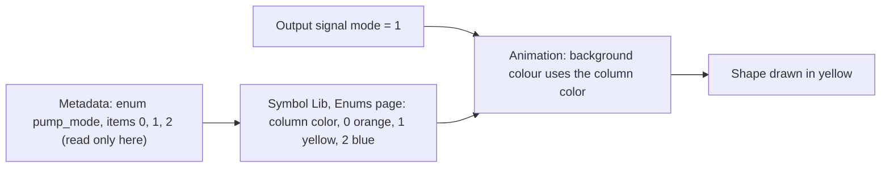

# Enums of a Symbol Lib

> [Home](../README.md) › [Symbols](README.md) › Enums of a Symbol Lib · Previous: [Open questions](10-open-questions.md) · Next: [Sub-symbols](12-sub-symbols.md)

Status: draft. The page and its added columns are carried by decisions 0036 and 0090; the assistant's readings below stay to confirm. Not validated. Open points are listed in [Open questions](#open-questions).

Each Symbol Lib has a small **Enums** page. It shows every enum of Metadata, read only, and lets the user add **columns** to them: a colour, a short text, a number... The animations of the symbols of this library then use these columns: when an enum signal changes value, a property of the drawing takes the value of the chosen column for that item.

## Rules

- **One Enums page in each Symbol Lib**. It opens from the navigation bar, as one of the four pages of the selected library (see [Libraries and symbols](01-libraries-and-symbols.md#navigation-bar-of-the-symbol-mode)).
- **It lists every enum of Metadata**, the global enums and the templates (see [Enums](../metadata/draft.md#global-enums-and-templates)). The list and the selected enum say whether it is **Global** or **Template**, read only (Product Owner, 2026-11-23).
- **What comes from Metadata is read only**: the key, the display name and the description of each item, so that the items can be understood. They are changed in Metadata only. Same columns, same order as on the Enums page of Metadata: Key, Display name, Description (decision 0032).
- **The user adds columns, as many as needed**, with no limit. Each column has:
  - a **title**, chosen freely by the user: `color`, `display name short`...;
  - a **kind of value**, chosen in a list (see [Kinds of value](#kinds-of-value)).
- **For a global enum, the user fills one value per item** in each added column: for `pump_mode`, 0 → orange, 1 → yellow, 2 → blue in the column `color`.
- **For a template, the user adds the columns the same way**, without items, since a template has none in advance. The items of a template are completed on each placed symbol, in the synoptic, with a small warning until they are (see [Enums](../metadata/draft.md#global-enums-and-templates)). The values of these columns are filled there too, with the items (assistant's reading: the question asked both together). Here, a template shows its name and its description, read only, instead of items.
- **The columns belong to the Symbol Lib**, not to Metadata: two Symbol Libs can give the same enum different colours, as they give the same objects a different look (see [Libraries and symbols](01-libraries-and-symbols.md#symbol-lib)). Assistant's reading, to confirm.
- Added columns never go to the model: they only serve the drawing.

## Added columns

- **Adding a column asks its name and its kind of value**, together, for a global enum as for a template (Product Owner, 2026-11-23; decision 0090). The + of the title "Columns" opens a small form: a name field, a select of the kinds, and Add. The new column is empty.
- **The header of a column shows its name and its kind.** The name is a field always visible in the header, edited at any time.
- **A column can be deleted.** **The order of the columns does not change**: no handle.
- Changing the kind of a column afterwards: open. Proposed: possible, but its values are emptied, after a warning when there are some.
- **A template shows only its columns**: it has no items here, so the table has its headers and no lines; its name, its kind and its description are shown read only.

## Kinds of value

The kind of a column is **a kind of animation, not a type of the model** (Product Owner, 2026-11-23): it says which properties of the drawing the column can drive (see [Properties a signal can drive](08-animation-mode/README.md#properties-a-signal-can-drive)).

| Kind | A value | Drives | Status |
| --- | --- | --- | --- |
| Colour | Red, green, blue and opacity (RGBA), written `#RRGGBB` with an opacity in % | Fill, border, text colour | Decided (colour), Proposed (RGBA) |
| Text | A short text | The content of a text of the symbol | Decided |
| Number | A decimal number, without unit | Rotation (degrees), position, opacity, fill level | Decided |
| Yes / no | A tick | Visibility, blinking | Proposed |

The list stays open to more kinds (a sub-symbol to show, a named colour of the Symbol Lib): see [Open questions](#open-questions).

## Used by an animation

- In the [Animation mode](08-animation-mode/README.md), the user picks an output signal of the type enum, then a property of the drawing (background colour, text...), then **the column of the enum** that gives its value.
- When the signal changes value, the property takes the value of that column for the new item.
- Only a column whose kind fits the property is offered: a colour column for a colour, a text column for a text, a number column for a size or an angle (assistant's reading).

## Example

The enum `pump_mode` on the Enums page of the Symbol Lib "Plant A". The first three columns come from Metadata, read only; the last two were added in this library. The values are made up for the example.

| Key | Display name | Description | color (colour) | display name short (text) |
| --- | --- | --- | --- | --- |
| 0 | Off | The pump is stopped. | orange | OFF |
| 1 | Manual | An operator drives the pump. | yellow | MAN |
| 2 | Automatic | The control loop drives the pump. | blue | AUTO |

In the symbol of a pump, an animation gives the body of the pump the colour of the column `color` of the signal `mode`, and a text shows its column `display name short`.

## Where it is used

| Thing | Created and changed in | Used in | In a symbol | In a synoptic |
| --- | --- | --- | --- | --- |
| Key, display name, description of an item | Metadata, Enums page | Shown read only here | No | No |
| Added column (title, kind of value) | Enums page of a Symbol Lib | Animations of the symbols of this library | Chosen by an animation | No |
| Value of an added column, global enum | Enums page of a Symbol Lib | Animations | Shown through the animation | No |
| Name and description of a template | Metadata, Enums page | Shown read only here | No | No |
| Value of an added column, template | On each placed symbol, with the items of the template | Animations | Shown through the animation | Filled for each placed symbol; a small warning until the template is completed |

## Open questions

Noted, not to be asked now: they come up at the review of the part.

- More kinds of value: a sub-symbol or a layer to show? Is a number always without unit (an angle in degrees, a position in px)?
- Changing the kind of a column that has values: allowed with a warning that empties it, or refused?
- An item added later in Metadata: its added columns are empty; what does the animation show then (a default value per column)?
- Deleting a column used by an animation breaks it, with the small red mark (see [What breaks a link](01-libraries-and-symbols.md#what-breaks-a-link)): to confirm.
- Does a column hold a value, or a link to a named colour of the Symbol Lib (proposed by the research, see [Fill and border](04-drawing-mode/fill-and-border.md))?
