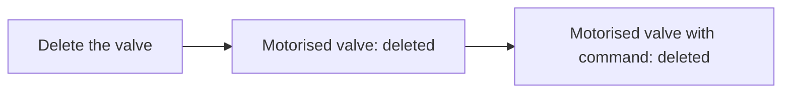
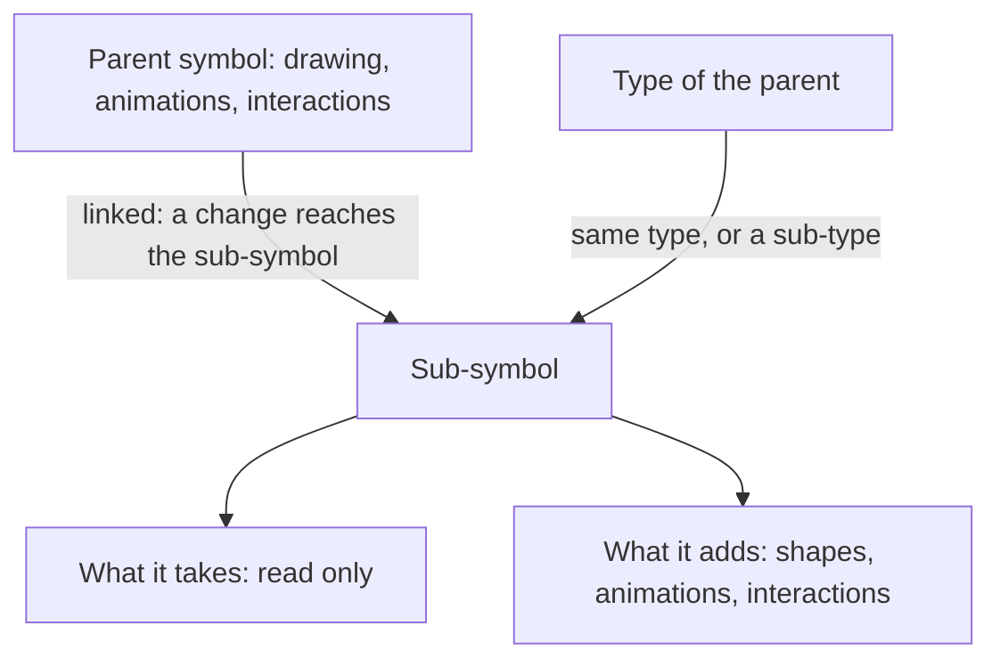
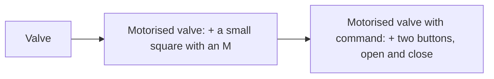

# Sub-symbols

> [Home](../README.md) › [Symbols](README.md) › Sub-symbols · Previous: [Enums of a Symbol Lib](11-enums-of-a-symbol-lib.md)

Status: draft (decision 0044). Not validated. Open points are listed in [Open questions](#open-questions).

A symbol can have a **parent symbol**, as a type of Metadata has a parent type (see [Types](../metadata/draft.md#types)). A **sub-symbol** starts from everything made for its parent, and the user adds more on top of it.

## Rules

- A symbol can be created as a sub-symbol of another symbol: its parent.
- A sub-symbol takes what was made for its parent symbol, then the user adds to it: shapes, and the links of these shapes to the signals and commands.
- A sub-symbol can itself have sub-symbols: the example below has three levels.
- **The changes of the parent reach its sub-symbols**: a sub-symbol is linked to its parent, never a copy made once. The valve is corrected once, and the motorised valve and the motorised valve with command follow. It is the inheritance of Metadata, applied to symbols.
- **A sub-symbol only adds**: what it takes from its parent is read only in it, as the inherited signals of a type are (see [Signals](../metadata/draft.md#the-table-of-signals)). It cannot change it, move it or hide it. To change it, the user opens the parent.
- **Its type is the type of its parent, or a sub-type of it**. So the animations and interactions taken from the parent keep their signals and commands. In the example, the motorised valve with command can have a sub-type of the valve's type that adds the commands open and close.
- **It takes everything from its parent**: the drawing, the animations, the interactions and the **connection points** of its pipes (the preset is gone since 2026-11-24). If the parent already has a type, the sub-symbol can only take the same type or a sub-type. It can only add things.
- Assistant's reading, to confirm: "everything" is what was made for the symbol, its drawing and what is linked to it.

### The list of symbols becomes a tree

- **The list of symbols of a Symbol Lib is a tree, as in Metadata**: a sub-symbol sits under its parent. It replaces the flat list decided on 2026-11-11 (decision 0045, accepted on 2026-11-18, which changes decision 0010). The list of pipe styles stays flat.
- **The parent is always in the same Symbol Lib** as its sub-symbol.

### Creating a sub-symbol

- With a **small +**, on the same principle as the types of Metadata (see [Types](../metadata/draft.md#types)):
  - **from the list**: the + on the right of a symbol, when the mouse is over it, creates a sub-symbol of it;
  - **from the parent open in the editor**: a + creates a sub-symbol of the open symbol (where it sits in the editor: open).

### The type of a sub-symbol

- **Parent with a type**: the sub-symbol has the same type or a sub-type of it (decision 0044).
- **Parent without a type**: the sub-symbol can take **any type**, since there is nothing to keep.
- **The parent changes type, or loses it**: **every sub-symbol goes into fault, and the application says so**. Nothing is repaired by itself. How a fault shows and how the user repairs it come with the list of faults (see [Open questions](#open-questions)).

### Deleting a parent

- **A parent that has sub-symbols can be deleted**.
- **Its sub-symbols are deleted with it**, at every level below it (decision 0046, accepted on 2026-11-18). In the example, deleting the valve deletes the motorised valve and the motorised valve with command.

## Example

An example: each level is the one above, plus what it adds.

| Symbol | Parent | What it adds |
| --- | --- | --- |
| Valve | none | The drawing of the valve. |
| Motorised valve | Valve | A small square with an M inside. |
| Motorised valve with command | Motorised valve | Two buttons: open and close, linked to the commands of its type. |

## Where it is used

| Thing | Created and changed in | In a symbol | In a synoptic |
| --- | --- | --- | --- |
| Parent of a symbol | Symbol mode | Set at creation, by the small + of the parent (in the tree or in the editor) | To settle (part 3) |

## Open questions

Left for the review of the Symbols part: they are settled then, and not asked before. The assistant's reading of what a sub-symbol takes also waits for that review.

- **The list of faults.** A sub-symbol goes into fault when its parent changes type or loses it. The list of every fault of the application is to write: what puts a symbol in fault, how it shows (the small red mark of a broken link?), how it is repaired.
- **Deleting a parent:** does the delete warn first and name the sub-symbols it deletes with it, as the deletes of Metadata warn? Not said yet.
- **The + in the editor:** where it sits.
- The parent is in the same Symbol Lib: assistant's reading, kept for the review of the Symbols part.
