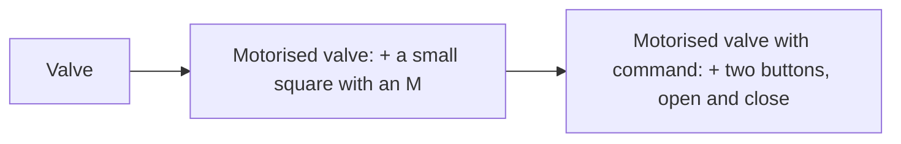

# Sub-symbols

> [Home](../README.md) › [Symbols](README.md) › Sub-symbols · Previous: [Enums of a Symbol Lib](11-enums-of-a-symbol-lib.md)

Status: draft, from the Product Owner's description of 2026-11-18. Only the principle is settled; how it works is open (see [Open questions](#open-questions)). Not validated.

A symbol can have a **parent symbol**, as a type of Metadata has a parent type (see [Types](../metadata/01-types.md)). A **sub-symbol** starts from everything made for its parent, and the user adds more on top of it (Product Owner, 2026-11-18: "t'as un symbole parent et tu peux créer un sous-symbole [...] ça prend [ce] qui a été fait pour le symbole, et tu peux rajouter [...] en plus").

## Rules

- A symbol can be created as a sub-symbol of another symbol: its parent.
- A sub-symbol takes what was made for its parent symbol, then the user adds to it: shapes, and the links of these shapes to the signals and commands (Product Owner, 2026-11-18).
- A sub-symbol can itself have sub-symbols: the example below has three levels (Product Owner, 2026-11-18).
- Assistant's reading, to confirm: the dictated message says "ça prend l'IA qui a été faite pour le symbole"; "l'IA" is read as what was made for the symbol, its drawing and what is linked to it.

## Example

The Product Owner's example (2026-11-18): each level is the one above, plus what it adds.

| Symbol | Parent | What it adds |
| --- | --- | --- |
| Valve | none | The drawing of the valve. |
| Motorised valve | Valve | A small square with an M inside. |
| Motorised valve with command | Motorised valve | Two buttons: open and close. |

## Where it is used

| Thing | Created and changed in | In a symbol | In a synoptic |
| --- | --- | --- | --- |
| Parent of a symbol | Symbol mode | Choose at creation (how: open) | To settle (part 3) |

## Open questions

- When the parent symbol changes, do its sub-symbols follow the change, or does a sub-symbol only copy its parent when it is created?
- Can a sub-symbol change or hide what it takes from its parent, or only add to it?
- Which type can a sub-symbol have: the type of its parent or one of its sub-types, or any type? The open and close buttons of the example need commands the valve's type may not have.
- The list of symbols of a Symbol Lib is flat, never a tree (decided on 2026-11-11). Does it become a tree, as in Metadata, or does it stay flat, the parent shown elsewhere?
- Can the parent be in another Symbol Lib?
- How a sub-symbol is created (from the list, from the parent symbol open in the editor...).
