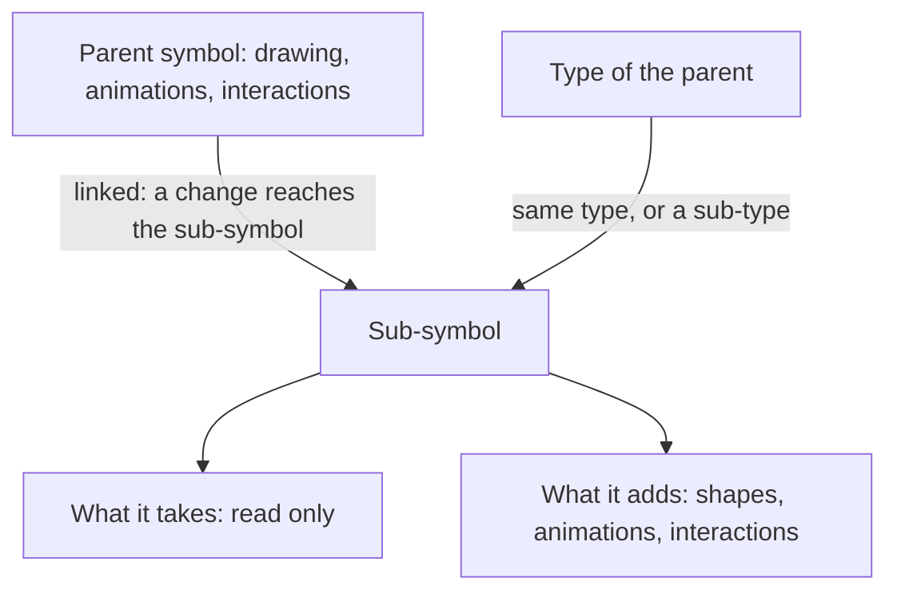
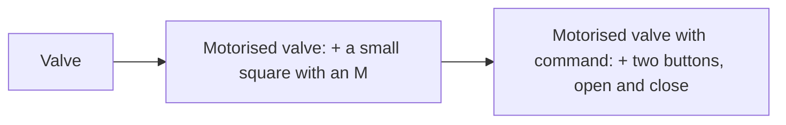

# Sub-symbols

> [Home](../README.md) › [Symbols](README.md) › Sub-symbols · Previous: [Enums of a Symbol Lib](11-enums-of-a-symbol-lib.md)

Status: draft, from the Product Owner's description of 2026-11-18 and his answers the same day (the changes of the parent reach the sub-symbols; a sub-symbol only adds; its type is the parent's or a sub-type of it; decision 0044, accepted on 2026-11-18), then his answers to the open questions, later the same day (a tree, the same Symbol Lib, a small +, the type, the faults, the preset and connection points, deleting a parent). Not validated. Open points are listed in [Open questions](#open-questions).

A symbol can have a **parent symbol**, as a type of Metadata has a parent type (see [Types](../metadata/01-types.md)). A **sub-symbol** starts from everything made for its parent, and the user adds more on top of it (Product Owner, 2026-11-18: "t'as un symbole parent et tu peux créer un sous-symbole [...] ça prend [ce] qui a été fait pour le symbole, et tu peux rajouter [...] en plus").

## Rules

- A symbol can be created as a sub-symbol of another symbol: its parent.
- A sub-symbol takes what was made for its parent symbol, then the user adds to it: shapes, and the links of these shapes to the signals and commands (Product Owner, 2026-11-18).
- A sub-symbol can itself have sub-symbols: the example below has three levels (Product Owner, 2026-11-18).
- **The changes of the parent reach its sub-symbols** (Product Owner, 2026-11-18): a sub-symbol is linked to its parent, never a copy made once. The valve is corrected once, and the motorised valve and the motorised valve with command follow. It is the inheritance of Metadata, applied to symbols.
- **A sub-symbol only adds** (Product Owner, 2026-11-18): what it takes from its parent is read only in it, as the inherited signals of a type are (see [Signals](../metadata/04-signals.md#the-table-of-signals)). It cannot change it, move it or hide it. To change it, the user opens the parent.
- **Its type is the type of its parent, or a sub-type of it** (Product Owner, 2026-11-18). So the animations and interactions taken from the parent keep their signals and commands. In the example, the motorised valve with command can have a sub-type of the valve's type that adds the commands open and close.
- **It takes everything from its parent** (Product Owner, 2026-11-18: "oui, tout pareil"): the drawing, the animations, the interactions, the **preset** and the **connection points** of its pipes. "If the parent already has a type, the sub-symbol can only take the same type or a sub-type, and it takes the same connections, animations and so on. It can only add things."
- Assistant's reading, to confirm: the dictated message says "ça prend l'IA qui a été faite pour le symbole"; "l'IA" is read as what was made for the symbol, its drawing and what is linked to it.

### The list of symbols becomes a tree

- **The list of symbols of a Symbol Lib is a tree, as in Metadata** (Product Owner, 2026-11-18): a sub-symbol sits under its parent. It replaces the flat list decided on 2026-11-11. The list of pipe styles stays flat.
- **The parent is always in the same Symbol Lib** as its sub-symbol (Product Owner, 2026-11-18: "un parent peut-il être dans une autre Symbol Lib ? Non").

### Creating a sub-symbol

- With a **small +**, on the same principle as the types of Metadata (Product Owner, 2026-11-18: "le même principe avec un petit +"; see [Types](../metadata/01-types.md)):
  - **from the list**: the + on the right of a symbol, when the mouse is over it, creates a sub-symbol of it;
  - **from the parent open in the editor**: a + creates a sub-symbol of the open symbol (where it sits in the editor: open).

### The type of a sub-symbol

- **Parent with a type**: the sub-symbol has the same type or a sub-type of it (decision 0044).
- **Parent without a type**: the sub-symbol can take **any type** (Product Owner, 2026-11-18: "dans la logique, oui"), since there is nothing to keep.
- **The parent changes type, or loses it**: **every sub-symbol goes into fault, and the application says so** (Product Owner, 2026-11-18: "on met tout le monde en défaut et on le dit"). Nothing is repaired by itself. How a fault shows and how the user repairs it come with the list of faults (see [Open questions](#open-questions)).

### Deleting a parent

- **A parent that has sub-symbols can be deleted** (Product Owner, 2026-11-18: "oui, on peut"). What becomes of its sub-symbols is open.

## Example

The Product Owner's example (2026-11-18): each level is the one above, plus what it adds.

| Symbol | Parent | What it adds |
| --- | --- | --- |
| Valve | none | The drawing of the valve. |
| Motorised valve | Valve | A small square with an M inside. |
| Motorised valve with command | Motorised valve | Two buttons: open and close, linked to the commands of its type. |

## Where it is used

| Thing | Created and changed in | In a symbol | In a synoptic |
| --- | --- | --- | --- |
| Parent of a symbol | Symbol mode | Set at creation, by the small + of the parent (in the tree or in the editor) | To settle (part 3) |

## Open questions

- **The list of faults.** A sub-symbol goes into fault when its parent changes type or loses it (Product Owner, 2026-11-18: "il faudra faire une liste des défauts"). The list of every fault of the application is to write: what puts a symbol in fault, how it shows (the small red mark of a broken link?), how it is repaired.
- **Deleting a parent:** what becomes of its sub-symbols: deleted with it, into fault, or kept on their own with what they took?
- **The + in the editor:** where it sits.
- Two dictated sentences the assistant could not read: "Un parent peut-il être ? Non." and "Un symbole, ça représente sa bibliothèque pipe en bas." Asked again to the Product Owner.
