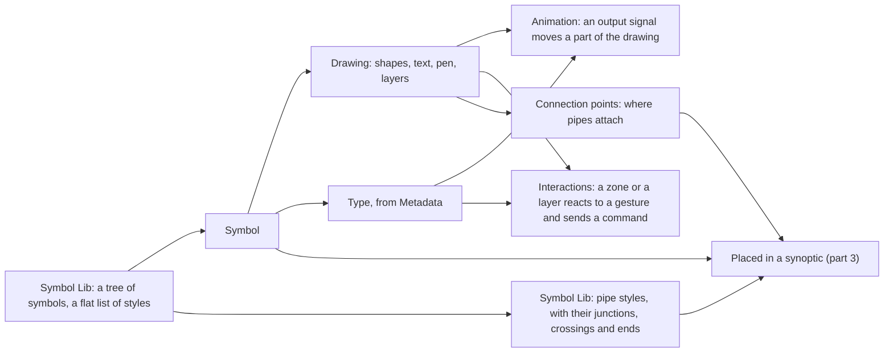

# symbols

> [Home](../README.md) › Symbols

The second part of Synoptic Studio: creating symbols. A symbol is a drawing, attached to a type from [Metadata](../metadata/README.md), that can be animated by the signals of that type and that can react to clicks. It is the front side of a type: how it looks and behaves.

Status: draft. Nothing here is validated yet. The words are provisional: every name is to be challenged before it is kept (see [Open questions](10-open-questions.md)).

## The big picture

The user picks a Symbol Lib, sees the tree of its symbols (a sub-symbol under its parent), and creates or opens a symbol. In the symbol editor, the user draws, then links the drawing to the type's signals (animation) and commands (interactions).

## One kind of symbol

There is one list of symbols and one kind of symbol: no "static" or "dynamic" symbol any more.

| A symbol... | Type | Faceplate | Animation | Interactions |
| --- | --- | --- | --- | --- |
| with a type | From Metadata, chosen at creation or later | Yes | Yes | Yes |
| without a type yet | None | No | No | No |

The type is never imposed: it can be chosen when the symbol is created, or later in the right-hand panel of the editor. Removing it only hides the faceplate, animations and interactions; choosing it again restores them. In a synoptic, a symbol with a type can be placed and left unwired (this belongs to part 3).

The only kind of library is the **Symbol Lib**, which sorts symbols. There are no libraries of types: a symbol picks its type among all the types of Metadata.

## What it contains

| Page | What it holds |
| --- | --- |
| [Libraries and symbols](01-libraries-and-symbols.md) | Symbol Libs, the left-hand panel (symbols, pipe styles, layers), creating a symbol, its optional type. |
| [Type and faceplate](02-type-and-faceplate.md) | The type of a symbol, the only thing it chooses; its faceplate is the one of the type. |
| [Editor](03-editor/README.md) | What is common to every mode: layout, floating bars, rules, modes, moving around (no Hand), Select, layers, precise move, the advanced tools (set aside). |
| [Drawing mode](04-drawing-mode/README.md) | Rectangle, ellipse, polygon, text, pen; the [Clip mode](04-drawing-mode/clip-mode.md), which draws the clip of a shape; the [Intersection mode](04-drawing-mode/intersection-mode.md), which builds a shape from others and their intersections. |
| [Point editing mode](05-point-editing-mode/README.md) | Editing the points of a path. |
| [Alignment mode](06-alignment-mode/README.md) | Placing shapes in relation to each other. |
| [Interaction mode](07-interaction-mode/README.md) | Interaction zones, gestures, what a gesture does. |
| [Animation mode](08-animation-mode/README.md) | Linking an output signal to a change of the drawing, values and units in texts; the [catalogue of the animations](08-animation-mode/animation-catalogue.md), every animation possible with an example; [animations by type of signal](08-animation-mode/animations-by-signal-type.md), one line per animation and type of signal, to choose from. |
| [Run mode](09-run-mode/README.md) | Trying the symbol with test values, and simulating another screen. |
| [Pipes](pipes/README.md) | Connection points of a symbol, and the pipe styles kept in the Symbol Lib, each with its junctions, crossings and ends. |
| [Open questions](10-open-questions.md) | Every open question in one place. |
| [Enums of a Symbol Lib](11-enums-of-a-symbol-lib.md) | The Enums page of each Symbol Lib: the enums of Metadata read only, and the columns the user adds to them (colour, text, number) for the animations. |
| [Sub-symbols](12-sub-symbols.md) | A symbol created from a parent symbol: it takes what was made for the parent and adds more (valve, motorised valve, motorised valve with command). |
| [Research brief](research-brief.md) | The questions sent to the documentary research, and where the answers are. |

One folder per mode, with its tools inside. What several modes share is in the editor folder (selection, hand, layers, precise move, anchors, advanced tools).

## Reading order

1. [Libraries and symbols](01-libraries-and-symbols.md), then [Type and faceplate](02-type-and-faceplate.md).
2. [Editor](03-editor/README.md), then the modes: drawing, clip, point editing, alignment, interaction, animation, run.
3. [Pipes](pipes/README.md).
4. [Open questions](10-open-questions.md), then the [research brief](research-brief.md).

## Page layout

Same skeleton as the Metadata pages: title and navigation line, `Status:` line, `## Rules`, detail sections, `## Example`, `## Where it is used`, `## Open questions` last and only when the page has some (each also listed in the index).

## See also

- [Metadata](../metadata/README.md): types, signals, commands, signal settings, faceplates. This part only uses them and never changes them.
- [Storage](../storage/README.md): how the files of symbols and Symbol Libs are saved.
- [Screens of the symbol editor](../screens/symbols.md) and [Screens of the pipes](../screens/pipes.md): every screen of this part, with its buttons, fields and lists, and what is missing.
