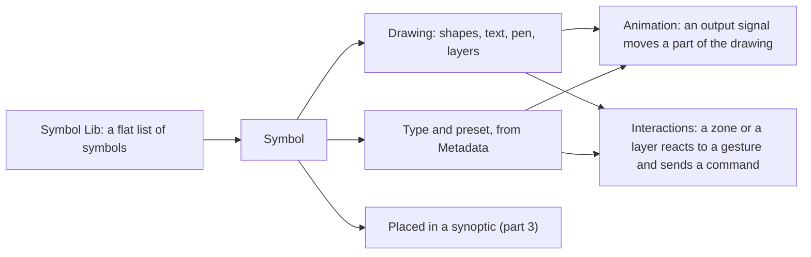

# symbols

> [Home](../README.md) › Symbols

The second part of Synoptic Studio: creating symbols. A symbol is a drawing, attached to a type from [Metadata](../metadata/README.md), that can be animated by the signals of that type and that can react to clicks. It is the front side of a type: how it looks and behaves.

Status: draft, written from the Product Owner's oral description of 2026-11-11. Nothing here is validated yet. The words are provisional: the Product Owner asked to be very critical about every name before keeping it (see [Open questions](10-open-questions.md)).

## The big picture

The user picks a Symbol Lib, sees the flat list of its symbols, and creates or opens a symbol. In the symbol editor, the user draws, then links the drawing to the type's signals (animation) and commands (interactions).

## Static and dynamic symbols

| Kind | What it is | Type | Preset and faceplate | Animation | Interactions |
| --- | --- | --- | --- | --- | --- |
| Dynamic | A symbol that is animated and stands for something of the installation. | Required, from Metadata | Yes | Yes | Yes |
| Static | A symbol that may stand for something, but is not animated. Only its drawing exists. | None | No | No | No |

When creating a symbol, the user chooses static or dynamic, and can switch whenever they want. Switching to static only hides the type, animations and interactions; switching back restores them. In a synoptic, a dynamic symbol can be placed and left unwired: it then behaves as a static one (this belongs to part 3).

The two kinds of library are the **Symbol Lib** (sorts symbols) and the **Type Lib** (sorts types, in Metadata). A Symbol Lib is linked to one Type Lib and only offers its types.

## What it contains

| Page | What it holds |
| --- | --- |
| [Libraries and symbols](01-libraries-and-symbols.md) | Symbol Libs, the flat list, creating a symbol, static and dynamic. |
| [Type, preset and faceplate](02-type-and-faceplate.md) | The type of a symbol, its preset, which faceplate entries the symbol shows. |
| [Editor](03-editor/README.md) | What is common to every mode: rules, modes, moving around, Select, Hand, groups, the expert menu. |
| [Drawing mode](04-drawing-mode/README.md) | Rectangle, ellipse, polygon, text, pen. |
| [Point editing mode](05-point-editing-mode/README.md) | Editing the points of a path. |
| [Alignment mode](06-alignment-mode/README.md) | Placing shapes in relation to each other. |
| [Interaction mode](07-interaction-mode/README.md) | Interaction zones, gestures, what a gesture does. |
| [Animation mode](08-animation-mode/README.md) | Linking an output signal to a change of the drawing, values and units in texts. |
| [Run mode](09-run-mode/README.md) | Trying the symbol with test values, and simulating another screen. |
| [Open questions](10-open-questions.md) | Every open question in one place. |

One folder per mode, with its tools inside. What several modes share is in the editor folder.

## Reading order

1. [Libraries and symbols](01-libraries-and-symbols.md), then [Type, preset and faceplate](02-type-and-faceplate.md).
2. [Editor](03-editor/README.md), then the modes in order: drawing, point editing, alignment, interaction, animation, run.
3. [Open questions](10-open-questions.md).

## Page layout

Same skeleton as the Metadata pages: title and navigation line, `Status:` line, `## Rules`, detail sections, `## Example`, `## Where it is used`, `## Open questions` last and only when the page has some (each also listed in the index).

## See also

- [Metadata](../metadata/README.md): types, signals, commands, faceplates, presets. This part only uses them and never changes them.
- [Storage](../storage/README.md): how the files of symbols and Symbol Libs are saved.
