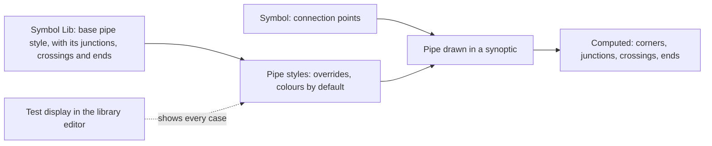
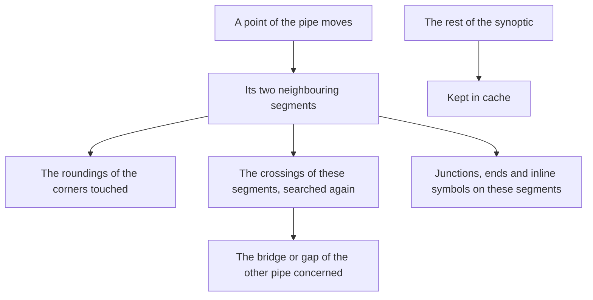

# Pipes

> [Home](../../README.md) › [Symbols](../README.md) › Pipes · Previous: [Run mode](../09-run-mode/README.md)

Status: draft, from the Product Owner's oral description of 2026-11-11 and the second research report of 2026-11-11 (`research/t4-…/rapport.md`, which also read the archived Figma page "Flow · Pipes"). Not validated.

Pipes are the lines that connect symbols in a synoptic. The user draws them with a pipe tool, and the editor computes the rest: joints, corners, junctions, crossings. This part of the specs covers what is **created in a library** (the styles) and what the symbol must offer (the connection points). How a pipe is drawn in a synoptic is in [Pipes in the synoptic](in-the-synoptic.md), which belongs to part 3.

## Rules

- A pipe connects the **connection points** of symbols (see [Connection points](connection-points.md)).
- A pipe is drawn with straight segments, by clicking. Everything else is computed.
- What a pipe looks like comes from its **pipe style**, kept in the Symbol Lib, never from options typed on each pipe.
- A Symbol Lib has **one base pipe style**, the global look of all its pipes. Each **pipe style** (water, gas, steam...) overrides it: by default only the colours (body, border, dashes or not), and any other option when needed, such as a smaller width for gas pipes (Product Owner, 2026-11-11; see [Pipe styles](pipe-styles.md)).
- Dashes, on a body or a border, are a **sequence of coloured segments** (a gap is a transparent segment), computed along the pipe.
- **Everything lives in the pipe style** (decided by the Product Owner, 2026-11-11): the junctions, the crossings and the start and end shapes are parts of the pipe style, not separate lists of the Symbol Lib. They are computed, not edited by hand: the user chooses one style for a pipe, and the style says how all of it looks.

| Part of the pipe style | What it sets | Page |
| --- | --- | --- |
| Body and border | Width, body fill (colour or dash sequence), border on both sides (width, inside, middle or outside, colour or dash sequence), corner radius. | [Pipe styles](pipe-styles.md) |
| Junctions | Looks of a place where a pipe branches. | [Junctions](junctions.md) |
| Crossings | What happens where a pipe passes over another: bridge, gap, nothing. | [Crossings](crossings.md) |
| Start and end shapes | The shapes that can be drawn at the start or at the end of a pipe of this style. | [Pipe ends](ends.md) |

- A Symbol Lib holds one base pipe style and several pipe styles; each library has its own, so that a software or a factory has its own look (same reason as for symbols: see [Libraries and symbols](../01-libraries-and-symbols.md)).
- The editor of a pipe style offers a **test display** with every case a pipe can meet, to see what an edit does (see [Test display](test-display.md)).

## Everything is computed

The user only gives points and styles. The editor computes: the rounded corners, the split of a pipe at a junction, the bridges or gaps at a crossing, the shape of the ends. The user does not edit these results by hand, except by choosing which pipe passes over another (see [Crossings](crossings.md)).

## Example

Base style: 6 px, grey body, 1 px dark grey border outside, corner radius 8 px, circle junctions, bridges, arrow and flange ends.

| Pipe style | What it overrides |
| --- | --- |
| Water | Body blue |
| Oil | Body black; junction square; crossing gap |
| Steam | Body white; border dashes grey 4, transparent 4 |
| Gas | Body yellow; width 3 px |
| Electricity | Body yellow; border off; width 2 px; crossing none |

## Where it is used

| Thing | Created and changed in | Used in | In a symbol | In a synoptic |
| --- | --- | --- | --- | --- |
| Connection points | Symbol editor | Symbol | Create, edit | Pipes snap to them |
| Base pipe style and pipe styles, with junctions, crossings and ends | Symbol Lib | Pipes of a synoptic | Create, edit, test | Choose a pipe style |
| Pipe drawing, junctions, crossings | Synoptic (part 3) | Synoptic | No | Draw, edit |

## What the research found

Source: the second research report (`research/t4-…/rapport.md`, sections 3.1 to 3.7). Nothing was measured. "Opinion" is the report's provisional opinion, not a decision.

### How other software models pipes

- The software read (draw.io, Visio, Ignition, AutoCAD Plant 3D, JointJS, GoJS, yFiles, libavoid) agree on four objects: a **connection point** with a direction, the **pipe** (or link), the **crossing** ("line jump": arc, gap, square or nothing, with a size), and, less often, the **junction**. Confidence: high.
- Which pipe passes over another is decided by a general rule: the stacking order (draw.io), the orientation (yFiles: horizontal over vertical), or a page setting (Visio). No software read offers the click on a crossing that the project wants: it stays, as an exception to a default rule.
- No colour of content is universal: four colour codes of piping (ASME A13.1, BS 1710, ISO 14726, DIN 2403) disagree on steam, natural gas, nitrogen, acids and oxygen. The rule "the content only names and groups the styles" is consistent with this: the editor holds no colour of content.
- The texts of the symbol standards (ISA-5.1, ISO 14617, EN 60617, ISO 10628) are paid and were not opened: what can be taken from them without a copyright problem stays open.

### The archived Figma page "Flow · Pipes"

An archived inspiration, not a decision. It differs from these pages on several points:

| Subject | Archived Figma page | These specs |
| --- | --- | --- |
| Where junctions, crossings and ends live | Inside the pipe style | Inside the pipe style (decided 2026-11-11, was four separate lists) |
| A branch | The pipe stays one pipe (a tree) | The pipe is split in two |
| Anchors of an end shape | Four, at the middle of the sides; one side chosen | Nine (sides and corners) |
| Corner radius | In the style, "for rounded paths"; the path kind (straight, right angles, rounded) is chosen per pipe | In the style only |
| Names | Core, Outline, Line, Part, Plain | Fill, Border, Flow dashes, End shape, Flat |
| Inline symbols | Yes: a symbol with two connection points slides along the pipe | Absent |
| Usage counter | "Used by 38 pipes" | Absent |
| Dashes | A line style (continuous or dashed) | Flow dashes, maybe animated |

### What the others do and this part lacks (opinion of the report)

| Missing | Opinion |
| --- | --- |
| **Inline symbol** placed on a pipe (valve, reducer, flow arrow), sliding along it, bends included | Add: the clearest gap. |
| Size of a bridge or a gap, set in the style | Add (see [Crossings](crossings.md)). |
| Default rule of which pipe is on top | Write it: the last drawn is on top; the click is the exception. |
| Orthogonal lock while drawing a pipe | Add, like the angle lock of the pen. |
| Path kind per pipe (straight, right angles, rounded) | To discuss with the corner radius of the style. |
| Usage counter of a style | Add: it prepares the display of broken links. |
| Colouring by topology (zenon) | Refuse: the editor does not know what a fluid is. |
| Automatic routing around symbols (libavoid) | Not in the first version: the Product Owner wants a path by clicks. |

### Vocabulary (opinion of the report)

| Concept | Words found | Proposed name |
| --- | --- | --- |
| The pipe | pipe, connector, edge, link, schematic line | **Pipe** |
| What it contains | service, fluid, appearance, content | **Content** (a group label; "fluid" excludes electricity; "service" is the trade word) |
| The style | appearance, connector style, pipe style | **Pipe style** |
| The connection point | connection point, pin, port, anchor point | **Connection point** ("anchor" is already taken by the nine anchors) |
| The junction | junction, branch, junction marker, waypoint | **Junction** (the place), **Junction marker** (the shape), **Branch** (the pipe that leaves) |
| The crossing | line jump, bridge, jumpover, gap, loop | **Crossing**, of type **Bridge**, **Gap** or **None** |
| Start and end | arrowhead, start, end, parts, marker | **Start**, **End**, **End shape**; avoid "cap", which is the end of a stroke in SVG |

### Computing pipes

- The computation holds in plain JavaScript with known bricks (arc at a corner, offset of a polyline, cut, arc for a bridge). Only the search of the crossings is to measure: comparing every segment with every other costs the square of their number; a spatial index and a recomputation limited to the two segments next to the moved point should bring it back to a few tens of tests (hypothesis, not a result).
- Opinion: never draw a bridge or a gap with a mask (Ignition hit the limit of the number of masks of the browser); compute the geometry. Confidence: medium.
- What is recomputed when a point moves:

- For the geometry research (not this part): offset of a polyline with arcs (body, borders, kinds of joins); search of the crossings between segments and arcs, with a spatial index, incremental; cut of a path at a point and insertion of an arc; length along a path (position of an inline symbol, start of the dashes).
- POC proposed, **P9**: 100, 300 then 1 000 pipes of 5 segments, 1 000 to 10 000 crossings, one point moved with the mouse; work time per frame in plain JavaScript, with and without index; ways A and B of [Pipe styles](pipe-styles.md).

## Decided by the Product Owner (2026-11-11)

- Junctions, crossings and start and end shapes live **inside the pipe style**, as in the archived Figma page and as the report advised. They are computed: the user picks a style for a pipe and does not edit these parts by hand.
- A symbol can be **connected to a pipe**: it fits onto it and can only be moved along it (see [Pipes in the synoptic](in-the-synoptic.md)).
- Dashes can **move**, in a direction the user chooses, and the movement **propagates** into the branches at a junction. A pipe style can be **linked to a type** of Metadata, if the user wants it: the model then drives the speed, the direction and the colours (see [Pipe styles](pipe-styles.md)).
- One **base pipe style** per Symbol Lib, overridden by **pipe styles** (colours by default, any option when needed); dashes as **sequences of coloured segments**, for pipes and for every border; dashes computed as cleanly as possible, an odd cut in a corner accepted.

## To decide by the Product Owner

1. A branch: one pipe as a tree (archived page, Ignition, advised) or two pipes (current specs)?
2. Path kind per pipe (straight, right angles, rounded) next to the corner radius of the style?

## Open questions

- The list is in [Open questions](../10-open-questions.md).
