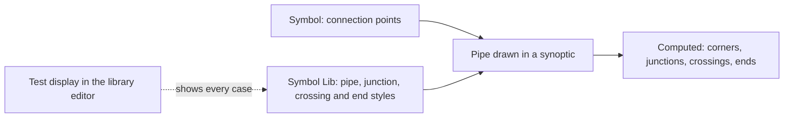

# Pipes

> [Home](../../README.md) › [Symbols](../README.md) › Pipes · Previous: [Run mode](../09-run-mode/README.md)

Status: draft, from the Product Owner's oral description of 2026-11-11. Not validated. The Figma page "Flow Pipes" of the design system file was not read when this page was written: the Product Owner said it holds everything and asked to read it later (see [Open questions](../10-open-questions.md)).

Pipes are the lines that connect symbols in a synoptic. The user draws them with a pipe tool, and the editor computes the rest: joints, corners, junctions, crossings. This part of the specs covers what is **created in a library** (the styles) and what the symbol must offer (the connection points). How a pipe is drawn in a synoptic is in [Pipes in the synoptic](in-the-synoptic.md), which belongs to part 3.

## Rules

- A pipe connects the **connection points** of symbols (see [Connection points](connection-points.md)).
- A pipe is drawn with straight segments, by clicking. Everything else is computed.
- What a pipe looks like comes from styles kept in the Symbol Lib, never from options typed on each pipe:

| Style | What it sets | Page |
| --- | --- | --- |
| Pipe style | Looks of a pipe, by what it contains (water, oil, steam, electricity...): colour, width, borders, corner radius, flow dashes. | [Pipe styles](pipe-styles.md) |
| Junction style | Looks of a place where a pipe is split in two. | [Junctions](junctions.md) |
| Crossing style | What happens where a pipe passes over another: bridge, gap, nothing. | [Crossings](crossings.md) |
| Start and end shape | The shape drawn at the start or at the end of a pipe. | [Pipe ends](ends.md) |

- A Symbol Lib can hold several of each kind, so that a software or a factory has its own look (same reason as for symbols: see [Libraries and symbols](../01-libraries-and-symbols.md)).
- Each library editor offers a **test display** with every case a pipe can meet, to see what an edit does (see [Test display](test-display.md)).

## Everything is computed

The user only gives points and styles. The editor computes: the rounded corners, the split of a pipe at a junction, the bridges or gaps at a crossing, the shape of the ends. The user does not edit these results by hand, except by choosing which pipe passes over another (see [Crossings](crossings.md)).

## Example

| Kind | Examples |
| --- | --- |
| Pipe styles | Water (blue, 6 px, grey border), oil (black, 6 px), steam (white with a grey border), electricity (thin yellow line) |
| Junction styles | Flat, circle with a border, square |
| Crossing styles | Bridge, gap, none |
| End shapes | Arrow, flange, cap, open end |

## Where it is used

| Thing | Created and changed in | Used in | In a symbol | In a synoptic |
| --- | --- | --- | --- | --- |
| Connection points | Symbol editor | Symbol | Create, edit | Pipes snap to them |
| Pipe, junction, crossing and end styles | Symbol Lib | Pipes of a synoptic | Create, edit, test | Choose |
| Pipe drawing, junctions, crossings | Synoptic (part 3) | Synoptic | No | Draw, edit |

## Open questions

- The list is in [Open questions](../10-open-questions.md): most of them are left to the next research (questions 8 to 12 of the [research brief](../research-brief.md)).
