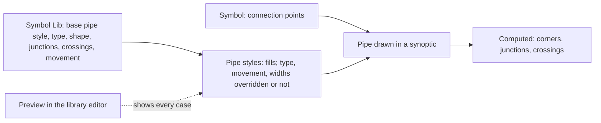

# Pipes

> [Home](../../README.md) › [Symbols](../README.md) › Pipes · Previous: [Run mode](../09-run-mode/README.md)

Status: draft, with the second research report (`research/t4-…/rapport.md`, which also read the archived Figma page "Flow · Pipes"). Not validated.

Pipes are the lines that connect symbols in a synoptic. The user draws them with a pipe tool, and the editor computes the rest: joints, corners, junctions, crossings. This part of the specs covers what is **created in a library** (the styles) and what the symbol must offer (the connection points). How a pipe is drawn in a synoptic is in [Pipes in the synoptic](in-the-synoptic.md), which belongs to part 3.

## Rules

- A pipe connects the **connection points** of symbols (see [Connection points](connection-points.md)).
- A pipe has **no start or end shape**. Each end is free, or connected to a symbol or to another pipe; an arrow, a flange or a cap at the end of a pipe is a **symbol** with a connection point (decision 0098).
- A pipe is drawn with straight segments, by clicking. Everything else is computed.
- What a pipe looks like comes from its **pipe style**, kept in the Symbol Lib, never from options typed on each pipe.
- A Symbol Lib has **one base pipe style**, the shape of all its pipes, without colour. Each **pipe style** (water, oil, steam...) gives the fills of the body, plain colours or dash sequences, and of the border, colours only (no dashes on a border since 2026-11-26). It takes the linked type, the movement and the body and border widths of the base, and can override each of them (smaller widths for gas pipes), with a reset that gives back the base's value; nothing else of the base changes (see [Pipe styles](pipe-styles.md)).
- The base pipe style and the pipe styles are shown with the same sections, in the same order.
- Dashes, on a body or a border, are a **sequence of coloured segments** (a gap is a transparent segment), computed along the pipe.
- **Junctions and crossings live in the pipe style**, not in separate lists of the Symbol Lib. They are computed, not edited by hand: the user chooses one style for a pipe, and the style says how all of it looks.

| Part of the pipe style | What it sets | Where | Page |
| --- | --- | --- | --- |
| Body and border | Width; border on both sides (width, 0 for none; inside, middle or outside); corner radius, the same for every style. | Base; a pipe style can override the body and border widths | [Pipe styles](pipe-styles.md) |
| Fills | Body fill: colour or dash sequence; border fill: colours stacked, no dashes. | Each pipe style | [Pipe styles](pipe-styles.md) |
| Linked type and movement | A type of Metadata, optional; the direction of the dashes (stopped, start to end, end to start) and their speed, each a value or a signal picked in its field. | Base; a pipe style can override them | [Pipe styles](pipe-styles.md#moving-dashes) |
| Junctions | Looks of a place where a pipe branches: flat (one clean outline), circle or square, a size for a circle or a square; fill and border are the pipe's. | Base | [Junctions](junctions.md) |
| Crossings | What happens where a pipe passes over another: bridge, gap, nothing; the size is computed from the body width. | Base | [Crossings](crossings.md) |

- A Symbol Lib holds one base pipe style and several pipe styles; each library has its own, so that a software or a factory has its own look (same reason as for symbols: see [Libraries and symbols](../01-libraries-and-symbols.md)).
- A pipe is **one pipe, as a tree**: a branch drawn from a pipe belongs to that pipe. The whole tree has one pipe style and one flow (see [Junctions](junctions.md)).
- The look of the angles comes from the **corner radius of the style** only: there is no path kind (straight, right angles, rounded) to choose on each pipe.
- The editor of a pipe style offers a **Preview** with every case a pipe can meet, to see what an edit does (see [Preview](preview.md)).

## Everything is computed

The user only gives points and styles. The editor computes: the rounded corners, the junction where a branch leaves, the bridges or gaps at a crossing. The user does not edit these results by hand, except by choosing which pipe passes over another (see [Crossings](crossings.md)).

## Example

Base style: type `fluid_line`, 6 px, border 1 px outside, corner radius 8 px, circle junctions, bridges, dashes moved by the signals of `fluid_line`.

| Pipe style | Fills | Type and movement | Own widths |
| --- | --- | --- | --- |
| Water | Body blue; border dark grey | Base's | — |
| Oil | Body dashes black 10, transparent 20, red 2; border dark grey | Own: signals of the type `oil_line` | — |
| Steam | Body dashes white 4, grey 4; border grey | Base's | — |
| Gas | Body yellow; border black, then red at 40 % over it | Base's | Body 3 px, border 0.5 px |
| Electricity | Body yellow; border yellow | Own: signals of the type `power_line` | Body 2 px |

## Where it is used

| Thing | Created and changed in | Used in | In a symbol | In a synoptic |
| --- | --- | --- | --- | --- |
| Connection points | Symbol editor | Symbol | Create, edit | Pipes snap to them |
| Base pipe style and pipe styles, with junctions and crossings | Symbol Lib | Pipes of a synoptic | Create, edit, test | Choose a pipe style |
| Pipe drawing, junctions, crossings | Synoptic (part 3) | Synoptic | No | Draw, edit |

## What the research found

Source: the second research report (`research/t4-…/rapport.md`, sections 3.1 to 3.7). Nothing was measured. "Opinion" is the report's provisional opinion, not a decision.

### How other software models pipes

- The software read (draw.io, Visio, Ignition, AutoCAD Plant 3D, JointJS, GoJS, yFiles, libavoid) agree on four objects: a **connection point** with a direction, the **pipe** (or link), the **crossing** ("line jump": arc, gap, square or nothing, with a size), and, less often, the **junction**. Confidence: high.
- Which pipe passes over another is decided by a general rule: the stacking order (draw.io), the orientation (yFiles: horizontal over vertical), or a page setting (Visio). No software read offers the click on a crossing that the project wants: it stays, as an exception to a default rule.
- No colour of content is universal: four colour codes of piping (ASME A13.1, BS 1710, ISO 14726, DIN 2403) disagree on steam, natural gas, nitrogen, acids and oxygen. The rule "the content only names and groups the styles" is consistent with this: the editor holds no colour of content.
- The texts of the symbol standards (ISA-5.1, ISO 14617, EN 60617, ISO 10628) are paid and were not opened: what can be taken from them without a copyright problem stays open.

### The archived Figma page "Flow · Pipes"

An archived inspiration, not a decision. It differs from these pages on several points:

| Subject | Archived Figma page | These specs |
| --- | --- | --- |
| Where junctions, crossings and ends live | Inside the pipe style | Inside the pipe style (decided 2026-11-11, was four separate lists) |
| A branch | The pipe stays one pipe (a tree) | The same: one pipe as a tree (decided 2026-11-23) |
| Start and end parts | Drawn in a box with four anchors, at the middle of the sides | None: a symbol at the end of the pipe (decision 0098) |
| Corner radius | In the style, "for rounded paths"; the path kind (straight, right angles, rounded) is chosen per pipe | In the style only, no path kind per pipe (decided 2026-11-23) |
| Name of the display of every case | Pipe style preview | Preview (decided 2026-11-23) |
| Names | Core, Outline, Line, Part, Plain | Fill, Border, Flow dashes, Flat |
| Inline symbols | Yes: a symbol with two connection points slides along the pipe | Absent |
| Usage counter | "Used by 38 pipes" | Absent |
| Dashes | A line style (continuous or dashed) | Flow dashes, maybe animated |

### What the others do and this part lacks (opinion of the report)

| Missing | Opinion |
| --- | --- |
| **Inline symbol** placed on a pipe (valve, reducer, flow arrow), sliding along it, bends included | Add: the clearest gap. |
| Size of a bridge or a gap, set in the style | Not taken: computed from the body width (decision 0096, see [Crossings](crossings.md)). |
| Default rule of which pipe is on top | Write it: the last drawn is on top; the click is the exception. |
| Orthogonal lock while drawing a pipe | Add, like the angle lock of the pen. |
| Path kind per pipe (straight, right angles, rounded) | Not taken: the corner radius of the style is enough (decided 2026-11-23). |
| Usage counter of a style | Add: it prepares the display of broken links. |
| Colouring by topology (zenon) | Refuse: the editor does not know what a fluid is. |
| Automatic routing around symbols (libavoid) | Not in the first version: a path is drawn by clicks. |

### Vocabulary (opinion of the report)

| Concept | Words found | Proposed name |
| --- | --- | --- |
| The pipe | pipe, connector, edge, link, schematic line | **Pipe** |
| What it contains | service, fluid, appearance, content | **Content** (a group label; "fluid" excludes electricity; "service" is the trade word) |
| The style | appearance, connector style, pipe style | **Pipe style** (kept rather than "pipe type", decision 0095) |
| The connection point | connection point, pin, port, anchor point | **Connection point** ("anchor" is already taken by the nine anchors) |
| The junction | junction, branch, junction marker, waypoint | **Junction** (the place), **Junction marker** (the shape), **Branch** (the pipe that leaves) |
| The crossing | line jump, bridge, jumpover, gap, loop | **Crossing**, of type **Bridge**, **Gap** or **None** |
| Start and end | arrowhead, start, end, parts, marker | **Start**, **End** of a pipe; no end shape (decision 0098) |

### Computing pipes

- The computation holds in plain JavaScript with known bricks (arc at a corner, offset of a polyline, cut, arc for a bridge). Only the search of the crossings is to measure: comparing every segment with every other costs the square of their number; a spatial index and a recomputation limited to the two segments next to the moved point should bring it back to a few tens of tests (hypothesis, not a result).
- Opinion: never draw a bridge or a gap with a mask (Ignition hit the limit of the number of masks of the browser); compute the geometry. Confidence: medium.
- What is recomputed when a point moves:

- For the geometry research (not this part): offset of a polyline with arcs (body, borders, kinds of joins); search of the crossings between segments and arcs, with a spatial index, incremental; cut of a path at a point and insertion of an arc; length along a path (position of an inline symbol, start of the dashes).
- POC proposed, **P9**: 100, 300 then 1 000 pipes of 5 segments, 1 000 to 10 000 crossings, one point moved with the mouse; work time per frame in plain JavaScript, with and without index; ways A and B of [Pipe styles](pipe-styles.md).

## Decided

- Junctions and crossings live **inside the pipe style**, as in the archived Figma page and as the report advised. They are computed: the user picks a style for a pipe and does not edit these parts by hand.
- A symbol can be **connected to a pipe**: it fits onto it and can only be moved along it (see [Pipes in the synoptic](in-the-synoptic.md)).
- The base pipe style and each pipe style can be **linked to a type** of Metadata. The dashes **move** by a direction of the built-in enum "pipe direction" (stopped, start to end, end to start) and a speed, each a value or a signal of the type picked with a small icon inside its field; no on or off option. The movement **propagates** into the branches at a junction. The model also drives the colours (decisions 0096 and 0097, see [Pipe styles](pipe-styles.md)).
- One **base pipe style** per Symbol Lib, without colour; **pipe styles** give the fills; dashes as **sequences of coloured segments**, for the body of a pipe only since 2026-11-26 (decision 0109: no border has dashes); dashes computed as cleanly as possible, an odd cut in a corner accepted (decision 0095).
- A pipe style can **override** only the linked type, the movement, the body width and the border width of the base; each overridden value has a **reset** that gives back the base's value. Base and pipe styles show the same sections in the same order (decisions 0096 and 0097).
- A border of width 0 is no border: there is no on or off option (decision 0097).
- The **size of a crossing** is computed from the body width, not set (decision 0096).
- A **flat junction** has no marker and no size: the pipes join in one clean outline; only a circle or a square has a size (decision 0096).
- **No start and end shapes**: the end of a pipe is free, or a symbol connected to it (decision 0098, which replaces their list on the Pipes page of decision 0095).
- A branch leaves **one pipe as a tree**, with one pipe style and one flow, as in the archived Figma page and in Ignition (decision 0094).
- **No path kind per pipe**: the corner radius of the style gives the look of every angle (decision 0094).
- The display of every case is named **Preview** (decision 0094).

## Open questions

- The list is in [Open questions](../10-open-questions.md).
