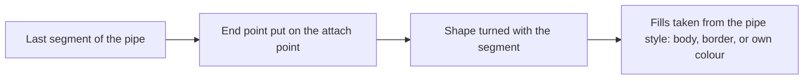

# Pipe ends

> [Home](../../README.md) › [Symbols](../README.md) › [Pipes](README.md) › Pipe ends

Status: draft. The page that edits an end shape was proposed by the assistant on 2026-11-24, on the test screen PI-03. Not validated.

A start shape and an end shape can be set on a pipe. They are made in a list of the Symbol Lib and chosen in the synoptic.

## Rules

- End shapes are **not** in the base pipe style. They have **a list of their own** on the Pipes page of the Symbol Lib, after the pipe styles: the user adds a shape there and sets it up (see [Screens of the pipes](../../screens/pipes.md#layout-of-the-page-pipes)).
- The same list holds the shapes for the start and for the end of a pipe (assistant's reading: one shape can serve at either end).
- In the synoptic, each end of a pipe offers a shape, or none (as in the archived Figma page).
- An end shape is drawn in a small editor of its own: a **box** of the size the user wants, with an **anchor** at each side and each corner of the box (see [Anchors](../03-editor/anchors.md)).
- The user draws the shape freely inside the box, with the tools of the [drawing mode](../04-drawing-mode/README.md).
- The anchor says where the pipe is attached to the shape, and so how the shape is placed on the end of the pipe.
- Each shape drawn in the box takes the **body fill** or the **border fill** of the pipe, or a **colour of its own**, chosen shape by shape; its border has the same choice (Product Owner, 2026-11-24). A shape that takes a fill of the pipe changes colour when the pipe changes style.
- The shape keeps the **size of its box** on every pipe, whatever the width of the pipe style: the same arrow on a Gas pipe of 3 px and on a Water pipe of 6 px (Product Owner, 2026-11-24).
- A pipe can have a start shape, an end shape, both, or none. The start and the end can be different shapes.

### The page of an end shape

Proposed by the assistant on 2026-11-24, drawn on the test screen [PI-03](../../screens/pipes.md#pi-03--end-shape-editor). A click on a shape of the list "Start and end shapes" opens it, in three columns after the list of the Pipes page:

```mermaid
block-beta
    columns 4
    list["List of the Pipes page: the shape selected"] draw["Drawing area: the box, its nine anchors, a piece of pipe on the attach point; tool bar at the bottom"] options["Options: name, box, attach point, shapes, fill of the selected shape"] preview["Preview: the shape on pipes of the styles"]
```

| Part | What it holds |
| --- | --- |
| Drawing area | The **box**, its **nine anchors**, the chosen one marked, and a **piece of pipe** of the base style that arrives on it from the left, so that the user sees how the shape sits on the pipe. A floating tool bar at the bottom holds the tools of the drawing mode, without Text: Select, Hand, Group, Rectangle, Ellipse, Polygon, Pen. |
| End shape | Its **name**, free text ("Arrow", "Flange", "Cap"); a **red button** that deletes it, with a warning (a whole thing, see [Delete](../../screens/README.md#delete-a-warning-only-for-a-whole-thing)). |
| Box | **Width** and **height**, in pixels. |
| Attach point | A grid of the **nine anchors**: the one where the end point of the pipe is put. |
| Shapes | The shapes drawn in the box, as the layers of a symbol: one line each, a click selects it. |
| Fill of the selected shape | **Pipe body**, **pipe border** or **colour**: the shape takes the body fill or the border fill of the pipe that uses it, or a colour of its own. Its border has the same choice. |
| Preview | The shape at the end and at the start of a pipe of several pipe styles, on a straight pipe and after a bend. |

How the shape sits on a pipe, proposed:

- The shape is drawn for a pipe that **arrives from the left**, as in the drawing area.
- The **end point of the pipe is put on the attach point**; the pipe keeps its length and the shape is drawn over it. An arrow attached by the middle of its back side goes past the end of the pipe; attached by its tip, it stops on the end.
- The shape **turns with the last segment** of the pipe, so that an arrow always points the way the pipe goes.
- At the **start** of a pipe, the same shape is turned to face the other way: one arrow serves at both ends.

## Example

| End shape | Box | Drawn as | Attach point | Fill |
| --- | --- | --- | --- | --- |
| Arrow | 16 × 12 px | A triangle pointing right | Middle of the left side | Pipe body |
| Flange | 4 × 16 px | A thin rectangle across the pipe | Centre | Pipe border |
| Cap | 8 × 12 px | A half circle, flat side on the left | Middle of the left side | Pipe body |

## Where it is used

| Thing | Created and changed in | Used in | In a symbol | In a synoptic |
| --- | --- | --- | --- | --- |
| End shape | Pipes page of a Symbol Lib ([PI-03](../../screens/pipes.md#pi-03--end-shape-editor)) | Preview of the pipe styles ([PI-05](../../screens/pipes.md#pi-05--preview)); pipes of a synoptic | No | Chosen for the start and the end of each pipe ([Pipes](../../synoptics/05-pipes.md)) |

## What the research found

Source: the second research report (`research/t4-…/rapport.md`, sections 3.5, 3.7, 3.18).

- The archived Figma page draws a start or end "part" in a W × H box with **four anchors, at the middle of the sides**: the user picks the side where the pipe attaches; the drawing may go outside the box; nothing is scaled; each end of a pipe offers the parts of its style, or none; a part can be copied from another style. The specs say nine anchors: to decide. The flange of the example needs the centre.
- SVG has start, middle and end markers; a marker can take the paint of the line that uses it (`context-stroke`, support per engine not read). draw.io and GoJS have arrowheads.
- Opinion of the report: **one single concept of end shape**, for the lines drawn in symbols (see [Fill and border](../04-drawing-mode/fill-and-border.md)) and for the pipes. Since end shapes now have a list of their own on the Pipes page, how a line of a symbol would reach them is open (below).
- Names: **Start**, **End**, and **End shape** for the shape; avoid "cap", which is the end of a stroke in SVG.

## Open questions

- Four anchors on the sides (archived Figma page) or nine (current specs)?
- Can every pipe style use every end shape of the list, or does a style restrict them?
- The arrows of a line drawn in a symbol: their own shapes, or the end shapes of the Pipes page?
- When the pipe's fill is a dash sequence (Oil), which colour does a shape that takes that fill get?
- How the shape sits on a pipe (proposed above): drawn for a pipe that arrives from the left, end point on the attach point, turned with the last segment, turned the other way at the start. Can it also be mirrored across the pipe?
- Is the end shape a symbol of the lib (a symbol without a type, with a connection point) or a separate kind of object?
