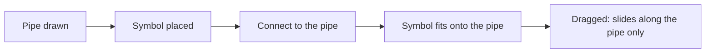

# Pipes in the synoptic

> [Home](../../README.md) › [Symbols](../README.md) › [Pipes](README.md) › Pipes in the synoptic

Status: draft. Not validated. This page belongs to part 3 (the synoptic), which is not written yet. It only records what is decided about pipes in the synoptic, so that it is not lost.

## Rules

- In the synoptic mode, a **pipe tool** draws pipes between the connection points of symbols (see [Connection points](connection-points.md)).
- The user clicks point after point. The segments are straight. Everything else is computed (see [Pipes](README.md)).
- **Junction**: the user clicks inside an existing pipe, then draws a branch. The editor computes the junction; the pipe is not cut and stays **one pipe, as a tree**, with one style and one flow. The junction takes the look set in the pipe style (see [Junctions](junctions.md)).
- The angles take the **corner radius of the style**; there is no path kind to choose on a pipe.
- **Crossing**: where a pipe passes over another, the editor computes a bridge, a gap or nothing, according to the pipe style (see [Crossings](crossings.md)).
- **Which pipe is on top**: when the mouse is over a crossing, the editor highlights it. A click changes which of the two pipes passes over the other.
- The user chooses the style of each pipe among those of the Symbol Lib, then its start and end shapes, or none; where the end shapes are made is open (see [Pipe ends](ends.md)).
- **What connects to what**: a pipe connects to a symbol (by its connection points) or to another pipe (a junction).

### A symbol connected to a pipe

Decided.

- The user draws a pipe, places a symbol, and sets the symbol **connected to the pipe** ("Connect to the pipe").
- The symbol then fits onto the pipe and stays attached to it. It can only be moved **along the pipe**, never freely: dragging it slides it along the pipe.
- When the pipe moves or changes, the symbol stays on it.
- It lets a valve, a reducer or a flow arrow stay on its pipe instead of being placed by hand next to it.
- Assumptions of the assistant, to confirm: the symbol turns with the segment it sits on and follows it through the bends (as in the archived Figma page); "Connect to the pipe" has a visible equivalent in the panel of the symbol, and can be undone to free the symbol.

## What the research found

Source: the second research report (`research/t4-…/rapport.md`, sections 3.1, 3.3, 3.5). To use when part 3 is written.

- Drawing: Ignition draws orthogonal segments by default (Alt: steps of 15 degrees, Shift: free). Opinion: an **orthogonal lock** while drawing, like the angle lock of the pen.
- The archived Figma page gives a pipe a panel: style (with "edit this style"), path kind (Straight, Right angles, Rounded, not kept: the corner radius of the style is enough), start and end, inline symbols with their position in percent, crossings (with "swap all").
- **Inline symbol** (archived page, Plant 3D): right click on the pipe, pick a symbol with two connection points; it slides along the pipe, bends included, without leaving it; removed, the pipe keeps its place and points. Advised by the report, and decided (see above).
- A branch leaves one pipe as a tree in the archived page and in Ignition: the rule kept (see [Junctions](junctions.md)).
- Automatic routing (libavoid): not in the first version, the user draws by clicks.

## Open questions

- A symbol connected to a pipe: any symbol, or only those with two connection points (in and out)? Is the pipe cut under the symbol (it goes in one side and out the other) or does the symbol sit on top of a continuous pipe? Where is its position kept (a distance or a percentage along the pipe)? What happens to it when the pipe is shortened, split or deleted?
- Which Symbol Lib do the pipe styles come from when a synoptic uses several libraries?
- How is a pipe attached when it is moved, joined or deleted, and what happens to its branches when one of them is deleted?
- A pipe whose style is linked to a type (decided 2026-11-11, see [Pipe styles](pipe-styles.md)): how it is wired to the model in the synoptic, like a placed symbol with a type; and whether its branches share its values (assistant's reading, the tree being one flow).
- How is a pipe drawn between two points that are not at right angles, and how does the editor route it (automatic routing or only the user's clicks)?
