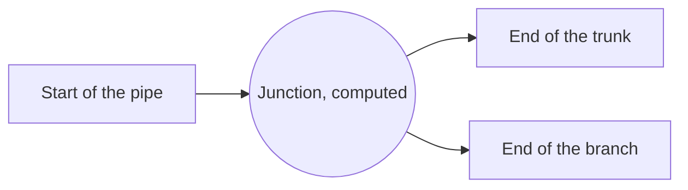

# Junctions

> [Home](../../README.md) › [Symbols](../README.md) › [Pipes](README.md) › Junctions

Status: draft. Not validated.

A junction is a place where a branch leaves a pipe.

## Rules

- A junction is made in the synoptic: the user clicks inside an existing pipe and draws a **branch** from there. The editor computes the junction (see [Pipes in the synoptic](in-the-synoptic.md)).
- The pipe **stays one pipe, as a tree**: it is not cut at the junction, and the branch belongs to it. The whole tree has **one pipe style and one flow**.

- The look of a junction is set in the **base pipe style** of the Symbol Lib, and a pipe style can override it (see [Pipe styles](pipe-styles.md)); it is not a separate list of the Symbol Lib. It is computed; the user does not edit it by hand.
- **Propagation**: when the dashes of a pipe move, the movement goes on through the junction into the branches, following the flow (see [Pipe styles](pipe-styles.md)).
- The junction of a pipe style is one of:

| Kind | What it looks like |
| --- | --- |
| Flat | No effect: the pipes simply meet. |
| Circle | A circle at the junction, bigger than the pipe, to show that it is a junction. |
| Square | A square at the junction, bigger than the pipe. |

- A junction has only two settings: its **kind** and, for a circle or a square, its **size**.
- Its **border** is the border of the pipe: on or off, width and position (inside, in the middle, outside) come from the base pipe style, and its fill from the pipe style. It is never set on the junction.
- Its **fill** is not a setting either: the junction takes the **body fill of the pipe style** (Product Owner, 2026-11-23).

## Example

Base style: border on, 2 px, outside.

| Pipe style | Junction kind | Size | What it looks like |
| --- | --- | --- | --- |
| Steam | Flat | - | The pipes simply meet. |
| Water | Circle | 12 px | A blue circle with the dark grey 2 px border of the water pipes, outside. |
| Oil | Square | 12 px | A square filled like the oil body, with its border. |

## What the research found

Source: the second research report (`research/t4-…/rapport.md`, sections 3.1, 3.5, 3.7).

- In Ignition, a pipe is a tree of "connections" from an "origin": two pipes laid on each other merge. In the archived Figma page, a branch adds a junction at its start and **the original pipe stays one pipe**; the branches are found by the editor, only the marker is styled. libavoid has a "JunctionRef", fixed or free. draw.io joins two links with a "waypoint" shape.
- Opinion of the report: one pipe as a tree, the rule kept above.
- The archived page names the kinds Plain, Circle, Square, with a diameter "bigger than the pipe", a fill and a stroke.
- Proposed names: **Junction** (the place), **Junction marker** (the shape), **Branch** (the pipe that leaves).
- Three or more pipes at one point: an order between the pipes, then each pair is handled (opinion of the report).

## Open questions

- A pipe that ends on another pipe of another style: is it a branch of that pipe (it takes its style), or two pipes that meet?
- Where several pipes of different styles meet, which style gives the fill and the border of the junction?
- When the body fill of the pipe style is a dash sequence, how is the junction filled?
- Is the junction size a fixed value or a multiple of the pipe width?
- Can the junction of a style be something else than a circle or a square (a free shape, like the ends of a pipe)?
- How are 3-way, 4-way and more junctions, and a junction on a corner, handled by the computation?
