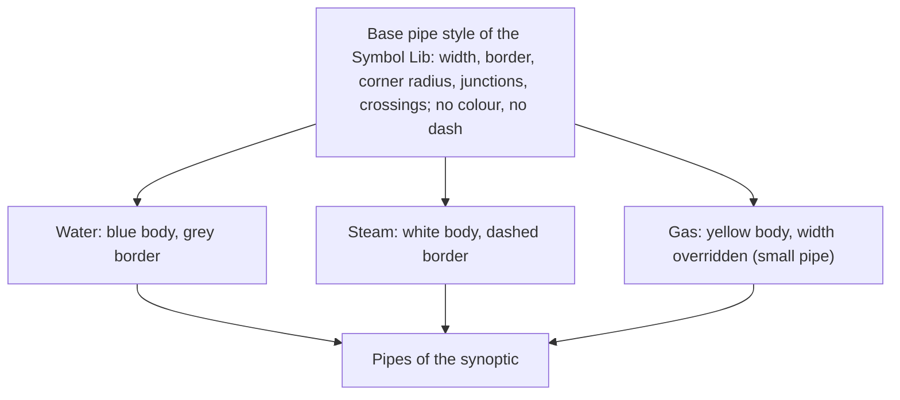
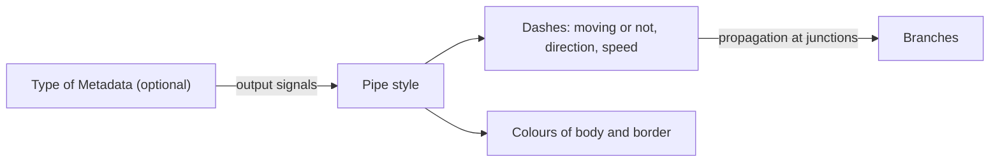

# Pipe styles

> [Home](../../README.md) › [Symbols](../README.md) › [Pipes](README.md) › Pipe styles

Status: draft (the base style and its overrides were described on 2026-11-11, after the second research). Not validated.

How a pipe looks. A Symbol Lib has **one base pipe style**, the shape shared by all its pipes, and **pipe styles** (water, oil, steam...) that give the fills: plain colours or dash sequences.

## Rules

### The base pipe style

- Each Symbol Lib has exactly one base pipe style. It is the global shape of all the pipes of the library. It holds **no colour and no dash**: the fills belong to the pipe styles.
- It holds the options below.

| Option | What it does |
| --- | --- |
| Width | The width of the body of the pipe, in pixels. |
| Border | On or off. When it is on, it is on **both sides** of the pipe, the same on each side. |
| Border width | The width of the border, in pixels. |
| Border position | **Inside**, **in the middle** or **outside** the edge of the body, as for the border of a shape (see [Fill and border](../04-drawing-mode/fill-and-border.md)). Inside, the border eats into the width of the body; outside, it adds to it. |
| Corner radius | Rounds the angles of the pipe (see below). The same for every pipe style: it is never overridden. |
| Junctions | How a branch looks: flat, circle or square, with its size; its fill and border are those of the pipe (see [Junctions](junctions.md)). |
| Crossings | What happens where a pipe passes over another: bridge, gap, none, with a size (see [Crossings](crossings.md)). |

- Junctions and crossings are parts of the style, not separate lists of the Symbol Lib. They are computed from the style; the user never draws them on each pipe.
- The base pipe style has no start and end shapes: they have a list of their own on the Pipes page (see [Pipe ends](ends.md)).

### Pipe styles: the fills, and some overrides

- A pipe style has a **name** (free text: "Water", "Oil", "Steam", "Electricity").
- It sets the **fills**, which the base style does not have:

| Option | What it does |
| --- | --- |
| Body fill | What fills the body: a plain colour, or a **dash sequence** that follows the pipe from its start to its end (see [Dash sequences](#dash-sequences)). |
| Border fill | A plain colour or a dash sequence, like the body. Shown when the base style has a border. |
| Moving dashes | On or off: the dashes of this style travel along the pipe (see [Moving dashes](#moving-dashes)). |
| Speed | The speed of the moving dashes, when no model drives it. |

- **Any other option of the base style can be overridden** when needed, except the corner radius. Example: in the plant, gas pipes are small pipes; the user wants them drawn small in the synoptic, so the "Gas" style overrides the width.
- An option that is not overridden follows the base style: when the base style changes, every pipe style that did not override that option changes with it.
- Proposed by the assistant, to confirm: the panel shows which options are overridden, and each override can be reset to the base value.
- The content ("what the pipe contains") only names and groups the styles. The editor does not know what a fluid is.
- A pipe has one pipe style, chosen in the synoptic; its branches have the same (a pipe is one tree, see [Junctions](junctions.md)). The base style has no colour, so a pipe always has a pipe style (assumption of the assistant, to confirm).
- A pipe style is stored in the Symbol Lib and used by identifier, as a symbol is linked to its type (the rules of broken links are to be written like for symbols).

### Dash sequences

The rule, for pipes and for **every border** of the software (the borders of shapes too, see [Fill and border](../04-drawing-mode/fill-and-border.md)):

- Dashes are not "a dash length and a gap". They are a **sequence of segments**, each with a **length** and a **colour**, repeated along the line.
- A gap is simply a segment with a **transparent** colour. Classic dashes: black 4 px, transparent 4 px. Two-colour dashes: red 4 px, black 4 px, repeated.
- The sequence can be as long as the user wants (red, black, red, transparent...).
- A body filled with a dash sequence shows dashes that run along the pipe from its start to its end.

Example:

| Sequence | Result |
| --- | --- |
| Black 4, transparent 4 | Classic dashes |
| Red 6, black 6 | Red and black stripes |
| Black 8, transparent 2, black 2, transparent 2 | Dash and dot |
| Black 10, transparent 20, red 2 | A long black dash, a long gap, a short red mark, then again black, gap, red |

### Computing the dashes

- Everything about a pipe is computed, the dashes too: they are computed from the drawn pipe, so that they follow it, corners and arcs included.
- The computation aims for the cleanest result: dashes that run continuously along the pipe, with no odd piece where it can be avoided.
- It is not a hard requirement: where a dash cuts a little oddly in a corner, it is accepted as it is.

### Moving dashes

- **Each pipe style** has an option to make its dashes **move**: they travel along the pipe to show the flow. The on or off and the speed are set in each pipe style, never in the base style (Product Owner, 2026-11-23): Water can move while Gas stays still.
- The dashes move **from the start of the pipe to its end**. The direction is not chosen in the style: it is **animated**. A pipe style linked to a type can turn it from end to start through a signal (see below).
- **Propagation**: where a branch leaves the pipe (a junction), the movement goes on into the branch, following the flow: the whole tree is one flow. The pipe is no longer a plain drawing: it behaves half like a symbol.
- The **speed** is set in the pipe style when no model drives it; its unit is open.
- Assumption of the assistant, to confirm: the movement can be stopped by a global setting and by the system setting "reduce motion" (advised by the research).

### A pipe style linked to a type

- A pipe style **can** be linked to a type of Metadata, if the user wants it. It is optional: a style with no type is a drawing, with fixed or moving dashes as set above.
- Linked to a type, the style is animated by the model, like a symbol with a type (see [Animation mode](../08-animation-mode/README.md)). Examples:
  - the **speed** of the moving dashes follows a value of the model;
  - the **colours** (body, border) change with what happens;
  - the **direction** of the movement changes with the model: start to end or end to start, through the built-in enum **pipe direction** of Metadata (see [Built-in enums](../../metadata/draft.md#built-in-enums));
  - and other properties of the style, "plenty of things like that".
- The type is chosen among all the types of Metadata, as for a symbol: there are no libraries of types.
- Assumption of the assistant, to confirm: only output signals animate, with the same shapes of mapping as for symbols (bounded linear, by ranges, two values for a boolean, state table for an enum).
- Each pipe of the synoptic then gets its own values from the model, as a placed symbol does (to write in part 3).

### Corner radius

- The user draws a pipe with straight segments only: click, click, click.
- The corner radius rounds each angle of the pipe. A right angle then gets a curve, which makes the pipe a little more stylised.
- With a radius of 0, the angles stay sharp.
- It is set once, in the base style, and is the same for every pipe style: different radii side by side would look odd.
- The radius also decides the look of the bridges at crossings (see [Crossings](crossings.md)).
- It is the only setting of the angles: there is no path kind (straight, right angles, rounded) to choose on each pipe.

## Example

Base style of the library "Plant A": width 6 px; border on, 1 px, outside; corner radius 8 px; junction circle 12 px; crossing bridge.

| Pipe style | Fills | Moving dashes | Overrides |
| --- | --- | --- | --- |
| Water | Body blue; border dark grey. | Off | — |
| Steam | Body white; border dashes: grey 4, transparent 4. | On | — |
| Oil | Body dashes: black 10, transparent 20, red 2; border dark grey. | On | — |
| Gas | Body yellow; border dark grey. | Off | Width 3 px (small pipes). |
| Electricity | Body yellow. | Off | Border off; width 2 px; crossing none. |

## What the research found

Source: the second research report (`research/t4-…/rapport.md`, sections 3.2, 3.4, 3.5, 3.6, 3.7). Written before the base style and dash sequences above: what they settle is said under each point.

### Name of the content

- Words found: service, fluid, appearance, line variation, content. Opinion of the report: keep **Content**, as a simple group label ("fluid" excludes electricity; "service" is the trade word, to quote in the documentation).

### Body and borders: two ways

| Way | Principle | For | Against |
| --- | --- | --- | --- |
| A · Two strokes on top of each other | A wide stroke (the border) under a narrower one (the body), on the same centre line. It is what the archived Figma page does ("Pipe — outline", "Pipe — core"). | Native, no outline to compute, native dashes possible. | These are SVG strokes; native dashes have one colour only. |
| B · Computed outlines | The engine computes the polygons of the body and of each border by offset. | Follows "a border is a fill"; inside, middle and outside borders; dash sequences of several colours. | Computed at each move of a point. |

- The rules (border inside, in the middle or outside; dash sequences of several colours; everything computed) match **way B**. Inference of the assistant, to confirm with the POC P9 (cost of the computation).

### Flow dashes

- Native dashes (`stroke-dasharray`, moved by `stroke-dashoffset`) exist only on a stroke and have **one colour**. A sequence of several colours is therefore computed.
- The report advised a separate native stroke for the flow dashes. **Superseded**: the dashes are now a fill of the body or of the border, computed.
- Animating dashes redraws the pipe at every frame; a WebKit bug reports a high load with a single `stroke-dashoffset` animation. An animation that lasts more than five seconds must be possible to pause (WCAG), and the system setting "reduce motion" can be read by the browser.
- The cost follows the number of dashes: the POC P8 (number of dashes) and P10 (animated dashes on 10 to 500 pipes) still apply, now on computed dashes.

### What can drive the look of a pipe

| Option | Principle | Opinion of the report |
| --- | --- | --- |
| A · Nothing | The pipe is a drawing; its dashes are fixed. | The simplest; poor compared with SCADA tools (ThingsBoard: fluid present, flow present, direction, speed, leak). |
| B · The pipe has a type of Metadata | A "dynamic" pipe style is linked to a type (signals: flow present, direction, state), like a dynamic symbol. | **Advised**, limited to three signals: a boolean "flow present" (dashes moving or still), a direction (forward, backward), an enum of state that changes the style (hot, cold). A speed proportional to the flow is refused first: the eye cannot read it. Confidence: low (one tool source). **Chosen, without the limit to three signals: the speed can follow the model.** |
| C · The pipe borrows a signal of a neighbouring symbol | In the synoptic, a signal of a connected symbol is picked. | Quick, but links a drawing to another in a fragile way. |

## Open questions

- Which properties of a style a signal can drive, beyond the speed, the direction and the colours (width, dashes on or off, border on or off...)?
- Can the base pipe style be linked to a type, or only the pipe styles?
- In which unit is the speed of the moving dashes set (pixels per second)?
- A pipe linked to a type is one tree, one flow: do its branches share its values (assistant's reading), or can a branch have its own (a closed valve on one branch, stopping the movement downstream)?
- Can a style hold several layers (the body, then a border, then a second line), or just the options above?
