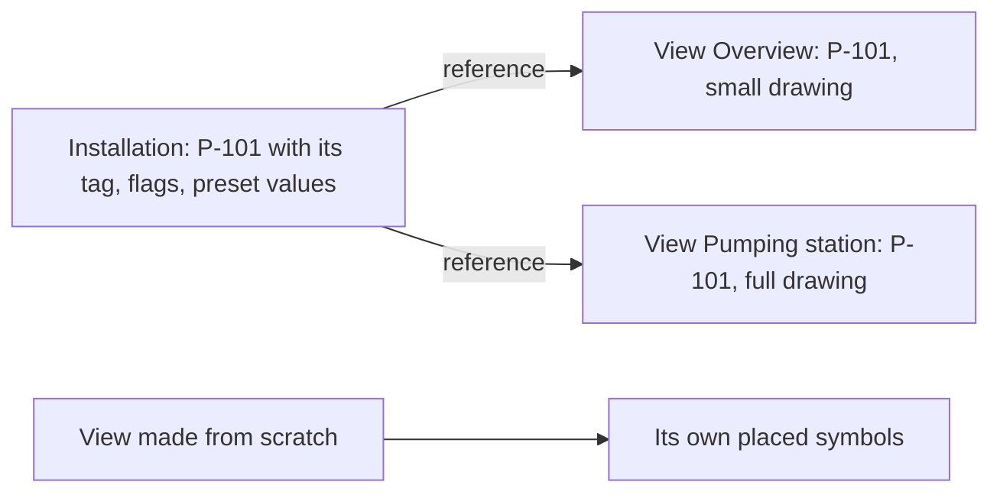

# Synoptics and views

> [Home](../README.md) › [Synoptics](README.md) › Synoptics and views · Next: [Synoptic editor](02-synoptic-editor.md)

Status: extrapolated by the assistant on 2026-11-20, from the [introduction](../overview/introduction.md) (two modes: full installation, summary view) and the layout rules. Not validated.

A **synoptic** is one drawing of the installation, saved as one file in the folder of the application. There are two kinds: the **installation**, where every object is placed once, and the **view**, a summary made for operators.

## Rules

### What a synoptic is

- A synoptic is **one canvas**, saved as **one file** in the folder the application points to (see [Storage](../storage/README.md)). Proposed.
- It has a **name**, a **kind** (installation or view), a **frame** (its size in pixels) and a **background colour**. Proposed.
- It uses **one or more Symbol Libs**: their symbols can be placed, their pipe styles can be drawn. Proposed: the list is set on its General page; a symbol of a library not in the list cannot be placed until the library is added.

### Two kinds: installation and view

The introduction names two modes: the full installation, and a more digestible summary view, made from scratch or from the installation. The assistant proposes to make them two kinds of synoptic.

| Kind | What it holds | Who reads it |
| --- | --- | --- |
| **Installation** | Every object of the installation, placed once: each placed symbol has its own identity (identifiers, flags, template items, preset values). | Those who model, specify or simulate the installation. |
| **View** | A summary: some placed symbols, laid out for a screen. A placed symbol of a view can be a **reference** to a placed symbol of an installation: it shares its identity, and only its position and look are its own. | Operators, through the runtime. |

- **Proposed: a reference shares the identity, never copies it.** Pump `P-101` is wired once, in the installation. The overview view and the pumping view show the same `P-101`: its tag, its flags and its values are the same everywhere. Changing its tag in one place changes it everywhere.
- A view can also hold **its own placed symbols**, which are not in any installation (a view made from scratch). They have their own identity, as in an installation. Proposed.
- A reference shows the **same symbol**, or another symbol **of the same type** (a simpler drawing for an overview). Proposed; the type stays fixed, as Metadata decided for every placed symbol.
- Option not advised: a view is a plain copy of the installation's objects. Simpler, but `P-101` would then be wired twice, and the two copies would drift apart.

### Creating a view from an installation

- In an installation, the user selects objects, then **Create a view from the selection**. Proposed.
- A dialog asks the name of the view, whether to keep the pipes between the selected symbols, and whether the placed symbols become references (advised) or copies. Proposed.
- The view opens with the selection at the same relative positions; the user then rearranges it.

### Navigation bar of the synoptic mode

Same principle as the bar of the symbol mode (decided for Metadata and Symbols: one bar per part, on the far left). Proposed for this part:

1. At the top, a **small +** that creates a synoptic (asks its name and kind).
2. Then the **list of the synoptics**, installations first, then views. Proposed: as a tree with folders, since a plant may have dozens of views; how a synoptic looks in the bar (icon, initials) follows the bar of the symbol mode, still open there.
3. After a **separator**, the **pages of the selected synoptic**, shown only once one is selected:
   1. **General**: its settings (below);
   2. **Canvas**: the [editor](02-synoptic-editor.md);
   3. **Placed symbols**: a table of every placed symbol of the synoptic, one line each, with its symbol, type, tag and the state of its identity (see below);
   4. **Faults**: the [list of what is broken or incomplete](08-faults.md), with a counter.

```mermaid
block-beta
    columns 4
    rail["Bar: small +, synoptics (installations, then views), separator, General, Canvas, Placed symbols, Faults"] left["Left-hand panel of the page"] main["Canvas or page"]:2
```

### General page of a synoptic

| Field | What it sets | Status |
| --- | --- | --- |
| Name | Free text. | Proposed |
| Kind | Installation or view; changing it is open. | Proposed |
| Frame | Width and height in pixels; a list of common screens (1920 × 1080, 2560 × 1440, 3840 × 2160) and a custom size. | Proposed |
| Background | A colour; the HMI guides read by the research advise a grey background (`research/t4-…/rapport.md`, key message 6). | Proposed |
| Symbol Libs used | The libraries whose symbols and pipe styles this synoptic uses; the first one gives the pipe styles offered first. | Proposed |
| Description | Free text, for the people who maintain it; never sent anywhere. | Proposed |
| Home | Ticked on one view only: the view the runtime opens first. | Proposed |

### The page Placed symbols

- A **table**, one line per placed symbol, taking the whole width (layout rule). Columns: thumbnail, symbol, type, the identifiers in the order of Metadata, preset, number of faults. Proposed.
- It is the quickest way to fill the tags of a big installation: the identifier cells are text fields, typed one under the other, like a spreadsheet. Proposed.
- A click on the thumbnail opens the canvas with the placed symbol selected and zoomed. Proposed.
- Sorted and filtered by type, by symbol, by fault. Proposed.

## Example

| Synoptic | Kind | What it holds |
| --- | --- | --- |
| Water treatment | Installation | 120 placed symbols, 85 pipes: every pump, valve, tank and sensor of the plant. |
| Overview | View, home | 12 references (the main pumps and tanks), simple drawings, no small pipes. |
| Pumping station | View | 18 references and 2 placed symbols of its own (a legend, a clock). |

## Where it is used

| Thing | Created and changed in | In a symbol | In a synoptic |
| --- | --- | --- | --- |
| Synoptic, its kind and frame | Synoptic mode, General page | No | Create, edit |
| Reference to a placed symbol of an installation | Create a view from the selection, or placing from the installation | No | Create, move, change its drawing |
| Symbol Libs used by a synoptic | General page | No | Choose |

## Open questions

- Is the summary view a kind of synoptic with references (advised), a plain copy, or a view stored inside the installation file? (It answers the open question of the introduction.)
- Is the frame fixed (a target screen, advised) or is the canvas infinite, with the runtime fitting what is drawn?
- Can a synoptic change kind once created?
- Is there one installation per folder, or several (one per building)?
