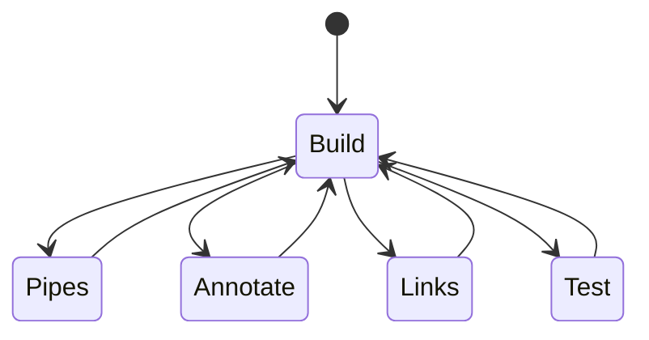

# Synoptic editor

> [Home](../README.md) › [Synoptics](README.md) › Synoptic editor · Previous: [Synoptics and views](01-synoptics-and-views.md) · Next: [Placed symbols](03-placed-symbols.md)

Status: extrapolated by the assistant on 2026-11-20, from the layout of the [symbol editor](../symbols/03-editor/README.md) and the [layout rules](../screens/README.md#layout-rules). Not validated.

The editor is the page **Canvas** of a synoptic. It has the same skeleton as the symbol editor, so that a user who knows one knows the other.

## Rules

### Layout

The same columns as the symbol editor (decided layout rules: list on the left, panel of the selection on the right). Proposed for this part:

```mermaid
block-beta
    columns 5
    rail["Navigation bar"] left["Left-hand panel: Library, then Objects"] canvas["Canvas: modes menu floating top left, tool bar floating at the bottom, faults drawer"]:2 panel["Right-hand panel: the selection, or the synoptic when nothing is selected"]
```

- **Left-hand panel, top: Library.** The symbols of the Symbol Libs used, one tree per library, with a search field (magnifier) and thumbnails. A symbol is dragged onto the canvas, or clicked then placed by a click. Proposed.
- **Left-hand panel, bottom: Objects.** Everything in the synoptic, as the layers of the symbol editor: placed symbols, pipes, annotations, links. Folders the user creates ("Building A", "Filtration") group them. The order is the stacking order. Hide and lock per line. Proposed.
- **Canvas.** The frame of the synoptic (its size, see [Synoptics and views](01-synoptics-and-views.md#general-page-of-a-synoptic)) on a neutral background; what is outside the frame is not shown by the runtime. Proposed.
- **Right-hand panel.** The options of the selection: a [placed symbol](04-placed-symbol-panel.md), a [pipe](05-pipes.md#the-panel-of-a-pipe), an [annotation](06-annotations.md). When nothing is selected, the settings of the synoptic (same fields as the General page). Proposed.

### Modes

A floating **modes menu** at the top left of the canvas, as in the symbol editor (decided there). Proposed modes:

| Mode | What it is for | Tools |
| --- | --- | --- |
| **Build** (default) | Place symbols, move, rotate, mirror, align, distribute, group in folders, lock. | Select, Hand, Place, Align (the alignment of the symbol editor) |
| **Pipes** | Draw and edit pipes, branches, crossings. | Select, Hand, Pipe, Edit points, Orthogonal lock |
| **Annotate** | Draw what is not a symbol: texts, areas, shapes, legends, value labels. | Select, Hand, the drawing tools of the symbol editor, Legend, Value label |
| **Links** | Make zones and placed symbols open another synoptic. | Select, Hand, Link zone |
| **Test** | Try the synoptic with test values, as the Run mode of a symbol. | Hand only |

- The **faults** are not a mode: a drawer at the bottom of the canvas, open in every mode, shows those of the open synoptic (see [Faults](08-faults.md)). Proposed.

### Moving around

The same as the symbol editor: the **Hand** tool, the middle button held, the wheel, a **zoom** field where a value can be typed (decided there). Added for big installations, proposed:

- **Fit the frame** and **fit the selection**, one button each.
- A **minimap** in a corner of the canvas, shown on demand: the whole frame, the visible part as a rectangle that can be dragged.
- **Search on the canvas**: typing `P-101` selects and zooms on the placed symbol whose designation has this text.

### Grid, snapping, guides

Proposed, from the minimum set the research advised for the symbol editor (report T4, section 3.17, 14e):

- A grid, shown or hidden, with a step in pixels set on the synoptic (default 8 px).
- Snapping to the grid, to the **connection points** of the symbols (pipes), to the edges and centres of the other objects, with temporary guides of alignment and of equal spacing.
- Arrow keys move the selection by 1 px, with Shift by 10 px.

### Undo, redo, copy, paste

- **Undo and redo** with the usual keys: the undo history keeps every action, as everywhere in the application (Product Owner, 2026-11-23, decision 0093; see [Undo history](../storage/files-and-conflicts.md#undo-history)). One history per open synoptic, kept until it is closed: proposed, open with the history.
- **No Save button**: each change is written to the synoptic file as it is made, by the server, with the conflict check of [Storage](../storage/files-and-conflicts.md#saving) (Product Owner, 2026-11-23).
- **Copy and paste**, also between two synoptics. A pasted placed symbol is a **new** placed symbol: it keeps the symbol, the preset and its values, but its designations are **emptied**, since a tag is meant to be unique. Paste as reference is offered when the copy comes from an installation and is pasted into a view.
- **Duplicate** (Ctrl + D): the same as copy and paste, beside the original.

### Multi-selection

- Several placed symbols selected: the panel shows the sections they share; a value changed applies to all. Proposed.
- **Numbering**: with several placed symbols selected, a designation can be filled with a pattern, `P-1{n}` from 01, in the order of the selection or from left to right. Proposed.
- Pipes and placed symbols selected together can be moved together; the pipes follow (see [Pipes](05-pipes.md)).

### Performance

- The goals of the project hold here: under the maximum set between a gesture and its display, and 120 images per second on a 120 Hz screen as a goal (criteria C14 and C15). Moving a symbol with ten pipes is the case to measure: only the segments touched are recomputed (see the research summary in [Pipes](../symbols/pipes/README.md#computing-pipes)).

## Example

The user opens the installation "Water treatment", Build mode. They search "pump" in the Library, drag three centrifugal pumps onto the canvas, select them, type the pattern `P-10{n}` in the designation Tag: the three pumps become `P-101`, `P-102`, `P-103`. Then they switch to Pipes and connect them.

## Where it is used

| Thing | Created and changed in | In a symbol | In a synoptic |
| --- | --- | --- | --- |
| Library panel | Synoptic editor | No | Pick a symbol to place |
| Objects panel, folders | Synoptic editor | No | Create, order, hide, lock |
| Modes of the synoptic editor | Synoptic editor | No (the symbol editor has its own) | Use |
| Grid step | Settings of the synoptic | No (open there) | Set |

## Open questions

- The names of the modes (Build, Pipes, Annotate, Links, Test): working names.
- Is the Library a second panel on the left (advised, as the symbols and their layers), or a floating window?
- Does the Objects panel group by kind (symbols, pipes, annotations) or follow the stacking order only?
- Does the grid step belong to the synoptic, to the project, or to the user?
