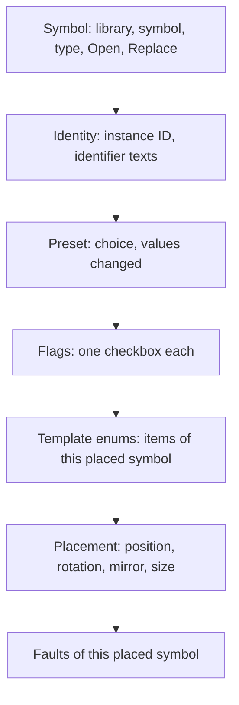

# Panel of a placed symbol

> [Home](../README.md) › [Synoptics](README.md) › Panel of a placed symbol · Previous: [Placed symbols](03-placed-symbols.md) · Next: [Pipes](05-pipes.md)

Status: extrapolated by the assistant on 2026-11-20. It gathers in one panel what Metadata leaves "to the synoptic, part 3" (identifier texts, flags, template items, preset). The Product Owner settled the instance ID and what the preset lets a synoptic change the same day; the rest is not validated.

The right-hand panel of the synoptic editor, when one placed symbol is selected. It is where a placed symbol gets its identity.

## Rules

- One panel, **sections one under the other**, each with a title and folded or unfolded by a click on it. The order goes from what the user fills most to least. Proposed.
- A section with something to fill shows a **small warning mark** on its title, the same as in the [faults](08-faults.md). Proposed.

### Symbol

| Element | What it does | Status |
| --- | --- | --- |
| Thumbnail, Symbol Lib › symbol | What is placed. | Proposed |
| Type | Read only: the type never changes in a synoptic. | Decided ([Type and symbol](../metadata/draft.md#type-and-symbol)) |
| Open the symbol | Opens it in the symbol mode, in its Symbol Lib. | Proposed |
| Replace | Another symbol of the same type (see [Replacing a symbol](03-placed-symbols.md#replacing-a-symbol)). | Proposed |
| Reference | In a view: "From the installation Water treatment", with a link that opens the placed symbol there. The sections below show the identity of the installation's placed symbol: a change made here is made there. | Decided (a reference shares the identity, 2026-11-20), Proposed (the link) |

### Identity

- **Instance ID**: the key of the placed symbol in the configuration files and in the signal list (`pump_p101.speed`). Decided on 2026-11-20: every placed symbol has an instance ID of its own, a field apart from the identifiers of Metadata; the tag is never the key. Proposed: set by the software from the type's `id` and a number (`centrifugal_pump_3`), changed by the user, unique in the folder. Its name waits for the research on the names of identifiers (task T5), the same question as in Metadata.
- **Identifiers**: one text field per identifier of Metadata **used by the faceplate of the preset** (decided: "the identifiers used give the synoptic its list to fill"), in the order of the Identifiers page, with their display name. Proposed: the identifiers not used by the preset are not shown.
- **Uniqueness**: a text already used by another placed symbol, for the same identifier, is marked at once in the field, and listed in the faults as a warning. It is never refused: the user may be in the middle of renaming. Proposed; Metadata left open whether it is checked.

### Preset

- **Preset**: a select of the presets of the type (decided: in a synoptic only the preset can be changed).
- Decided on 2026-11-20: a synoptic may change, for one placed symbol, the **default values**, the **display units**, the **decimals** and the **texts** of the title and description elements of its faceplate. Nothing else of the preset changes in a synoptic.
- Decided on 2026-11-20: these changes are **kept as changes from the preset**. A placed symbol that changes nothing follows its preset when the preset changes.
- Under the select, a table of the values this placed symbol changes: signal, default value, display unit, decimals, then the texts. Proposed (the table).
- A changed value shows a dot, and a **Reset to the preset** button on its line (decided on 2026-11-20); the dot is proposed, like the overrides of a pipe style.
- A value typed is kept in the default unit of its quantity, as every number typed in Metadata (decision 0051); the screen shows it in the display unit. Proposed: the same rule here.
- Still to align: the [Metadata draft](../metadata/draft.md#in-a-symbol-and-in-a-synoptic) says "in a synoptic, only the faceplate can be edited". This page follows the Product Owner's answer of 2026-11-20; the sentence of Metadata is left as it is until Metadata may be changed.

### Flags

- One **checkbox per flag of the type**, own and inherited, with its description beside it, so that it is ticked knowingly (decided: [Flags](../metadata/draft.md#flags), the description is shown when editing a synoptic).
- In the order of the type's flags. Nothing is ticked on a new placed symbol. Proposed.

### Template enums

- One block per **enum signal of the type that points to a template**, titled with the signal and the description of the template (decided: the items are completed on each placed symbol).
- Each block is a **table of items**: key, display text, description, with the small + on the right of its title and a delete button at the far right of each line (layout rules of the application).
- Until a block has at least one item, the placed symbol shows the **small warning** decided in Metadata, on the canvas and in this section. It never stops the user from working.
- Proposed: **Copy the items from** another placed symbol of the same type, for ten switches with the same positions.

### Placement

| Element | What it does | Status |
| --- | --- | --- |
| X, Y | Position of the frame of the symbol, in pixels, number fields. | Proposed |
| Rotation | Four buttons: 0°, 90°, 180°, 270°. | Proposed |
| Mirror | Two toggles: horizontal, vertical. | Proposed |
| Size | Number field in percent. | Proposed |
| On a pipe | When connected: the pipe, the distance from its start, **Free from the pipe**. | Proposed (the connection is decided) |
| Locked, hidden | Two toggles, as on its line in the Objects panel. | Proposed |

### Faults of this placed symbol

- The lines of the [faults](08-faults.md) about this placed symbol, with the same **Show** button. Proposed.

## Example

`P-101`, placed symbol of "Motorised centrifugal pump", type `centrifugal_pump`:

| Section | Content |
| --- | --- |
| Identity | Instance ID `pump_p101`; Tag `P-101`; Location `Building A` |
| Preset | `default`; `speed_setpoint` default 1450 rpm changed to 1200 rpm (dot, reset) |
| Flags | `has_bypass` ticked, `remote_start` not ticked |
| Template enums | `mode` (template `pump_mode`): 0 Off, 1 Local, 2 Remote |

## Where it is used

| Thing | Created and changed in | In a symbol | In a synoptic |
| --- | --- | --- | --- |
| Instance ID | Panel of a placed symbol | No | Set, unique; shared by its references in views |
| Identifier texts | Panel of a placed symbol, or the page Placed symbols | No | Fill |
| Flags ticked | Panel of a placed symbol | No | Tick |
| Template items | Panel of a placed symbol | No | Create, edit, delete, copy from another |
| Values changed from the preset | Panel of a placed symbol | Same idea in the right-hand panel of the symbol editor | Change, reset |

## Open questions

- The name of the instance ID: waits for task T5.
- Show only the identifiers used by the preset (advised), or all of them?
- Is a duplicate identifier text a warning (advised) or refused?
