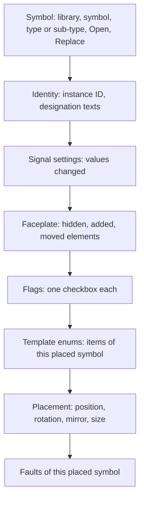

# Panel of a placed symbol

> [Home](../README.md) › [Synoptics](README.md) › Panel of a placed symbol · Previous: [Placed symbols](03-placed-symbols.md) · Next: [Pipes](05-pipes.md)

Status: extrapolated by the assistant. It gathers in one panel what Metadata leaves "to the synoptic, part 3" (designation texts, flags, template items, values changed). The instance ID, the sub-type, and what a synoptic may change are settled; the rest is not validated.

The right-hand panel of the synoptic editor, when one placed symbol is selected. It is where a placed symbol gets its identity.

## Rules

- **Metadata is the strict base, the synoptic the freedom** (Product Owner, 2026-11-24). Metadata is another trade: its types stay clean and shared. On one placed symbol, the synoptic may change almost everything its type gives: its sub-type, its signal settings, its faceplate. A symbol unique among ten synoptics never needs a type of its own.
- **Every change is kept as a change from the type** (decided on 2026-11-20): a placed symbol that changes nothing follows its type when the type changes, and each change has a way back to the type.
- One panel, **sections one under the other**, each with a title and folded or unfolded by a click on it. The order goes from what the user fills most to least. Proposed.
- A section with something to fill shows a **small warning mark** on its title, the same as in the [faults](08-faults.md). Proposed.

### Symbol

| Element | What it does | Status |
| --- | --- | --- |
| Thumbnail, Symbol Lib › symbol | What is placed. | Proposed |
| Type | The type of the symbol, or **one of its sub-types**, chosen here; the signal settings, the faceplate and the flags then come from the sub-type. A select of the type of the symbol and the types down its branch; a reset button sets it back to the type of the symbol. The type of the symbol itself is never changed in a synoptic. | Decided (a sub-type chosen on the placed symbol, 2026-11-24), Proposed (the select, the whole branch) |
| Open the symbol | Opens it in the symbol mode, in its Symbol Lib. | Proposed |
| Replace | Another symbol of the same type (see [Replacing a symbol](03-placed-symbols.md#replacing-a-symbol)). | Proposed |
| Reference | In a view: "From the installation Water treatment", with a link that opens the placed symbol there. The sections below show the identity of the installation's placed symbol: a change made here is made there. | Decided (a reference shares the identity, 2026-11-20), Proposed (the link) |

- A sub-type has every signal, command and flag of the type of the symbol, so the animations and interactions of the symbol keep working.
- Changing the sub-type keeps every change already made; a change that points to a signal or an element the new type does not have is ignored while it is missing, as an `internal_id` that no longer exists in a `faceplate_order`. Proposed.

### Identity

- **Instance ID**: the key of the placed symbol in the configuration files and in the signal list (`pump_p101.speed`). Decided on 2026-11-20: every placed symbol has an instance ID of its own, a field apart from the designations of Metadata; the tag is never the key. Proposed: set by the software from the type's `id` and a number (`centrifugal_pump_3`), changed by the user, unique in the folder. Its name is open: the research on names (T5) covered Metadata only.
- **Designations**: one text field per [designation](../metadata/entities/11-designation.md) of Metadata, in the order of the Designations page, labelled by their ID (a designation has no display name since 2026-11-21).
  - **Every required designation** is shown on every placed symbol, whether or not its faceplate uses it, and marked as required.
  - **A required text left empty warns, never blocks**: the field is marked, the section shows the small warning mark, the placed symbol is listed in the [faults](08-faults.md) as a warning, and the synoptic is saved anyway.
  - **A designation that is not required** is shown when the faceplate of the placed symbol uses it (decided in Metadata: the designations used give the synoptic its list to fill). Proposed: the others are not shown.
- **Uniqueness**: a text already used by another placed symbol, for the same designation, is marked at once in the field, and listed in the faults as a warning. It is never refused: the user may be in the middle of renaming. Proposed; Metadata left open whether it is checked.

### Signal settings

- The placed symbol starts from the [signal settings](../metadata/entities/19-signal-setting.md) of its type, or of the sub-type chosen.
- A synoptic may change, for one placed symbol, the **signal settings** of every signal: **start value**, **display unit**, **decimals** (decided on 2026-11-20, confirmed on 2026-11-24: "changer la display unit, tout plein de trucs comme ça"), and the **texts of a boolean**, as a sub-type does (assistant's reading).
- A table of the signals: signal, start value, display unit, decimals, texts of a boolean. Proposed (the table).
- A changed value shows a dot, and a **Reset to the type** button on its line, as the reset of the signal settings of a sub-type ([MD-07](../screens/metadata.md#md-07--signal-settings); decided on 2026-11-20); the dot is proposed.
- A value typed is kept in the default unit of its quantity, as every number typed in Metadata (decision 0051); the screen shows it in the display unit. Proposed: the same rule here.

### Faceplate

Decided by the Product Owner on 2026-11-24: in a synoptic, the faceplate of one placed symbol can be edited whole ("relédition de pop-up en entier"), for a symbol too particular to deserve a type of its own.

- **Hide** an element of the type: it is not shown in the faceplate of this placed symbol. Decided.
- **Add** elements of its own, of the five kinds of the [faceplate builder](../screens/metadata.md#md-14--faceplate), at the top or inside any group. Decided.
- **Move** any element, into a group or out of it, as a sub-type does. Decided.
- **Change the texts** of the title and description elements (decided on 2026-11-20).
- A group left with nothing shown is not shown, as in Metadata.
- **Edit the faceplate**, a button of the section, opens the faceplate builder of [MD-14](../screens/metadata.md#md-14--faceplate) for this placed symbol: the elements of the type look like the elements of a parent in a sub-type (read only, no delete), each with an eye to hide it; the own elements have their delete button. Proposed.
- The section shows how many elements are hidden, added or moved, and **Reset the faceplate to the type**. Proposed.

### Flags

- One **checkbox per flag of the type**, own and inherited, with its description beside it, so that it is ticked knowingly (decided: [Flags](../metadata/draft.md#flags), the description is shown when editing a synoptic).
- In the order of the type's flags. Nothing is ticked on a new placed symbol. Proposed.

### Template enums

- One block per **enum signal of the type that points to a template**, titled with the signal and the description of the template (decided: the items are completed on each placed symbol).
- Each block is a **table of items**: key, display name, description, with the small + on the right of its title and a delete button at the far right of each line (layout rules of the application).
- Until a block has at least one item, the placed symbol shows the **small warning** decided in Metadata, on the canvas and in this section. It never stops the user from working.
- Proposed: **Copy the items from** another placed symbol of the same type, for ten switches with the same positions.

### Placement

| Element | What it does | Status |
| --- | --- | --- |
| X, Y | Position of the frame of the symbol, in pixels, number fields. | Proposed |
| Rotation | Four buttons: 0°, 90°, 180°, 270°. | Proposed |
| Mirror | Two toggles: horizontal, vertical. | Proposed |
| Size | Number field in percent. | Proposed |
| On a pipe | When connected: the pipe, the distance from its start, **Free from the pipe**. | Proposed (the connection is decided) |
| Locked, hidden | Two toggles, as on its line in the Objects panel. | Proposed |

### Faults of this placed symbol

- The lines of the [faults](08-faults.md) about this placed symbol, with the same **Show** button. Proposed.

## Example

`P-101`, placed symbol of "Motorised centrifugal pump", type `centrifugal_pump`:

| Section | Content |
| --- | --- |
| Symbol | Type `centrifugal_pump`, sub-type chosen `centrifugal_pump_with_bypass` (reset) |
| Identity | Instance ID `pump_p101`; Tag `P-101`; Location `Building A` |
| Signal settings | `speed_setpoint` start value 1450 rpm changed to 1200 rpm; `flow` shown in l/s instead of m³/h (dots, reset) |
| Faceplate | `bearing_temperature` hidden; a title "Local only" added at the top (2 changes, reset) |
| Flags | `has_bypass` ticked, `remote_start` not ticked |
| Template enums | `mode` (template `pump_mode`): 0 Off, 1 Local, 2 Remote |

## Where it is used

| Thing | Created and changed in | In a symbol | In a synoptic |
| --- | --- | --- | --- |
| Instance ID | Panel of a placed symbol | No | Set, unique; shared by its references in views |
| Sub-type chosen | Panel of a placed symbol | No (the symbol chooses its type only, 2026-11-24) | Choose, reset |
| Designation texts | Panel of a placed symbol, or the page Placed symbols | No | Fill |
| Signal settings changed from the type | Panel of a placed symbol | No | Change, reset |
| Faceplate changed from the type | Panel of a placed symbol, through the faceplate builder | No | Hide, add, move, change texts, reset |
| Flags ticked | Panel of a placed symbol | No | Tick |
| Template items | Panel of a placed symbol | No | Create, edit, delete, copy from another |

## Open questions

- The name of the instance ID: not treated by the research T5.
- For a designation that is not required: show only those used by the faceplate (advised), or all of them? (A required one is always shown, 2026-11-21.)
- Is a duplicate designation text a warning (advised) or refused?
- May a synoptic change the fields of an element of the type (display name, read or write, input, bounds), or only hide it and add its own? Advised: hide and add, so that a change of the type still reaches the element.
