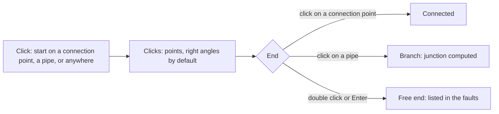

# Pipes

> [Home](../README.md) › [Synoptics](README.md) › Pipes · Previous: [Panel of a placed symbol](04-placed-symbol-panel.md) · Next: [Annotations](06-annotations.md)

Status: extrapolated by the assistant. What is decided stays written in [Pipes in the synoptic](../symbols/pipes/in-the-synoptic.md), in the Symbols part, untouched; this page builds on it. Not validated.

How pipes are drawn and edited in a synoptic. What a pipe looks like (its style, junctions, crossings, ends) is made in the Symbol Lib: see [Pipes](../symbols/pipes/README.md).

## Rules

### Decided on 2026-11-11

- A **pipe tool** draws pipes between the connection points of symbols, point after point, with straight segments; everything else is computed.
- A **branch** starts by a click inside an existing pipe; the junction is computed, with the look of the pipe style.
- A **crossing** gets a bridge, a gap or nothing, as the pipe style says; hovering it highlights it, a click swaps which pipe passes over.
- Each pipe has a **pipe style**. It has no start or end shape: each end is free, or connected to a symbol or to another pipe; an arrow or a flange at an end is a symbol (decision 0098).
- A symbol can be **connected to a pipe**: it fits onto it and only slides along it.

### Drawing a pipe

Proposed, from the research (report T4, sections 3.1 and 3.3) and the tools of the symbol editor:

- The **Pipe** tool of the Pipes mode. The first click starts the pipe: on a connection point, on a pipe (a branch of that pipe, which takes its style), or anywhere (a free end).
- From a connection point, the **first segment leaves towards the next click**: a connection point has no direction since 2026-11-25 (see [Connection points](../symbols/pipes/connection-points.md)); with the orthogonal lock, it is horizontal or vertical, whichever is closer to the mouse (assistant's proposal).
- Each click adds a point. **Orthogonal lock** on by default: segments are horizontal or vertical; Shift held frees the angle. A toggle in the tool bar is its visible equivalent, as for the other keys of the editor.
- A click on a connection point, or on a pipe, ends the pipe there. A double click or Enter ends it with a free end. Escape cancels the pipe being drawn; Backspace removes its last point.
- The pipe gets the **style chosen in the tool bar** (the last used, at first the first style of the first Symbol Lib used).

### Editing a pipe

Proposed:

- **Edit points** (a tool of the Pipes mode, as the point editing mode of a symbol): drag a point; double click on a segment adds a point; Delete removes the selected point.
- **Drag a segment**: it moves parallel to itself, and its two neighbours stretch, so right angles are kept (as draw.io and Visio do).
- **When a symbol moves**, the pipe follows its connection point: only the last segment and its neighbour change, so the rest of the pipe stays where the user put it.
- **Deleting a placed symbol** leaves its pipes in place, with free ends; deleting a pipe leaves the symbols in place.

### Branches

- Decided: a click inside a pipe starts a branch, and the junction is computed.
- Decided: the pipe is not cut; it stays **one pipe, as a tree**, with one pipe style and one flow (see [Junctions](../symbols/pipes/junctions.md)). Changing the style of the pipe changes it on every branch.
- Proposed: Delete on a selected branch removes it, from its junction to its end; the rest of the tree stays. Deleting the pipe removes the whole tree.

### Crossings

- Proposed default rule, advised by the research: **the last pipe drawn passes over**. The click on a crossing is the exception, and is kept.
- In the panel of a pipe: the list of its crossings, and **Swap all**. Proposed (archived Figma page).

### Symbols on a pipe

- Decided: a symbol connected to a pipe fits onto it and only slides along it.
- Proposed: only a symbol with **two connection points** can be connected; the pipe is **not cut** under it: it is drawn under the symbol, which covers it.
- Its place is kept as a **distance from the start of the pipe**, in pixels. When the pipe gets shorter than this distance, the symbol stops at the end, and a fault says so.
- It turns with the segment it sits on; in a bend, it stays on the segment where its centre is. Proposed (the archived page lets it follow the bend; to choose).
- **Free from the pipe** in its panel undoes the connection; the symbol stays where it is.

### The panel of a pipe

| Element | What it does | Status |
| --- | --- | --- |
| Pipe style | Select among the pipe styles of the Symbol Libs used, with "Edit this style" (opens it in the symbol mode). | Decided (select), Proposed (edit) |
| Connected to | Start and end: a placed symbol and its connection point, a pipe, or free. | Proposed |
| Crossings | The list, each with which pipe passes over; Swap all. | Proposed |
| Symbols on the pipe | The list, each with its distance. | Proposed |
| Name | Optional, for the Objects panel and the signal list (`W-02`). | Proposed |
| Identity, values changed, flags | When the style is linked to a type: the same sections as a [placed symbol](04-placed-symbol-panel.md). | Proposed |

### A pipe whose style is linked to a type

- Decided: a pipe style can be linked to a type of Metadata, and the model then drives the speed, the direction and the colours of its dashes.
- Proposed: such a pipe is wired **like a placed symbol**: it gets an instance ID, designation texts, flags, template items and its values changed from the type, in the same sections of its panel. It is listed in the signal list as a placed symbol is.
- Assistant's reading, to confirm: the branches share the values of the pipe, the tree being one flow.

## Example

The user draws `W-01` from the outlet of tank `T-1` to the inlet of pump `P-101`: three clicks, two right angles. Then `W-02` from the outlet of `P-101` to the right. They drop the valve `V-12` on `W-02`: "Connect to the pipe". `W-02` crosses the existing pipe `G-04` (gas): `W-02`, drawn last, passes over with a bridge.

## Where it is used

| Thing | Created and changed in | In a symbol | In a synoptic |
| --- | --- | --- | --- |
| Pipe, its points | Synoptic editor, Pipes mode | No | Draw, edit, delete |
| Its style | Panel of a pipe | Made in the Symbol Lib | Choose |
| Which pipe passes over a crossing | Canvas (click), panel of a pipe | No | Swap |
| Symbol on a pipe | Build mode | No | Connect, slide, free |

## Open questions

- A pipe that ends on another pipe of another style: a branch of that pipe, or two pipes that meet?
- A symbol on a pipe: does it follow the bends (archived page) or stay on one segment?
- Which Symbol Lib do the pipe styles come from when a synoptic uses several? Advised: all those used, grouped by library.
- Should the editor route a pipe around symbols by itself? Not in the first version.
