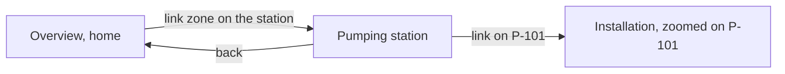

# Navigation links

> [Home](../README.md) › [Synoptics](README.md) › Navigation links · Previous: [Annotations](06-annotations.md) · Next: [Faults](08-faults.md)

Status: extrapolated by the assistant on 2026-11-20. Not validated. What the runtime does with a link depends on the runtime, still an open question of the [introduction](../overview/introduction.md#open-questions).

An operator goes from the overview to the detail of a station, and back. A **navigation link** is what lets them.

## Rules

- A link opens **another synoptic**, or a **placed symbol in another synoptic** (the synoptic opens zoomed on it, the symbol selected). Proposed.
- A link sits on a **link zone**: an invisible or outlined rectangle drawn in the **Links** mode, over anything. Proposed.
- A link can also sit on a **placed symbol**, when its symbol has no interaction on the click: a click on the small overview of a station opens the station. Open: a symbol with its own click interaction (open the faceplate) would get two meanings for one click.
- The **home** view is set on the General page of a synoptic (see [Synoptics and views](01-synoptics-and-views.md#general-page-of-a-synoptic)). Proposed.
- In the editor, links do nothing in the Build mode; they work in the **Test** mode, which can thus follow a navigation between synoptics. Proposed.
- A link to a synoptic or a placed symbol that no longer exists is **broken**: a red mark, a line in the faults. Proposed.

### The panel of a link

| Element | What it does | Status |
| --- | --- | --- |
| Target | A select of the synoptics; then, optionally, a placed symbol of it. | Proposed |
| Look | Invisible, outline on hover, or always outlined. | Proposed |
| Tooltip | A short text shown on hover in the runtime. | Proposed |

## Example

In "Overview", a link zone covers the drawing of the pumping station and opens "Pumping station". In "Pumping station", a link zone "Back to overview" sits at the top left.

## Where it is used

| Thing | Created and changed in | In a symbol | In a synoptic |
| --- | --- | --- | --- |
| Link zone | Links mode | No | Draw, set a target |
| Link on a placed symbol | Panel of the placed symbol, Links mode | No | Set a target |
| Home view | General page of a synoptic | No | Tick |

## Open questions

- May a placed symbol carry a link when its symbol already reacts to a click?
- Should "back" be a link the user draws, or a button of the runtime?
