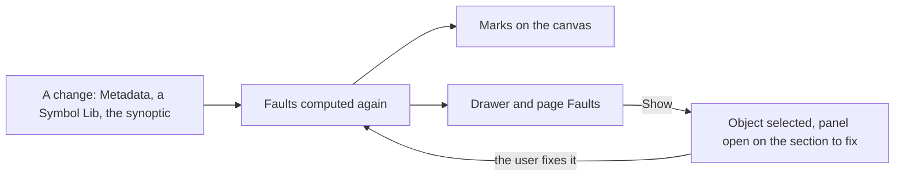

# Faults

> [Home](../README.md) › [Synoptics](README.md) › Faults · Previous: [Navigation links](07-navigation-links.md) · Next: [Test mode](09-test-mode.md)

Status: extrapolated by the assistant on 2026-11-20, from the decided rule "the synoptic mode shows a list of what is broken" and the list of faults asked for the sub-symbols. Not validated.

The **faults** list everything in a synoptic that is broken or still to complete. Metadata never warns; the synoptic says it all here.

## Rules

### What is decided elsewhere

- Metadata never warns about what a change breaks; the symbol mode and the synoptic mode show **a list of what is broken** ([When Metadata changes](../symbols/01-libraries-and-symbols.md#when-metadata-changes)).
- A broken item has a **small red mark**; nothing is repaired by itself: the user redoes the link (same page).
- A placed symbol whose template enum is not completed shows a **small warning**, and the user can go on working (Metadata draft, [Enums](../metadata/draft.md#global-enums-and-templates)).
- A sub-symbol whose parent changes type goes **into fault**, and the application says so; "a list of faults" is to write ([Sub-symbols](../symbols/12-sub-symbols.md#open-questions)). This page proposes it for the synoptic.

### Three levels

Proposed:

| Level | Meaning | Mark | Blocks |
| --- | --- | --- | --- |
| **Error** | Something cannot work as drawn: a link points to nothing. | Red | Nothing in the editor; open whether it blocks the outputs. |
| **Warning** | Something is incomplete or doubtful: a text to fill, a duplicate tag. | Orange | Nothing. |
| **Information** | Worth knowing, often wanted: a placed symbol left unwired. | Grey | Nothing; hidden by default. |

- A mark is never a colour alone: each level has its own shape (circle, triangle, square), as the research advises for alarms (`research/t4-…/rapport.md`, key message 6). Proposed.

### What puts something in fault

| Fault | Level | Source of the rule |
| --- | --- | --- |
| The type of a placed symbol, a signal, a command or an enum it uses was deleted or changed (the table of [What breaks a link](../symbols/01-libraries-and-symbols.md#what-breaks-a-link)) | Error | Decided for symbols; applied to placed symbols |
| The symbol of a placed symbol was deleted, or its Symbol Lib removed from the synoptic | Error | Proposed |
| A sub-symbol in fault (its parent changed type) | Error | Decided (sub-symbols) |
| A pipe style, or an end shape, of a pipe was deleted | Error | Proposed |
| A link points to a synoptic or a placed symbol that no longer exists | Error | Proposed |
| A reference of a view points to a placed symbol deleted from its installation | Error | Proposed |
| A template enum of a placed symbol has no item | Warning | Decided (Metadata) |
| A required designation is empty, on any placed symbol | Warning | Decided ([Designation](../metadata/entities/11-designation.md)) |
| A designation that is not required is empty | Not a fault: it may stay empty | Proposed (was a warning when used by the faceplate, before `required` existed) |
| A designation text is used by two placed symbols | Warning | Proposed ("meant to be unique", Metadata) |
| A pipe has a free end, or a connection point it was attached to was deleted | Warning | Proposed |
| A symbol on a pipe stopped at the end of a pipe made shorter | Warning | Proposed |
| A placed symbol with a type that no value reaches (unwired) | Information | Proposed (decided as allowed) |

### Where the faults are shown

- **On the canvas**: the mark of its level on the object, at its top right. Proposed.
- **In the editor, a drawer at the bottom of the canvas**: the faults of the open synoptic, one line each, folded to one line with the counts when closed ("2 errors · 5 warnings"). Proposed.
- **On the page Faults** of the navigation bar: the faults of every synoptic, grouped by synoptic, with a counter on its icon. Proposed.
- **In the panel of a placed symbol**: its own faults (see [Panel of a placed symbol](04-placed-symbol-panel.md#faults-of-this-placed-symbol)).

### A line of the list

| Column | Content |
| --- | --- |
| Level | Its mark. |
| Object | The placed symbol, pipe or link, by its tag or name: `P-101`. |
| What | One sentence: "The signal `speed` was deleted from the type `centrifugal_pump`; the rotation of the impeller no longer works." |
| Where | The synoptic, when the list shows several. |
| Show | Selects the object, zooms on it and opens the section of its panel to fix. |

- Filters: by level, by kind of fault, by text. Proposed.
- **No automatic repair**, as decided for symbols. A fault leaves the list as soon as its cause is gone.

## Example

After a type lost its signal `speed`, the installation "Water treatment" shows "1 error · 3 warnings": `P-101` (error, the rotation animation lost its signal), `SW-4` (warning, template `switch_positions` empty), `P-102` and `P-107` (warning, both tagged `P-102`).

## Where it is used

| Thing | Created and changed in | In a symbol | In a synoptic |
| --- | --- | --- | --- |
| List of faults | Computed by the editor | The symbol mode has its own list (decided, not described) | Drawer, page Faults, panel |
| Marks on the canvas | Computed | Small red mark (decided) | Mark of each level |

## Open questions

- Can a synoptic with errors be published for the runtime? Advised: yes with a warning in the publish dialog, since the runtime only loses what is broken.
- Is "unwired" worth an information, or is it noise?
- Does the symbol mode use the same three levels? (The Symbols part is not changed today.)
