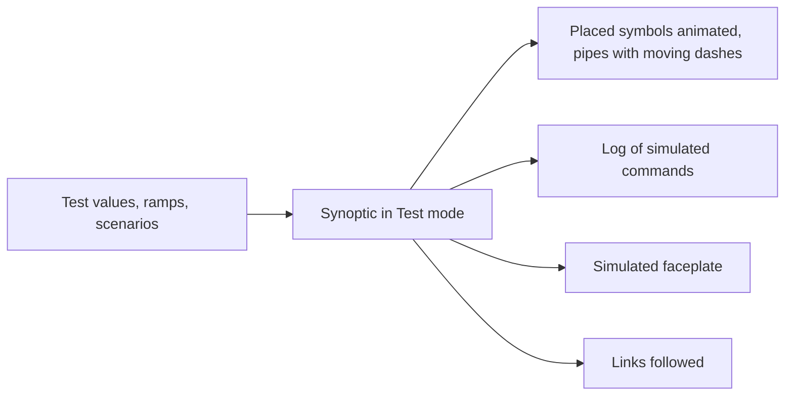

# Test mode

> [Home](../README.md) › [Synoptics](README.md) › Test mode · Previous: [Faults](08-faults.md) · Next: [Outputs](10-outputs.md)

Status: extrapolated by the assistant on 2026-11-20, from the [Run mode](../symbols/09-run-mode/README.md) of a symbol (decided there, 2026-11-11) and the opinions of the research. Not validated.

The **Test** mode tries a whole synoptic without a model: the user gives test values to the signals of its placed symbols and sees everything move, pipes included.

## Rules

### Taken from the Run mode of a symbol

These rules are decided for a symbol; the assistant proposes the same for a synoptic.

- There is no model: nothing is sent, nothing is saved in the synoptic.
- The control of a test value depends on the signal: a number field or a slider for a number, a select of the display names for an enum, a switch for a boolean.
- An interaction is only **simulated**: opening a faceplate shows the pop-up; a command gives a line in a **log**.
- A **simulated screen** shows the synoptic at the size and resolution of another screen; the research adds the scale factor of the system (100 % to 200 %).

### Added for a synoptic

Proposed:

- **Right-hand panel**: the tree of the placed symbols (and pipes linked to a type), each unfolding into its output signals, with their test values. A click on the canvas selects a placed symbol and unfolds its signals.
- **Defaults**: every signal starts at the start value of the signal settings of the type of its placed symbol, with the values the synoptic changed.
- **Ramps**: on a number signal, a small play button makes the value go from its minimum to its maximum and back, over a duration typed in seconds, to see an animation run without dragging a slider.
- **Scenarios**: a set of test values can be saved under a name ("Pump P-101 tripped", "Night") and played again. Saved in the synoptic file, never sent anywhere.
- **Quality**: a segmented control per signal (Good, Uncertain, Bad, one click; [layout rule](../screens/README.md#a-segmented-control-for-two-or-three-short-options), 2026-11-26), to see the quality mark the research advises (report T4, section 3.16).
- **Links work**: a link zone opens its synoptic, in the Test mode too; a back button returns.
- **Performance meter**: on demand, a small counter shows the time to draw each image and the images per second, to check the goals of the project (criteria C14 and C15) on the real synoptic.

### The log

- One line per simulated action, as the research advises: time, placed symbol, gesture, command, value sent (`10:42:03 · P-101 · click · start · true`). Proposed.
- In the drawer at the bottom of the canvas, beside the faults. Proposed.

## Example

The user opens "Pumping station", Test mode, plays the scenario "Night": the three pumps stop, the water pipes stop moving. They set `P-101.speed` on a ramp of 10 s: the impeller turns faster, then slower. A click on `P-101` opens its simulated faceplate; a click on Start writes `P-101 · click · start · true` in the log.

## Where it is used

| Thing | Created and changed in | In a symbol | In a synoptic |
| --- | --- | --- | --- |
| Test values | Test mode | Run mode (decided) | Set, not saved |
| Scenario | Test mode | No | Save, play, delete |
| Log | Test mode | Run mode (decided) | Read |

## Open questions

- Should scenarios be saved in the synoptic file (advised) or in a file of their own?
- Should the name be Test mode, as the research advised for the Run mode of a symbol?
