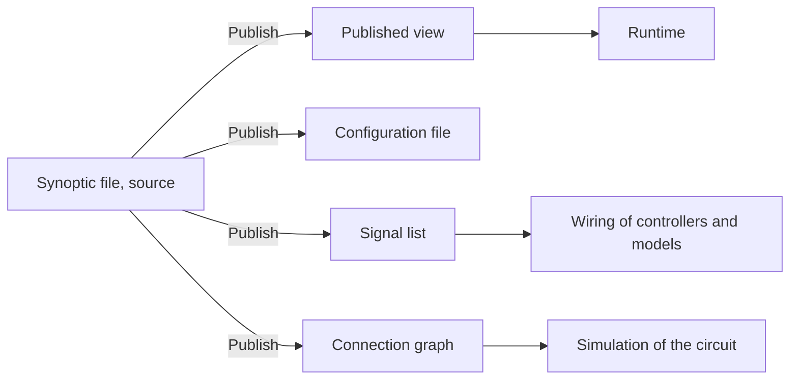

# Outputs

> [Home](../README.md) › [Synoptics](README.md) › Outputs · Previous: [Test mode](09-test-mode.md) · Next: [Data model](11-data-model.md)

Status: extrapolated by the assistant on 2026-11-20. Not validated. The runtime itself is still an open question of the [introduction](../overview/introduction.md#open-questions); this page only says what the editor could give it.

What a synoptic gives to the world outside the editor: to the runtime, to the people who wire the controllers, to those who simulate.

## Rules

### What is decided elsewhere

- The editor writes the views, the runtime reads them: **the file format of a view is the contract** between the two ([Introduction](../overview/introduction.md#two-products-around-one-format)).
- **Flags** do nothing in the application: they are only written in the **configuration files** it produces, so that something outside can customise a placed symbol ([Flags](../metadata/draft.md#flags)).
- The signals of a type are the **inputs and outputs of the model**: they define in advance what simulation models connect to ([Introduction](../overview/introduction.md#more-than-synoptics-modeling-and-simulation)).
- All reading and writing of files goes through the server (criterion C10).

### Five outputs

Proposed:

| Output | For whom | What it holds | Format |
| --- | --- | --- | --- |
| **Synoptic file** | The editor | The source: everything of the [data model](11-data-model.md). Saved at each save. | JSON |
| **Published view** | The runtime | One file per view, self-contained: the drawings of the symbols used, their animations and interactions, the pipes already computed, the faceplates, and the address of every signal. The runtime needs nothing else. | JSON with SVG inside |
| **Configuration file** | The software outside (controllers, gateway, model) | One entry per placed symbol, references counted once: instance ID, type `id`, preset values with the changes of the synoptic (in the default unit), flags ticked, designation texts, template items. | JSON |
| **Signal list** | Whoever wires the controllers or the model | One line per placed symbol and signal: address `P-101.speed`, direction, value kind, quantity and default unit, enum. | CSV and JSON |
| **Connection graph** | Those who simulate a circuit | Which placed symbol is connected to which, through which pipes and connection points. | JSON |

- **Publish** is a command of the synoptic (in its General page and in the top of the editor): it writes the published view, the configuration file and the signal list in an output folder of the project. Proposed.
- The publish dialog lists the faults first; publishing with errors is allowed after a warning (see [Faults](08-faults.md#open-questions)). Proposed.
- **Export an image** (SVG, PNG, PDF) of a synoptic, for documentation, without animation. Proposed.

### The address of a signal

- A signal of a placed symbol is addressed by the **instance ID** of the placed symbol and the `id` of the signal: `pump_p101.speed`. Decided on 2026-11-20: the instance ID is the key of a placed symbol, never the tag.
- The runtime receives values and sends commands by these addresses; how they travel (WebSocket, OPC UA gateway...) is outside the editor. Proposed.
- A reference in a view uses the address of the placed symbol it points to, so `P-101` is wired once (decided on 2026-11-20: a reference shares the identity).
- Renaming an instance ID changes its addresses: as for the `id` of a signal in Metadata, "renaming is breaking, on purpose". Proposed.

### The connection graph

- Built from the pipes: each pipe connects two connection points (or a junction). The graph lists the placed symbols as nodes and the pipes as links, with their pipe style. Proposed.
- It answers the open question "what exactly does the editor do for simulation": it **describes the circuit**, it runs nothing. Proposed.
- A format of the simulation world could be used for it: SSP, cited by the research T2 for its vocabulary. That SSP describes the connections between components is the assistant's knowledge, not checked in this session. Open.

## Example

Signal list of `P-101`, extract:

| Address | Direction | Kind | Unit |
| --- | --- | --- | --- |
| `pump_p101.speed` | output | real | rpm |
| `pump_p101.speed_setpoint` | input | real | rpm |
| `pump_p101.running` | output | boolean | — |
| `pump_p101.mode` | output | enum `pump_mode` (template: 0 Off, 1 Local, 2 Remote) | — |

## Where it is used

| Thing | Created and changed in | In a symbol | In a synoptic |
| --- | --- | --- | --- |
| Published view | Publish | No | Write |
| Configuration file, signal list | Publish | No | Write |
| Connection graph | Publish | No | Write |

## Open questions

- Does the runtime read the synoptic file and the Symbol Libs, or a published view (advised)?
- Which format for the connection graph: one of the project, or SSP?
