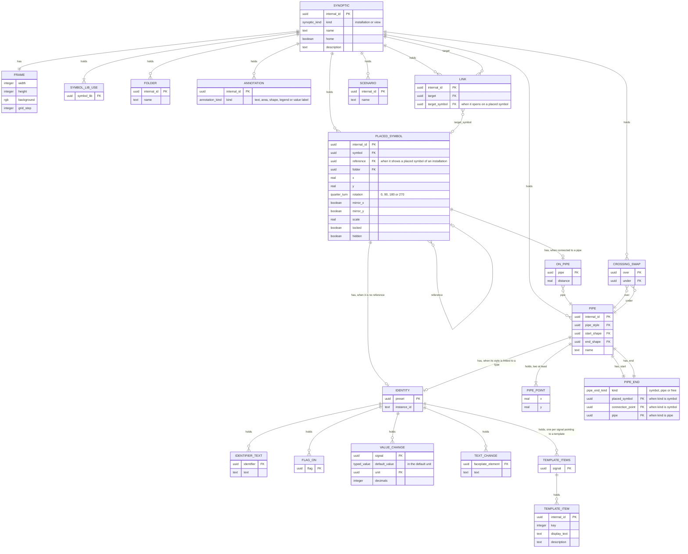

# Data model

> [Home](../README.md) › [Synoptics](README.md) › Data model · Previous: [Outputs](10-outputs.md) · Next: [Open questions](12-open-questions.md)

Status: a first sketch by the assistant, 2026-11-20. Not validated. Written with the conventions of the [data model of Metadata](../metadata/data-model.md), which it points to and never changes.

## Conventions

The same as in Metadata:

- `internal_id`: the UUID set by the software; every FK holds one.
- A box without `internal_id` is a part of its owner (a nested object in the JSON), never pointed to.
- `has`: one nested object; `holds`: an ordered list inside its owner.
- Every other link is a FK, labelled by the field that holds it.
- A field or a link that only exists in some cases says when: `when ...`.
- A choice of the software is an English word in the JSON (`"installation"`, `"view"`), never a number.
- A number typed for a signal is kept in the default unit of its quantity (decision 0051).

Boxes of Metadata and of the Symbol Lib (`TYPE`, `PRESET`, `SIGNAL`, `FLAG`, `IDENTIFIER`, `FACEPLATE_ELEMENT`, `SYMBOL`, `CONNECTION_POINT`, `PIPE_STYLE`, `END_SHAPE`) are only pointed to by a FK field (`symbol`, `preset`, `flag`...); they are not drawn here.

## The schema

## Reading notes

- **Identity is a part of its own**, so that a reference has none: a placed symbol of a view that points to a placed symbol of an installation reads the identity of that one (see [Synoptics and views](01-synoptics-and-views.md#two-kinds-installation-and-view)).
- **A pipe linked to a type has an identity too**, the same part, so it is wired like a placed symbol (see [Pipes](05-pipes.md#a-pipe-whose-style-is-linked-to-a-type)).
- **Only what differs from the preset is kept** (`VALUE_CHANGE`, `TEXT_CHANGE`): a placed symbol that changes nothing holds nothing, and follows its preset when the preset changes.
- **A crossing keeps only the swaps**: the default rule (the last drawn passes over) needs nothing stored; the user's click stores which pipe passes over.
- **Junctions are not stored**: a branch is a pipe whose end is of kind `pipe`; the junction is computed from it. If the Product Owner chooses one pipe as a tree, `PIPE` will hold its branches instead.
- The content of an annotation (its shapes, its text, the signal of a value label) and of a scenario (its values) is not drawn yet.

## Open

- The name of `instance_id`: waits for the research on the names of identifiers (task T5).
- The names of the boxes: working names, like those of Metadata.
- Whether a synoptic file holds the computed geometry of its pipes (faster to open) or only their points (smaller, advised).
