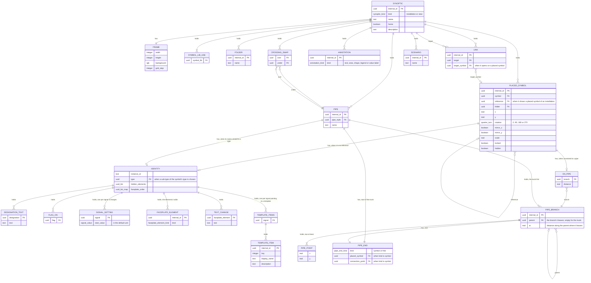

# Data model

> [Home](../README.md) › [Synoptics](README.md) › Data model · Previous: [Outputs](10-outputs.md) · Next: [Open questions](12-open-questions.md)

Status: a first sketch by the assistant. Four of its choices are settled (references, instance ID, changes from the type, what a placed symbol may change, see the reading notes); the rest is not validated. Written with the conventions of the [data model of Metadata](../metadata/data-model.md), which it points to and never changes.

## Conventions

The same as in Metadata:

- `internal_id`: the UUID set by the software, version 7 (see [Rules of the schema](../metadata/data-model-notes.md#rules-of-the-schema)); every FK holds one.
- A box without `internal_id` is a part of its owner (a nested object in the JSON), never pointed to.
- `has`: one nested object; `holds`: an ordered list inside its owner.
- Every other link is a FK, labelled by the field that holds it.
- A field or a link that only exists in some cases says when: `when ...`.
- A choice of the software is an English word in the JSON (`"installation"`, `"view"`), never a number.
- A number typed for a signal is kept in the default unit of its quantity (decision 0051).
- `uuid_list`: an array of `uuid`, each once.

Boxes of Metadata and of the Symbol Lib (`TYPE`, `SIGNAL`, `FLAG`, `DESIGNATION`, `SYMBOL`, `CONNECTION_POINT`, `PIPE_STYLE`) are only pointed to by a FK field (`symbol`, `type`, `signal`, `flag`...); they are not drawn here. Two boxes of Metadata are held by a placed symbol, with the JSON Schema of their entity file: [`SIGNAL_SETTING`](../metadata/entities/19-signal-setting.md) and [`FACEPLATE_ELEMENT`](../metadata/entities/27-faceplate-element.md). `uuid_list_map` is the type of `TYPE.faceplate_order` ([Type](../metadata/entities/30-type.md)).

## The schema

## Reading notes

- **Identity is a part of its own**, so that a reference has none: a placed symbol of a view that points to a placed symbol of an installation reads the identity of that one (decided on 2026-11-20, see [Synoptics and views](01-synoptics-and-views.md#two-kinds-installation-and-view)).
- **`instance_id` is the key** of a placed symbol in the outputs, a field of its own, never one of the designation texts (decided on 2026-11-20). `internal_id` stays the key of every link inside the files.
- **A pipe linked to a type has an identity too**, the same part, so it is wired like a placed symbol (see [Pipes](05-pipes.md#a-pipe-whose-style-is-linked-to-a-type)).
- **Only what differs from the type is kept** (decided on 2026-11-20): a placed symbol that changes nothing holds nothing, and follows the [signal settings](../metadata/entities/19-signal-setting.md) and the faceplate of its type when they change. There is no preset to point to since 2026-11-24.
- **A placed symbol changes its type the way a sub-type does** (Product Owner, 2026-11-24: great freedom in the synoptic), with the same boxes, proposed by the assistant:
  - `type`: the sub-type chosen; `null`, the type of the symbol;
  - `SIGNAL_SETTING`: one per signal it changes, which replaces the type's whole, as in a sub-type;
  - `FACEPLATE_ELEMENT`: the elements it adds; `faceplate_order`: where every element sits, as `TYPE.faceplate_order`; `hidden_elements`: the `internal_id` of the elements of the type it hides;
  - `TEXT_CHANGE`: a new text for a title or description element of the type.
- **A crossing keeps only the swaps**: the default rule (the last drawn passes over) needs nothing stored; the user's click stores which pipe passes over.
- **A pipe is one tree** (decision 0094): `PIPE` holds its style and its branches, the trunk first. Each other branch names the branch it leaves (`parent`) and where along it (`at`). **Junctions are not stored**: they are computed from `parent` and `at`.
- **Each branch has its own end**; the pipe has one start. Proposed by the assistant. No end shape is stored (decision 0098).
- A pipe that ends on another pipe has no kind of end yet: it waits for the open question of [Junctions](../symbols/pipes/junctions.md#open-questions).
- The content of an annotation (its shapes, its text, the signal of a value label) and of a scenario (its values) is not drawn yet.

## Open

- The name of `instance_id`: the research on names (T5) covered Metadata only and did not treat it.
- The names of the boxes: working names, like those of Metadata.
- Whether a synoptic file holds the computed geometry of its pipes (faster to open) or only their points (smaller, advised).
