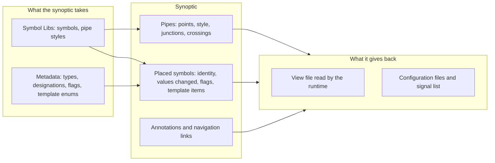

# synoptics

> [Home](../README.md) › Synoptics

The third part of Synoptic Studio: building synoptics. A **synoptic** is a drawing of the installation. The user places symbols taken from Symbol Libs, connects them with pipes, and fills in, for each placed symbol, what Metadata leaves to the synoptic: its designations, its flags, the items of its template enums, and what it changes from its type: a sub-type, its signal settings, its faceplate. The runtime displays what is built here, and the configuration files describe it.

Status: **extrapolated by the assistant**. It starts from what [Metadata](../metadata/README.md), [Symbols](../symbols/README.md) and [Pipes](../symbols/pipes/README.md) already say. Nothing here is validated: it is a base of ideas, to review. Each rule says where it comes from:

| Mark | Meaning |
| --- | --- |
| **Decided** | Already decided in another part, with its source. |
| **Proposed** | The assistant's extrapolation, to review. |
| **Open** | A question the extrapolation cannot settle. |

## The big picture

This diagram shows what a synoptic takes from the two other parts, and what it gives back.

## What is already decided elsewhere

These rules come from the other parts; this part only applies them.

| Rule | Source |
| --- | --- |
| The top bar has a **Synoptic** icon, beside Metadata and Symbols. | [Layout rules](../screens/README.md#top-bar-of-the-window), 2026-11-16 |
| In a synoptic, the **type** of a symbol is never changed; a placed symbol may take one of its sub-types; there are no presets (2026-11-24). | [Metadata draft, Type and symbol](../metadata/draft.md#type-and-symbol) |
| On one placed symbol, the synoptic changes freely its **signal settings** and its **faceplate** (hide, add, move): Metadata is the strict base, the synoptic the freedom (2026-11-24). | [Metadata draft, In a symbol and in a synoptic](../metadata/draft.md#in-a-symbol-and-in-a-synoptic) |
| A symbol with a type can be placed and **left unwired**. | [Symbols](../symbols/README.md#one-kind-of-symbol), 2026-11-15 |
| The **flags** of a type are ticked on each placed symbol. | [Metadata draft, Flags](../metadata/draft.md#flags) |
| The **designations** used by a faceplate give the synoptic a list of texts to fill, one per placed symbol; a text is meant to be unique. A required designation is filled on every placed symbol. | [Metadata draft, Identifiers](../metadata/draft.md#identifiers), 2026-11-18; [Designation](../metadata/entities/11-designation.md), 2026-11-21 |
| The items of a **template enum** are completed on each placed symbol, which shows a small warning until then. | [Metadata draft, Enums](../metadata/draft.md#global-enums-and-templates), 2026-11-17 |
| The synoptic mode shows **a list of what is broken**; Metadata never warns. | [Libraries and symbols](../symbols/01-libraries-and-symbols.md#when-metadata-changes), 2026-11-17 |
| Pipes are drawn with a **pipe tool**, point by point; junctions and crossings are computed; a click swaps a crossing; a symbol can be **connected to a pipe**. | [Pipes in the synoptic](../symbols/pipes/in-the-synoptic.md), 2026-11-11 |

## What it contains

| Page | What it holds |
| --- | --- |
| [Synoptics and views](01-synoptics-and-views.md) | What a synoptic is, installations and summary views, the navigation bar of the synoptic mode, the General page. |
| [Synoptic editor](02-synoptic-editor.md) | The layout, the modes, the library panel, the objects panel, grid, zoom, undo, copy and paste. |
| [Placed symbols](03-placed-symbols.md) | Placing a symbol, the linked instance, rotation and mirror, replacing a symbol, changing the Symbol Lib. |
| [Panel of a placed symbol](04-placed-symbol-panel.md) | Its sub-type, identity, designations, signal settings, faceplate, flags and template enums, one section each. |
| [Pipes](05-pipes.md) | Drawing and editing pipes in a synoptic, branches, crossings, symbols on a pipe. |
| [Annotations](06-annotations.md) | Texts, areas, shapes, legends and value labels: what is drawn in a synoptic and is not a symbol. |
| [Navigation links](07-navigation-links.md) | Going from one synoptic to another. |
| [Faults](08-faults.md) | The list of what is broken or incomplete, and how it is shown. |
| [Test mode](09-test-mode.md) | Trying a whole synoptic without a model. |
| [Outputs](10-outputs.md) | The view file, the configuration files, the signal list, the connection graph, the interface description of the models. |
| [Data model](11-data-model.md) | A first schema of a synoptic file, written like the one of Metadata. |
| [Open questions](12-open-questions.md) | Every open question of this part, with the option the assistant advises. |

The screens are inventoried in [Screens of the synoptic](../screens/synoptics.md) and drawn on the page "Spec" of the Figma file, section "Synoptic · SN-00 to SN-12".

## Reading order

1. [Synoptics and views](01-synoptics-and-views.md), then the [editor](02-synoptic-editor.md).
2. [Placed symbols](03-placed-symbols.md) and [their panel](04-placed-symbol-panel.md).
3. [Pipes](05-pipes.md), [annotations](06-annotations.md), [navigation links](07-navigation-links.md).
4. [Faults](08-faults.md), [Test mode](09-test-mode.md), [Outputs](10-outputs.md).
5. [Data model](11-data-model.md), then the [open questions](12-open-questions.md).

## Page layout

Same skeleton as the pages of Metadata and Symbols: title and navigation line, `Status:` line, `## Rules`, detail sections, `## Example`, `## Where it is used`, `## Open questions` last (each also listed in the index).

## See also

- [Introduction](../overview/introduction.md): the two modes (full installation, summary view) this part starts from.
- [Storage](../storage/README.md): how a synoptic file is saved in the folder.
